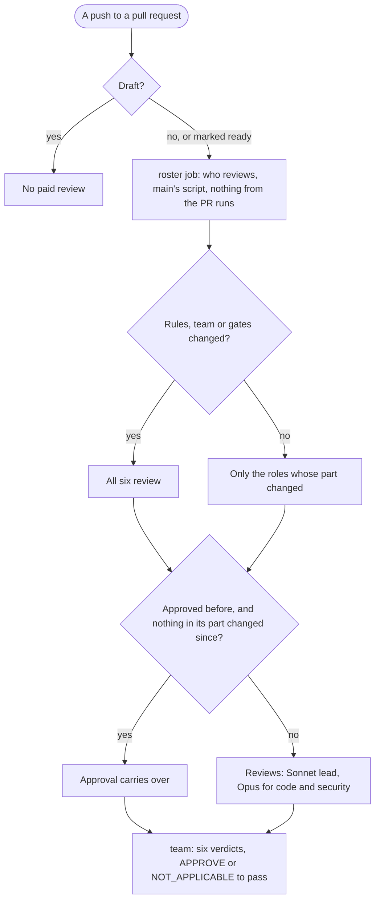

# The team does only the work a change needs, so it costs a fraction of what it did

Status: built. Branch: `cheaper-team`. Asked by Steven on 2026-10-22: "we spent $100 in tokens in the last 2-3h that is insane… propose a better way that cuts the costs, drastically", then "yes".

## Problem

The agent team ran $159 of API spend in about 3.5 hours on 2026-10-22 (the run logs' `total_cost_usd`): the Review workflow $115 over 24 runs, the Site update workflow $44 over 7. Every push to a pull request re-ran all six reviewers, all on Opus, each re-reading the repository and re-running the test suite; a fix loop of four to six rounds cost $25 to $45 per feature (ask-ratings $43, mcp-prs-flow $25, mcp-plain-names six rounds). Most merges also started a Building refresh of this site's own write-up (about $5 to make, $2.60 to review), and those refreshes replaced each other. Steven's local sessions run on his Max plan's weekly limit, which he runs out of, so moving the work there is no saving.

## Outcome

The same gate (every change reviewed by agents that did not write it, `gates`, `team` and `check` required), at roughly a tenth of the cost: a typical feature pull request from $20–45 to $2–4, a Site update with résumé edits from $4–9 to $1–2, the site's own write-up refresh from one per merge to at most one a day.

## Acceptance criteria

1. `scripts/review-roster.mjs` picks the panel from the pull request's files: the developer and the tester for any change other than text (specs, Markdown, a write-up's feed: its words are code to them); security for the server, the scripts, migrations, headers, the build config, the assistant, the admin and WebMCP (not tests); the designer for pages, components, styles, images and the résumé and share-image layout (not a write-up's words, only its diagrams); the recruiter for anything readers see (pages, `public/`, the résumé, write-ups, the assistant); the PM for a spec, code, or any Site update branch. A change to `CLAUDE.md`, `.claude/`, a workflow, `functions/_lib/review/` or a gate script (including the roster itself) gets all six, and so does a path git still quotes (paths are read with `core.quotePath=false`). Nobody on the panel means the developer. Every role off the panel is `NOT_APPLICABLE` with its reason.
2. An `APPROVE` in this workflow's own last comment (`github-actions[bot]`, the `team-verdicts` marker) carries over when its commit is an ancestor of the head and none of the pull request's files changed since touches that role's part or the rules. A force push, a missing or unreadable marker, or another verdict carries nothing. A re-run of the same commit re-runs only the roles that did not approve.
3. The roster runs in a job of its own (`roster`) that runs nothing from the pull request, with main's copy of the script (the pull request that adds it runs its own). The team job reads its answer only from the job's outputs, and fails (never skips: a skipped required check passes) when the roster job did not succeed. The result's roles are the model's verdicts for the panel plus the roster's carried and skipped ones, merged before the verdicts marker is written so the next round reads every role; it still needs six roles, each `APPROVE` or `NOT_APPLICABLE`, to pass.
4. When every approval carries over, no reviewer runs: the workflow posts the carried verdicts and `team` passes.
5. The Review workflow's `roster` and `team` jobs skip draft pull requests; `ready_for_review` starts the review. `/feature` opens its pull request as a draft and marks it ready once every role approves and lint, tests, coverage and the build pass.
6. Lint and coverage run once in the team job for the whole panel (`.review/lint.txt`, `.review/coverage.txt` with the totals and every changed file); reviewers read them and run single test files only. The designer's browser, database and main's build are set up only when the designer is on the panel.
7. The lead runs on Sonnet in the Review and Site update workflows (`--model claude-sonnet-5-5`); `senior-developer` and `security-engineer` have `model: opus`, the four other agents `model: sonnet`.
8. The Site update workflow's team step takes the short path (no spec agents; the lead writes the short spec of team.md step 4) for approved résumé proposals and write-up refreshes. A new Building refresh pull request closes the older open ones of the same write-up, with the checks a redo uses (this repository, the site bot, an `update/` branch).
9. `building-notify.yml` runs once a day (05:00 UTC) or by hand, and starts a refresh only when the write-up's sources changed since the commit its last successful run saw (the last day when there is none), named after the newest change ("and N more").
10. The rules and the story move with the flow: `.claude/team.md` (text, the flow chart and a roster chart), `CLAUDE.md` "## The team", the `/feature` and `/team-review` skills, and the write-up's "The loop" section with its diagram and description. `scripts/review-roster.mjs` is in `ORCHESTRATION`, the write-up's sources and the daily refresh's paths.
11. `npm run lint`, the tests, coverage of 90% or more overall and per changed file, and the build pass.

## Out of scope

- The site assistant's model and spend (a separate look).
- The other projects' "Building write-up" workflows (they live in their own repositories).
- Moving work onto the Max plan (it is the weekly limit Steven already runs out of).

## Recruiter impact (senior-recruiter)

No page a recruiter reads changes except the write-up, which gains a few sentences on how the team spends; the résumé, its score and the assistant are untouched. The recruiter still reviews every change a reader sees.

## Design (ux-designer)

The write-up's team diagram keeps its layout; the reviews box now reads "Reviews, for the parts it touches" over "fresh agents; approvals carry over" (both fit the stacked 276px box at 13px and 11.5px).

## Threat model (security-engineer)

- A pull request choosing its own reviewers: the roster runs main's script in a job that runs no pull request code; the team job reads only that job's outputs, which its own steps (which do run the pull request's install, build and tests) cannot change.
- A forged approval: only `github-actions[bot]`'s comment is read, and its marker is written by the workflow from the run's result.
- A pull request that weakens the roster: a change to the roster is a gate change, so it gets all six reviewers, and it takes effect only after it merges.
- Closing pull requests: only open Site update pull requests of this repository opened by the site bot, matched by the refresh title, as for a redo.

## Technical approach (senior-developer)

A pure script with a command line (tested in-process and as a process), a `roster` job, `PANEL` and `ROSTER` from its outputs in the team job, `jq` to merge the verdicts, `model:` front matter, `--model` in `claude_args`, a scheduled notify job with a bash array of pathspecs.

## Test plan (senior-tester)

| Criterion | Test |
|---|---|
| 1 panel | review-roster.test.mjs "who reviews" (it.each: the MCP server, a page, a résumé fact, the words of a refresh, a diagram, the admin, only a test, only the README; the full panel per rules path; the PM on a Site update and each skipped reason) |
| 2 carried approvals | review-roster.test.mjs "approvals that carry over" (changed since, same commit, force push, no review, bad sha, rules changed); "role names" |
| 2 command line | review-roster.test.mjs "on the command line" (files, branch, verdicts, "-", bad JSON, missing file) |
| 3, 4 roster job and result | review-workflow.test.mjs "the panel…" (own job, no npm, main's copy, bot comment only, ancestor, unquoted paths, outputs, fails when the roster did not decide, the merge before the marker and the six-role check, no reviewer when all carry); "every shell step parses" (`bash -n` on every run block) |
| 5 drafts | review-workflow.test.mjs (team `if` with `draft != true`; roster `if`) |
| 6 coverage once, designer only | review-workflow.test.mjs "builds main and starts a browser only for the designer…" |
| 7 models | review-workflow.test.mjs and site-update-workflow.test.mjs "coordinates on Sonnet"; review-workflow.test.mjs "runs the developer and the security engineer on Opus, the other four on Sonnet" |
| 8 short path, older refreshes | site-update-workflow.test.mjs "the work an update needs, and no more" |
| 9 daily refresh | site-update-workflow.test.mjs "the daily refresh…"; team-manifest.test.mjs reads its paths |
| 10 rules and story | articles.test.tsx (the diagram's labels and description); team-manifest.test.mjs |
| 11 | `npm run lint`, `npm run test:coverage`, `npm run build` |

## Open questions for Steven

None: he chose the approach ("yes") after seeing the numbers.

## Sign-offs

| Role | Spec | Merge |
|---|---|---|
| Product manager | lead (short spec) | |
| Recruiter | | |
| Designer | | |
| Developer | | |
| Security | | |
| Tester | | |
