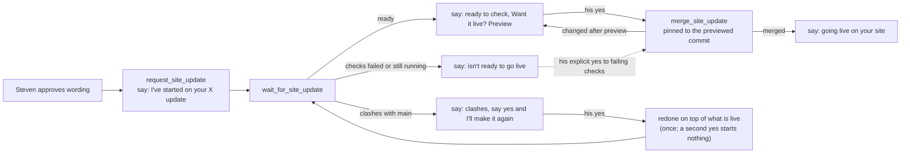

# The MCP talks to Steven in plain English about site updates

Branch `mcp-plain-english`, pull request #71. The product manager wrote this spec after the fact, during round 1 of the Review workflow. Round 1's fixes are folded in.

## Problem

When Steven changes his site through his private MCP, his assistant repeats GitHub's vocabulary: pull request numbers, runs, branches, workflows, merges. Steven wants to hear what happened to *his update*, not how GitHub moved it. A clash between two updates also needed an extra, explicit `redo` step.

## Reader

Steven, through his assistant in Claude (the private MCP). There is no public page, no recruiter surface, and no change to the résumé or the PDF.

## Outcome

Every site-update answer carries one sentence the assistant can pass on as it is, naming the update by a short human name. The machine fields (ids, URLs, outcome) stay so the tools can chain. Hiding the pull request from Steven must not hide anything he needs to decide on: failing checks, a lower score, or a change made after he looked.

## The flow Steven hears

## Acceptance criteria

1. `request_site_update`, `wait_for_site_update`, `site_update_status`, `merge_site_update` and `close_site_update` return a `say` line, and a `name` for each update, on every path that answers.
2. No `say` line contains "pull request", "PR", "branch", "run", "workflow", "merge" or a `#<number>`. A preview link is said as a link, at the end of the line.
3. `updateName` builds the name from the update's title. It strips `#<number>`, "PR <n>", links, markup and control characters, and caps every name at 60 characters (Building refreshes included). It falls back to "site update" and never returns a bare number.
4. Ids, URLs, `outcome`, `run` and `pullRequest` stay in their fields.
5. All five tool descriptions include the plain-English guidance (`speakPlainly`).
6. The `next` hints tell the assistant to pass on the say line. None of them tell it to talk to Steven about pull requests or branches.
7. An update whose checks failed (`unstable`) or that is held by the branch rules (`blocked`) is never offered as "ready to check… Want it live?". `merge_site_update` refuses a failing one unless Steven accepts it explicitly (`acceptFailingChecks`), and never merges a blocked one.
8. The merge is pinned to the commit Steven previewed (`sha`). If the branch changed after the preview (409), nothing goes live and he gets the newer preview. Only "Base branch was modified" is retried, and only once.
9. `merge_site_update` redoes an update by itself only on a real conflict (`mergeable === false` or `dirty`, or a "not mergeable" refusal confirmed by asking GitHub again), and only for a Site update branch (`update/`). Any other refusal is reported as it is. A redo already under way, or a new version that already exists, is returned, never started a second time. `site_update_status` does not list an update that is being redone as ready or as needing a redo.
10. A run that made no change keeps its own `reason` out of `say`, and a retry still waits for Steven's yes.
11. The server instructions and CLAUDE.md ("## The MCP server") describe how the tools talk.
12. The hidden request marker and the workflow inputs are unchanged. The only change on GitHub's side is that the merge call sends the previewed `sha`.
13. `npm run lint`, the tests, and coverage of 90% or more overall and per changed file all pass. Nothing changes in `src/resume.ts`, the PDF or the pages.

## Out of scope

- The public MCP (`/mcp`) and the site assistant.
- The Site update workflow, the marker format and the admin.
- The agent orchestration. The CLAUDE.md change is in "## The MCP server", not in "## The team".

## Steven's decisions

1. Should a clash be redone right away when Steven says yes, or only after he is asked first? **Right away.** In the session that asked for this change, Steven wrote: "Make conflicts and redos invisible where you can: when a merge conflicts, automatically redo it and report it in plain English." The redone update still needs his yes before it goes live.
