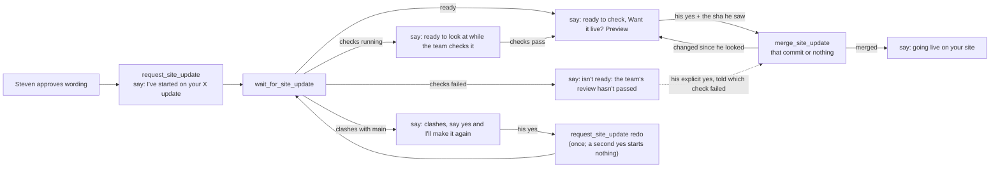

# The MCP talks to Steven in plain English about site updates

Branch `mcp-plain-english`, pull request #71. The product manager wrote this spec after the fact, during round 1 of the Review workflow. The fixes of rounds 1 and 2 are folded in.

## Problem

When Steven changes his site through his private MCP, his assistant repeats GitHub's vocabulary: pull request numbers, runs, branches, workflows, merges. Steven wants to hear what happened to *his update*, not how GitHub moved it. A clash between two updates also needed an extra, explicit `redo` step.

## Reader

Steven, through his assistant in Claude (the private MCP). There is no public page, no recruiter surface, and no change to the résumé or the PDF.

## Outcome

Every site-update answer carries one sentence the assistant can pass on as it is, naming the update by a short human name. The machine fields (ids, URLs, outcome) stay so the tools can chain. Hiding the pull request from Steven must not hide anything he needs to decide on: failing checks, a lower score, or a change made after he looked.

## The flow Steven hears

## Acceptance criteria

1. `request_site_update`, `wait_for_site_update`, `site_update_status`, `merge_site_update` and `close_site_update` return a `say` line, and a `name` for each update, on every path that answers.
2. No `say` line contains "pull request", "PR", "branch", "run", "workflow", "merge" or a `#<number>`. Two exceptions: a preview link, said as a link at the end of the line, and the update's name, which is Steven's own words ("Merge the two Microsoft roles" stays).
3. `updateName` builds the name from the update's title. It strips `#<number>`, "PR <n>", links, markup and control characters (the same set the run's quoted reason drops), and caps every name at 60 characters, the ellipsis included (Building refreshes too). It falls back to "site update" and never returns a bare number.
4. Ids, URLs, `outcome`, `run` and `pullRequest` stay in their fields.
5. All five tool descriptions include the plain-English guidance (`speakPlainly`).
6. The `next` hints tell the assistant to pass on the say line. None of them tell it to talk to Steven about pull requests or branches.
7. An update held by GitHub (`unstable` or `blocked`) is never offered as "ready to check… Want it live?". The check runs on its head commit tell the cases apart. While checks are running, Steven can look at the preview but it cannot go live yet. Failed checks are named in his words ("the team's review", "the résumé score check", "the site checks"), and a failed team review is flagged as possibly a question for him. `merge_site_update` refuses while checks run, refuses failed checks unless he accepts them explicitly (`acceptFailingChecks`), and never merges a blocked one.
8. Every preview hands out its `headSha`, and `merge_site_update` requires it as `sha`. If the update's head is not that commit, nothing is merged and Steven gets the newer preview. The merge sends that `sha` to GitHub, so a push during the merge is refused (409) rather than merged. Only "Base branch was modified" is retried, and only once.
9. `merge_site_update` redoes an update by itself only on a real conflict (`mergeable === false` or `dirty`, or a "not mergeable" refusal confirmed by asking GitHub again), and only for a Site update branch (`update/`). The clash is handled before the score question, because the version that goes live is the new one. Any other refusal is reported as it is. When Steven says yes to a clash, the assistant redoes it with `request_site_update` and `redo`, which never merges anything. In both tools, a redo already under way, or a new version that already exists, is returned and never started a second time. `site_update_status` does not list an update that is being redone as ready, as a conflict, or as needing a redo.
10. A run that made no change keeps its own `reason` out of `say`, and a retry still waits for Steven's yes.
11. The server instructions and CLAUDE.md ("## The MCP server") describe how the tools talk.
12. The hidden request marker and the workflow inputs are unchanged. The only change on GitHub's side is that the merge call sends the previewed `sha`.
13. `npm run lint`, the tests, and coverage of 90% or more overall and per changed file all pass. Nothing changes in `src/resume.ts`, the PDF or the pages.

## Test plan

| Criterion | Test |
|---|---|
| 1 say and name on every path | tools-branches.test.ts "waits on an update that is already live…", "redoes a clash only once…", "closes…"; review-tools.test.ts "site updates" |
| 2 no jargon | plain.test.ts "never names a pull request, a run, a branch…"; review-tools.test.ts `started.json.say` |
| 3 updateName | plain.test.ts "an update's name" (it.each: links, markup, C1 and direction characters, "PR 12", bare numbers; caps at 60) |
| 4 ids kept | review-tools.test.ts redo (`run.id`, `supersedes`); tools-branches.test.ts known run keys |
| 5 descriptions | server.test.ts "tells the assistant to speak plainly…" (`tools/list`) |
| 6 next hints | review-tools.test.ts and tools-branches.test.ts `next` matches |
| 7 checks running, failed, blocked | tools-branches.test.ts "waits on an update… being checked or held", "refuses an update still being checked…"; github.test.ts "reads the check runs on a commit" |
| 8 sha of the version he saw | tools-branches.test.ts "merges only the version Steven saw…" (newer head, no sha, no head, a push during the merge with `GitHubError` 409), "tries once more, and only once…"; github.test.ts merge body with `sha` |
| 9 redo on a real conflict, update/ only, once | tools-branches.test.ts "redoes a clash only once…" (merge, request_site_update and status), "redoes a merge GitHub calls not mergeable only when asking again shows a real clash", "makes a clash again before asking about its score", "redoes a clash by itself only on a Site update branch" |
| 10 reason kept out of say | tools-branches.test.ts "what became of a run" (`say` without `reason`) |
| 11 instructions and CLAUDE.md | server.test.ts "tells the assistant to speak plainly…" (`initialize`); CLAUDE.md read in review |
| 12 marker unchanged, sha only | github.test.ts marker tests unchanged; merge body with `sha` |
| 13 lint, tests, coverage | `npm run lint`, `npm run test:coverage` |

## Out of scope

- The public MCP (`/mcp`) and the site assistant.
- The Site update workflow, the marker format and the admin.
- The agent orchestration. The CLAUDE.md change is in "## The MCP server", not in "## The team".

## Steven's decisions

1. Should a clash be redone right away when Steven says yes, or only after he is asked first? **Right away.** In the session that asked for this change, Steven wrote: "Make conflicts and redos invisible where you can: when a merge conflicts, automatically redo it and report it in plain English." The redone update still needs his yes before it goes live.
