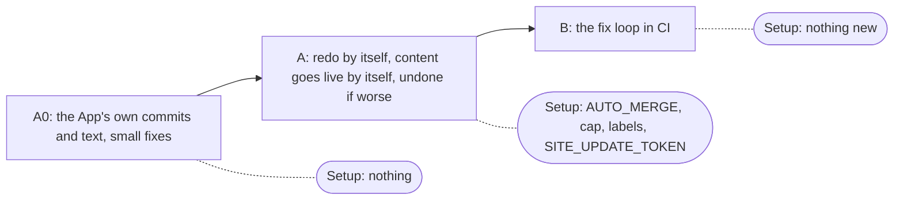
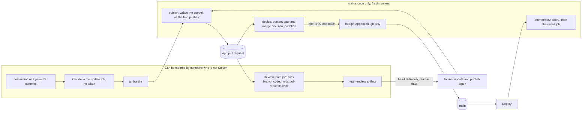
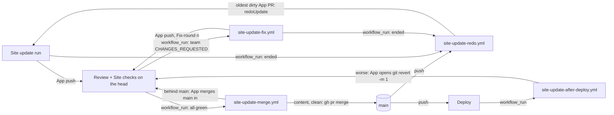

# Your MCP's content changes fix themselves, redo themselves and go live by themselves; everything else still waits for you

Slug: `mcp-prs-automation` · Branch: `mcp-prs-automation` (A0), then one branch per pull request · Status: **A0 built** (2026-10-22, pull request A0 on this branch); A and B approved in principle (PM reconciled 2026-10-22, round 2; follow-up of `specs/mcp-prs-flow.md`, merged and live as #66)
Asked by Steven on 2026-10-20: "make sure that the pipeline is set up so that those changes from the MCP aren't blocked and go through quickly"

## Problem

**Who.** Steven, through his MCP server; indirectly every recruiter, who reads the older
version of his record for as long as an approved change waits.

**What he runs into now that `mcp-prs-flow` is live.** The new path works: on #80 the
site's App opened the pull request, `gates`, `team` and `check` attached through
`pull_request` runs, no run sat at `action_required`, and the assistant check ran in the
Review workflow and passed. What still makes a change wait is everything after the checks
start:

1. **Changes requested, nobody to make them.** On #80 the designer found a CSS gap (the
   home hero's intro under a four-line facts column). Nothing in CI fixed it; it waited
   until the lead pushed a two-line fix by hand (`00648e3`). Earlier: #61 (security), #62
   (designer and recruiter).
2. **Conflicts after main moves.** Every update that touches `src/resume.ts` regenerates
   the same PDF, so when one merges the others conflict. #67 and #73 (the same request,
   "Work arrangement, Cosmos story and outcome numbers") were redone by hand after main
   moved; #80 is the third copy. Since the plain-English change (`functions/_lib/mcp/plain.ts`,
   `merge_site_update`), a clash is redone by itself, but only when Steven says yes to
   putting it live; nothing redoes it while he is away.
3. **A fully green content change still waits for his `merge_site_update`**, although
   his standing preference (2026-10-22) is that green pull requests merge without asking him.
4. **The commits are not the App's.** #80's commit `dc30907` has author `claude[bot]` and
   committer `github-actions[bot]`: claude-code-action rewrites the local git identity
   (its `bot_name` / `bot_id` defaults) over the workflow's `git config`, so not
   `<slug>[bot]` as `mcp-prs-flow` AC-5 requires. Every automation below trusts a pull
   request only when it is the App's own, so until this is fixed nothing could fix, redo
   or merge by itself.
5. **GitHub text that anyone with a write token can edit is read as the App's.**
   `updateRequestFromBody` reads the request marker without asking who last edited the
   body, and `merge_site_update`'s redo on Steven's yes runs from it. The Review `team`
   job holds pull-requests: write in a job where branch code ran, so a code pull request
   could rewrite another update's marker (security, T14). This is live on main today.
6. **Refresh pull requests pile up.** Two open `/building-this-site` refreshes by the App
   (#78, #81) and two from the old path (#75, #76); a newer refresh does not close the
   older one, and a redo that changes nothing leaves the replaced one open.

**How we know.** `gh pr view 80 --json commits,author,mergedBy` (2026-10-22: author
`app/stevenwilssens-site-bot`, commit authors `claude[bot]` / `claude`, the hand fix by
`stewils`, merged by `stewils`); `gh pr list --state all` (#67, #68, #73 closed and
redone; #75, #76, #78, #81 open refreshes); the deferred minors of #66's reviews; the
threat model below (T13 to T22); Steven's decisions of 2026-10-20 and his preference of
2026-10-22.

## Outcome

A Site update pull request the App opened is fixed in CI when the team asks for changes
(at most three rounds) and redone from main when another update merged first, without
anyone starting either. When it only changes content (C14's content gate: the words in
`src/resume.ts` and the PDF made from them, write-up text and feed numbers, page titles
and descriptions, its own spec) and every required check is green with six approvals on
its head, it merges by itself, is checked again on production and undone if it made
things worse. Anything else (code, the admin, the assistant, headers, dependencies, and
always the rules) waits for Steven's merge. He is told what went live by itself, can put
any update **on hold** or stop everything with `AUTO_MERGE=off`, and is asked only what
CI cannot settle.

## Acceptance criteria

These start from `specs/mcp-prs-flow.md` (there AC-16 to AC-25) and its threat model,
with Steven's decisions of 2026-10-20 and 2026-10-22, the controls C14 to C23 below and
the developer's corrections 1 to 6. **Already on main, so not rebuilt here:** the App
token and the `update` / `publish` split; `recheck`; the `team-verdicts` marker; a clash
redone by itself on Steven's yes (`merge_site_update`, once, with `redoUnderWay`); the
Building refresh redone by `repository_dispatch` with `project` and `sourceSha`; the
`beingRedone` standing in `site_update_status`.

**Three pull requests, in this order.** Each has its own ACs, its own write-up and rules
changes (only what it makes true), its own Setup list and the bars of AC-21. A merges
after A0 is live; B merges after A has been live for one auto-merge and one redo,
recorded in A's *Evidence*. AC numbers stay as they were so the other sections keep
pointing at the right criterion.



**"An App pull request"** (one function, `isAppPullRequest`, in main's code, used by the
MCP from A0 and by redo, merge and fix from A and B): head repository this one; branch
`^update/[a-z0-9-]+-[0-9]+$`; opened by `<SITE_BOT_SLUG>[bot]`; every commit's author and
committer that bot (merge commits only as AC-9a allows); every push to the branch and its
creation by the App as actor, read from the repository's activity, with the last push's
`after` equal to the head (C17). Activity that cannot be read means it is not an App pull
request. Pull requests opened before the App (author `github-actions`) are never fixed,
redone or merged by any automation here.

### Pull request A0: the App's own commits and text, and the small fixes (approved)

Nothing in the flow changes for the reader: the merge stays Steven's. It is first because
A and B trust only what A0 makes true, and AC-22 closes a weakness live on main.

- AC-11 (C17): Every commit the Site update workflow pushes is written by `publish`, not
  by the update job (A's update-branch and revert jobs write theirs the same way: as the
  bot, with git only, AC-9a and AC-10). `publish` takes only the tree from the bundle (`<sha>^{tree}`) and writes
  one commit with `git commit-tree` on the expected parent: author and committer
  `<slug>[bot] <<id>+<slug>[bot]@users.noreply.github.com>` (the id read from the App's
  user in `preflight`), the marker's title as subject, Claude's message indented as the
  body, and the trailers last, written only by `publish` (`Site-update-run: <run id>`;
  `Fix-round: n` from B on). Claude's own commits and messages never reach GitHub. As a
  backstop the update job sets the identity too (claude-code-action's `bot_name` /
  `bot_id`, and `GIT_AUTHOR_*` / `GIT_COMMITTER_*` in "Check and commit"), and
  `scripts/site-update-bundle.mjs --identity` refuses a bundle with any other author or
  committer (exit 7) before the token is minted. `isAppPullRequest` (above) ships here,
  with the push-actor check. `site_update_status` lists pull requests from before the App
  (#69, #72, #75, #76) with the designer's `oldWay` line and offers to make them again;
  nothing else touches them. Evidence: the first Site update pull request after A0
  merges shows only the bot in `gh pr view <n> --json commits`, and its activity only the
  App, recorded.
- AC-22 (C16): GitHub text counts as state only when the App wrote it and nobody edited
  it. The request marker in a pull request body, the App's comments (`redo-of`, round
  notes, "Merged by itself") and a revert's `reverts:` count only when the author is the
  App and the GraphQL `editor` (last editor) is null or the App, the filter `review.yml`
  already applies to Steven's replies. `updateRequestFromBody` gets the check, so
  `merge_site_update`'s redo on Steven's yes refuses an edited marker today: it tells
  Steven, in `plain.ts` words, that the update cannot be made again by itself and offers
  to start it fresh from his instruction. The reader for `hold` ships here too
  (`holdState`, tested; A wires it): the label counts as removed only when the
  timeline's last `unlabeled` event for `hold` has the repository owner as actor;
  otherwise the pull request stays on hold. No workflow and no App call ever removes
  `hold`.
- AC-13: A run that is queued reads as queued ("waiting to start", `say.waitingToStart`),
  never as "has not run", in `site_update_status`, `merge_site_update` and
  `wait_for_site_update`, and offers no `recheck` while it is queued (`status()` reads
  the runs of the head SHA once, split by status; the same number of requests as today).
- AC-14 (C21): main's assistant input is built in its own job, `assistant-input-main`,
  which checks out main, runs no branch code, has no secret and outputs the sha256 of
  `main.json`; the branch's job uploads under its own name; `assistant` takes each input
  only when its digest matches its job's output. A mismatch or a missing input reads "did
  not run", never a pass.
- AC-15 (C23): `GET /api/notes` answers from the edge cache (5 minutes; only a 200 is
  cached, keyed on the path without the query, varying on no header) with no D1 read on a
  hit, and on a miss applies the per-client limit of the public MCP (hashed client, same
  window) before the read. Tests: the 429, a second call served from the fake cache
  without touching D1, a non-200 not cached.
- AC-16: Content left stale, with no new fact: the comment above `selectedWork` in
  `src/resume.ts` describes what the list holds now (six cases, not "the two earlier
  stories"); the interview angles in `functions/_lib/mcp/tools.ts` (the `cosmos` timeline
  angle, the general "Remote, hybrid, relocation" question) no longer ask what
  `src/resume.ts` already answers (the Info Support to Cosmos move,
  `profile.workArrangement`) and keep only what is still open (start date,
  compensation); the `ASK_MOCK` canned answer states no fact that differs from
  `src/resume.ts`. The PDF and both scores do not move.
- AC-23 (A0's write-up and rules): `.claude/team.md` step 8 adds one sentence: `publish`
  writes the commit as the site bot, and the bot's markers and comments count only when
  nobody edited them. CLAUDE.md "## The team" says the same in its GitHub paragraph, and
  "## The MCP server" that an edited marker is never redone from. The chart, the
  `/building-this-site` text and diagrams and `prompt.ts` do not change (nothing a reader
  sees in the flow changes). The branch's Team page marks step 8 and the rules section
  New; `scripts/team-manifest.test.mjs` passes (coverage and real-repository tests); the
  `site-update.yml` change sits in `PR_STEP` ("Open the pull request"), so it counts.
- Setup for A0: nothing. AC-21 applies.

### Pull request A: made again by itself, content goes live by itself, undone if worse (approved in principle)

The redo on conflict, one at a time.

- AC-4: After every push to main, and after each Site update run ends (and each fix run,
  once B is on main), the oldest open App pull request that now conflicts with main
  (`mergeable` read twice, 5 s apart, both `false`; never on `null`) is redone from main
  through `redoDispatch` (moved to `functions/_lib/site-update/redo.ts` with
  `redoUnderWay`, `redoRunTitle` and `refreshRunTitle`; `tools.ts` calls the same
  function), so a redo started by Steven's yes in `merge_site_update` and one started
  here never both run. The marker is read under AC-22: an edited one is never redone
  from. The old pull request is closed with a pointer to the new one and its proposals
  move with it. The redo workflow (`concurrency: site-update-redo`, cancel off) starts at
  most one redo per trigger, posts the App comment `redo-of: <n> main: <sha>` before the
  dispatch, and starts nothing while a `site-update.yml` run is queued, waiting, pending
  or in progress (the `site-update` group drops a pending run instead of queueing it).
- AC-5 (C22): At most one redo per pull request per commit on main (the App's unedited
  `redo-of` comment) and at most 2 in a row for the same request (walked through the
  `supersedes` chain of closed App pull requests); then a comment, the label
  `waits-for-steven` and **Needs you**. The daily cap (`CLAUDE_RUNS_PER_DAY`) counts the
  Claude runs of Site update, redo and fix plus the Review runs the automation started
  (update-branch, fix pushes), and is checked before the Claude step and before an
  update-branch; at the cap, no run, one line on the pull request and one **Needs you**
  item a day. No redo for a pull request on hold, not an App pull request, or with a
  commit by anyone else. A Building refresh is closed with that reason, not redone, when a
  merged App refresh of the same project carries a `sourceSha` the compare API reports as
  ahead; when the compare cannot be read, it is redone.
- AC-6: `site_update_status` lists a redone pull request by its name with its
  replacement and the reason, in the designer's words ("Your {name} was made again on top
  of the update that went live, by itself"), taking "by itself" from the App's unedited
  `redo-of` comment; `merge_site_update`'s redo on Steven's yes keeps working as on main.
- AC-12: Refresh hygiene. `before` becomes a marker key (`UpdateRequest`,
  `updateRequestKeys`, the `jq` of "Open the pull request" from `needs.brief.outputs.before`,
  `redoDispatch`), so a redone refresh sees the same range of changes instead of
  `before: ''` (correction 4). A refresh or redo that ends with no change closes the pull
  request it replaces, with that reason (a `close-superseded` job with the App token;
  `site-update-outcome.mjs` writes `nochange=true` before the step fails). A new refresh
  pull request closes the App's older open refresh pull request of the same project
  (the marker's `project`), with a pointer.

Content goes live by itself (Steven, 2026-10-20 and 2026-10-22).

- AC-7 (C14, C20): An App pull request merges by itself only when **main's content gate**
  (`scripts/content-gate.mjs`, C14) passes every changed path on that exact head SHA:
  - The gate reads git objects of the base (main's head) and the head and parses them
    with a parser from main's dependencies; it never imports, requires or runs a branch
    file. C14's table is the rule: `src/resume.ts` only as literal data in statements
    that exist on main; `src/pageMeta.ts` only the `title` and `description` strings of
    pages already on main; the project's article (named in main's `sources.json`) only in
    its text positions and attribute-less text elements, with no `<`, `javascript:`,
    `data:` or `://` in changed text; `feed.json` only the same keys and types, no URL;
    the pull request's own spec only; the PDF only with a content change to
    `src/resume.ts` and none of C14's active objects; `og-image.png` only when
    `profile.name` or `profile.headline` changed, with main's dimensions. Everything else,
    and a deleted, renamed, new, symlinked or mode-changed file, a parse error, more than
    50 files or a file over 1 MB, fails closed: it waits for Steven.
  - Per kind (from the marker, read under AC-22): a Building refresh changes only its own
    project's article and feed, `pageMeta['building-<p>'].description` and its spec,
    never `src/resume.ts` or the PDF; a change request may change every row; a revert
    passes C19's revert row only.
  - The merge workflow (`site-update-merge.yml`, `workflow_run` of Review and Site checks
    completed, so main's definition; also `pull_request_target: [unlabeled,
    ready_for_review]` with no checkout of the pull request, and `workflow_dispatch`)
    has one global concurrency group `site-update-merge`, cancel off, and scans every
    open App pull request on each run, merging at most one, so a dropped pending run
    loses nothing. No `${{ github.event.* }}` text reaches a `run:`; values go through
    `env:` and are checked against `^update/[a-z0-9-]+-[0-9]+$` and `^[0-9a-f]{40}$`.
  - `decide` (no GitHub write token; main checked out, main's lockfile; the head fetched
    as data) runs the gate and `mergeDecision` and outputs `{pr, sha, base}`. Conditions,
    all on that SHA: not a draft; an App pull request; not on hold; `AUTO_MERGE` exactly
    `on`; the newest `gates`, `team` and `check` from `pull_request` runs, check runs of
    the `github-actions` app only, all `success`; the `team-review` artifact of that
    Review run says six `APPROVE` (or `NOT_APPLICABLE` where `merge.ts` allows it) with
    no `NEEDS_STEVEN`, and the `team-verdicts` marker for that SHA agrees (the marker
    alone is never enough); the spec's open questions, read through the contents API,
    have no item and no `TODO(steven)`; `mergeStateStatus` `CLEAN`; `compare/main...<sha>`
    `behind_by == 0`; not superseded.
  - `merge` (environment `site-update-app`, the App token, `gh` and `jq` only, no
    checkout of the branch, no npm) reads again just before acting: the head is `sha`,
    **main's head is still `base`** (if main moved, it brings the branch up to date per
    AC-9a instead of merging), no hold, `AUTO_MERGE` `on`, `CLEAN`, not a draft, not
    superseded. Then `gh pr merge <n> --merge --match-head-commit <sha> --subject
    "<title>"`; never `--admin`, `--auto`, squash or rebase. GitHub's native auto-merge is
    not used; the App is never a bypass actor.
  - One function decides "content only": the pull request body (AC-9), the merge job and
    the MCP all call it (`contentPaths` in a dependency-free `scripts/site-update-paths.mjs`
    for the path half, re-exported by `functions/_lib/site-update/paths.ts`; the gate for
    the rest).
- AC-8 (the recruiter's merge conditions; Steven's answer of 2026-10-22: `src/resume.ts`
  merges by itself, profile, roles, dates and numbers included, under these). It never
  merges by itself, and a test covers each case, when:
  - the content gate does not pass (code, CSS, the admin, the assistant, headers,
    dependencies, migrations, workflows, `.claude/`, `CLAUDE.md`, the checkers: the rules
    always wait for Steven);
  - the ATS score is lower than live, the live report cannot be read, or
    `accept-lower-score` is on it (Steven's call, `acceptLowerScore: true`); the scores
    come from the `gates-reports` artifact of the same Review run (`gates` uploads its
    `recruiter-check --json` and `resume-check --json` reports);
  - `check:recruiter` is lower than live or has a new `high` or `medium` finding id;
  - the `src/resume.ts` diff is not word for word the approved proposals
    (`resumeDiffIsProposals` in `functions/_lib/mcp/proposals.ts`: every changed path of
    the résumé JSON is the target of an approved proposal and `isApplied` on the branch,
    every other path equal), or **a proposal's current text differs from main's text at
    the merge base** (a proposal written against wording another update has since changed
    would overwrite newer approved words), or it adds a `TODO(steven)`, or an `impact[]`
    entry without a `backing` that is an `experiences[].key`; an instruction-only résumé
    change has no proposals, so any résumé difference waits for him;
  - the proposal texts are read from where they are kept, never from the pull request
    body: `GET /api/site-update/proposals?ids=` (a Pages Function answering approved
    proposals only, authorized by `SITE_UPDATE_TOKEN`, compared in constant time, never
    logged; correction 5). The secret sits in `decide` only, which holds no GitHub write
    token; security confirms this placement in A's review (a condition of A's security
    sign-off, not a question for Steven);
  - any latest verdict is `CHANGES_REQUESTED` or `NEEDS_STEVEN`, or is on an older head;
    it is on hold; it is not an App pull request; it is superseded.
- AC-9: Steven can stop it. The label `hold` (from anyone: holding is always safe) stops a
  pull request's auto-merge, redos (and from B, fix runs); it counts as lifted only under
  AC-22 (the owner removed it). `AUTO_MERGE` (`on` when A ships; anything else stops every
  auto-merge) is the switch for all. The MCP's new `merge_site_update` option `hold: true`
  puts an update on hold with Steven's token; there is no option to lift it (C16: an MCP
  session steered by visitor text must not lift a stop). His assistant says it as "on
  hold", never "held" (which already means "the checks have not passed"), and tells him
  how to lift it: "To let it go on, remove the hold on GitHub; want the link?" (the
  designer's `onHold` line, reworded for this). Every App pull request body starts with
  one bold line from `contentPaths`: "**Goes live by itself** once every check is green
  and all six reviewers approve. To stop it: add the label `hold`, or ask your MCP to put
  it on hold. `AUTO_MERGE=off` stops every update." or "**Waits for your merge**: it
  changes {the first reason}. Merge it here or say yes in your MCP." (the designer's
  wording, section 4).
  - AC-9a (C18, correction 6): A content pull request that is green but behind main (no
    conflict) is brought up to date by the merge job, at most one per run, counted in the
    daily cap: main checked out, the head fetched, `git merge --no-ff --no-edit
    origin/main` with the bot as author and committer and hooks off, pushed as a
    fast-forward of the head the decision read. The only merge commit an App pull request
    may carry has exactly two parents (the first a head that passed `isAppPullRequest`,
    the second on main's first-parent history), a tree equal to `git merge-tree
    --write-tree <p1> <p2>`, and the bot as author and committer; any other merge commit,
    or a later commit by anyone else, means it is not an App pull request. A push GitHub
    refuses (main changed `.github/workflows/` and the App has no Workflows permission)
    means the pull request is redone (AC-4) or waits for Steven; the permission is never
    widened. In A every role reviews again after it (there is no carry-over before B);
    from B, verdicts carry over across it only when `git patch-id --stable` of the pull
    request's own diff is the same before and after, and `gates`, `check` and the
    assistant check always run again.
- AC-10 (C19): Steven is told what went live, and a worse result is undone.
  - Before merging, the merge job records production's scores as an artifact of its run
    (`before-merge`: the live `check:recruiter` score and its high and medium finding ids,
    the live ATS score and the live PDF's hash); the App's unedited comment "Merged by
    itself: checks green and six approvals on `{sha7}`. To undo it: `git revert -m 1
    {merge sha}`, or ask your MCP." names that run.
  - Deploy's "resume is live" email, when `merged_by` is the bot, says it went live by
    itself, names the changed résumé lines old and new (so Steven can copy them to
    LinkedIn), and gives the revert command. `site_update_status` and
    `wait_for_site_update` say it went live by itself, with a relative time in the `say`
    line and the ISO `mergedAt` beside it (`PullRequest` gains `mergedBy`, `mergedAt`).
    Proposals are marked applied as on a manual merge (`syncProposals`).
  - The MCP texts that say nothing goes live without his yes (`speakPlainly`, the
    `request_site_update`, `wait_for_site_update` and `merge_site_update` descriptions and
    `next` lines, the server instructions in `tools.ts`; `say.ready`, `say.clashes`,
    `say.notReadyYet`, `say.started`, `status(...)` in `plain.ts`) say what is true now,
    in the designer's lines (section 3): content goes live by itself once every check is
    green and the team approves; anything else waits for his yes; any update can be put
    on hold.
  - After deploy (`site-update-after-deploy.yml`, `workflow_run` of Deploy on main,
    success): only for a merge by the bot with the App's unedited comment; Steven's own
    merge is never reverted. A scoring job with no token waits until production serves
    the merge (the live `resume-report.json` names the merge commit and carries the PDF
    hash of that commit's PDF), at most 10 minutes; then it runs main's
    `check:recruiter --pages` and `resume-check` against the `before-merge` artifact,
    found by run id, never from a body or anyone else's comment. Deploy failed, or
    production never shows the merge: an email and **Needs you**, never a silent pass.
    After two quick merges (Deploy cancels the older run), the check runs once against
    the earliest baseline and reverts both, newest first.
  - Worse, on AC-8's terms: either score lower, or a new `high` or `medium` finding. A
    report that cannot be read is not a revert (a flaky read must not undo a change): it
    is an email and **Needs you**.
  - The revert job (environment `site-update-app`, App token, main checked out without
    credentials, git only) runs `git revert -m 1 --no-edit <merge>` as the bot on
    `update/revert-<pr>-<run>`, marker kind `revert` with `reverts: <sha>`; one revert per
    merge. The revert pull request's first line: "**Undoes #{n}**: after it went live,
    {the résumé's ATS score / the recruiter check} on the live site dropped from {before}
    to {after}." It may merge by itself under AC-7 (its exemption from the word-for-word
    check holds only when it is one non-merge commit by the bot, plus AC-9a merges, whose
    tree equals what main's code gets from `git revert -m 1 --no-commit` on that parent);
    `hold` and `AUTO_MERGE` apply. A revert is never itself reverted: still worse after
    it, or a revert that conflicts, is **Needs you**, and `AUTO_MERGE` is the switch
    Steven reaches for. Steven gets an email (`resume-mail.mjs reverted`) and the
    designer's `undone` line.
  - **Needs you** (`src/admin/needs.ts` gains a pull request source, from the label
    `waits-for-steven`, which only shows a stop and never counts for anything): the
    designer's `update-undone` (listed first; it clears 7 days after the revert is live)
    and `updates-waiting` (the redo cap and, from B, a stopped fix loop). Each links to
    the new `section.card` `data-part="Updates"` on `#mcp` (the designer's table: every
    open App pull request and the ones that went live by themselves in the last 7 days,
    with its loading, empty and error states).
- AC-24 (the recruiter's (d), in A): a `team` result whose only open point is that the
  assistant check did not run (a model error or a missing key, "re-run the job") re-runs
  that Review run's failed jobs once, with the built-in token (`actions: write`), and is
  never a fix round (B counts only App `Fix-round` commits) and never `NEEDS_STEVEN`. A
  second "did not run" on the same SHA waits: one line and **Needs you**.
- AC-17 (A's chart and team.md): step 8 says a clashing App pull request is made again
  from main by itself, one at a time; step 9 says content pull requests (C14's gate)
  merge by themselves when every check is green and six reviewers approve, are checked
  again on the live site and undone if worse, and everything else, the rules always,
  waits for Steven; `hold` and `AUTO_MERGE` stop it. The intro reads "…runs the review on
  the pull request, and a content change goes live by itself when everything is green;
  anything else waits for Steven." The chart, in the designer's order (the merge line
  before the content line, or the Team page draws "Back to Deploy"):

  ```
    subgraph pr [Pull request: its required checks start on it]
      prGates[gates: main's checkers]
      prTeam[team: six reviews, with the assistant check in CI]
      prCheck[check: site checks]
    end
    pr -- made again from main after a clash --> build
    pr -- code or rules --> merge([Steven merges]) --> deploy[Deploy to steven.wilssens.com]
    pr -- content only, all green --> deploy
    deploy -- worse on the live site, so undone --> pr
  ```

  Exactly 10 top-level nodes (the meter stays a note); `class ask,steven1,merge you`,
  `class spec,reviews,pr gate` and the nine `%% step N` lines unchanged (step 9 stays on
  `merge`; its text carries both paths); one member per line, no colon or bracket inside
  an edge label.
- AC-18 (A's rules): CLAUDE.md "## Working on a branch" and "## The team" say that App
  pull requests that only change content (the content gate) merge by themselves when
  every check is green and six reviewers approve, are checked again on the live site and
  undone if worse, and are stopped with `hold` or `AUTO_MERGE`; that every other pull
  request and every change to the rules (`.github/`, `.claude/`, CLAUDE.md, the gate
  scripts, `functions/_lib/site-update/`) waits for Steven's merge; and that a clashing
  App pull request is made again by itself. "## The MCP server" names `hold: true`, the
  auto-merge in `site_update_status` and `functions/_lib/site-update/`.
- AC-19 (A's write-up and prompt): `/building-this-site` in the designer's words
  (section 2): the merge box "Merge" / `by itself when all is green,` / `or by me when it
  waits` (still `main`); the deploy box `steven.wilssens.com,` / `checked again, undone if
  worse`; in `TeamFlowDiagram` the label "Made again after a clash" on the new segment
  from the pull request into the loop back to Build (across and stacked, no text wider
  than its box at 320px); `flowFooter`, the figure caption, `flowDescription` (without
  the fix-in-CI clause, which comes with B); `LoopDiagram`'s fourth box "It goes live" /
  "once every check is green", not `main`, its `aria-label` and caption; the "AI with
  guardrails" line; the loop list's fifth step; and the callout that says "a person
  decides before anything ships" (the designer's minor, now in scope). "The agent never
  pushes to production" stays. `functions/_lib/ask/prompt.ts` lines 60 and 63 in the
  designer's words; "deciding twice" becomes "a person deciding on every proposal". No
  number typed in, no token or workflow names, no "autonomous" or "self-driving". The
  prompt change runs the assistant check, which the recruiter reads.
- AC-20 (A's orchestration files): `site-update-redo.yml`, `site-update-merge.yml`,
  `site-update-after-deploy.yml` go into `ORCHESTRATION` as `siteUpdate` entries without
  `steps`; `functions/_lib/site-update/**` (tests excluded) as `checks` and in `AUDITED`;
  `scripts/content-gate.mjs` and `scripts/site-update-*.mjs` / `site-update-automation.ts`
  as gate scripts; the same paths in `building-notify.yml` and `sources.json`
  `site.sources`; coverage `include` gains the new scripts. The branch's Team page marks
  steps 8 and 9, the rules and the chart New; `scripts/team-manifest.test.mjs` passes.
- Setup for A (Steven, once, listed first in A's pull request body): the repository
  variables `AUTO_MERGE=on` and `CLAUDE_RUNS_PER_DAY` (the developer suggests 12); the
  labels `hold` and `waits-for-steven`; the secret `SITE_UPDATE_TOKEN` in the Pages
  production environment and in `site-update-app`. Nothing changes in branch protection
  or the App's permissions; the environment's branch rule stays main-only.

### Pull request B: the fix loop in CI (approved in principle)

- AC-1 (C15): When `team` concludes `failure` with a `result.json` that asks for changes on
  an App pull request (content or not), a fix run starts without anyone starting it
  (`site-update-fix.yml`, `workflow_run` of Review completed, `concurrency:
  site-update-pr-<n>`, cancel off). It requires: event `pull_request`, path
  `.github/workflows/review.yml`, head repository this one, the run's latest attempt,
  `head_sha` equal to the head from the single-pull call, and `git diff
  <merge-base>..<head> -- .github/` empty (so that run's `review.yml` is main's). A failure
  without a result, or a result whose only point is AC-24's, starts no fix.
  `senior-developer` in build mode, on the **reviewed SHA**, fixes every `blocker` and
  `major` and fixes or answers each `minor` (team.md step 7), runs lint, tests with
  coverage and the build; `publish` writes the commit (AC-11) with `Fix-round: n` and
  `Fix-disputed: <role>/<id>` trailers from the answers file and pushes it as a
  fast-forward of that SHA, which starts the review again. Only the reviewers who asked
  for changes review again, plus the tester when a path outside the content gate
  changed: `review.yml` runs main's carry-over step, which merges the carried verdicts
  into `result.json` with `jq` after the model, only when the last `team-verdicts`
  marker's SHA is an ancestor of the head and every commit since is a bot `Fix-round`
  commit. A fix that takes a content pull request outside the gate (a CSS fix, as on #80)
  rewrites the body's first line to "**Now waits for your merge**: fix round {k} changed
  `{path}`, outside content." and Steven hears `fixMovedOut`. Evidence: a
  `CHANGES_REQUESTED` on an App pull request gets a `Fix-round: 1` commit by the bot and a
  second Review run, recorded.
- AC-2: At most 3 fix rounds per pull request: the number of the bot's commits on the
  branch whose trailer block has `Fix-round`, counted by main's code (the trailer's value
  is a label; a trailer in Claude's text never counts, since `publish` writes the
  trailers). After round 3 with a `blocker` or `major` open, on a finding id disputed in
  two `Fix-round` commits, on any `NEEDS_STEVEN`, or at the daily cap, no fix run starts:
  one App comment headed "Waits for you" with each open point, both positions, the
  lead's recommendation and "Reply here to decide."; the label `waits-for-steven`; `team`
  stays failing; `site_update_status` (`needsYou`) and **Needs you** (`updates-waiting`)
  show it.
- AC-3 (C15, corrections 1 to 3): The fix run's findings come only from the one
  `team-review` artifact of that Review run, downloaded by id into `$RUNNER_TEMP` (never
  the workspace), at most 10 MB unpacked; kept are `result.json`, checked against a
  schema (the six roles, the verdict enum, at most 50 findings of at most 2 KB, each with
  a stable `{role, id, severity, title}`: the team-review skill writes the ids, a
  `.claude/` change in B), and the six `<role>-r<n>.md`; everything else is dropped. Two
  artifacts of that name, an oversized one or a schema violation: no fix. They reach
  Claude as files labelled untrusted under `.fix/findings/`, never through `${{ }}` and
  never inside the prompt; the owner's unedited replies come through `review.yml`'s
  GraphQL filter, as answers only. It never starts on a pull request that is not an App
  pull request or that is on hold. The App token never shares a job with Claude. The
  deny-list, run by main's `paths.ts` on both sides of every rename, refuses a fix that
  touches `.github/`, `.claude/`, any `CLAUDE.md`, `scripts/*-check.mjs`, `*-gate.mjs`,
  `*-compare.mjs`, `functions/_lib/review/`, `functions/_lib/site-update/`,
  `scripts/site-update-*.mjs`, `scripts/site-update-automation.ts`, `vitest.config.ts`,
  `package.json`, `package-lock.json`, `migrations/` or `wrangler.toml` or
  `public/_headers`, and says so on the pull request. After the fix, `src/resume.ts` must
  still pass AC-8's word-for-word check, or the bundle is refused and the point goes to
  **Needs you**. The fix workflow is its own file, not a reusable `workflow_call` of
  `update`/`publish` (correction 3: moving them would take "Let Claude make the change"
  out of `site-update.yml` and break `TEAM_STEP`); a workflow-reading test pins its
  Claude step's `--allowedTools`, `--max-turns`, `settings` and `timeout-minutes` to the
  team step's, so the team step's powers do not grow.
- AC-25 (B's write-up and rules): `.claude/team.md` step 7 says the fix loop also runs in
  CI on App pull requests (at most 3 rounds, findings only from the Review artifact for
  the head SHA, never from comments); the chart's `pr` gains the member
  `prFix[fix in CI, at most 3 rounds]` (still 10 top-level nodes; `pr`'s one loop slot
  stays the redo). CLAUDE.md "## The team" names the fix loop and what stops it.
  `/building-this-site`: the segment's label becomes "Fixed in CI too, or" / "made again
  after a clash" (across and stacked, the reviews slot grown as the designer drew),
  `flowDescription`'s "for at most three rounds, before the pull request and on it", the
  loop list's ", on the pull request too". `site-update-fix.yml` goes into
  `ORCHESTRATION`, `building-notify.yml` and `sources.json`; `.claude/skills/team-review/SKILL.md`
  and `.claude/agents/senior-developer.md` (the CI fix round: answers file, no questions)
  change; the Team page marks step 7, the chart and the rules New;
  `scripts/team-manifest.test.mjs` passes.
- Setup for B: nothing new (it uses A's cap and labels).

### The bars, for each of the three

- AC-21: `npm run lint`, `npm run test:coverage` (90% or more overall and on every
  changed file) and `npm run build` pass; `npm run check:recruiter` (80/100 live on
  2026-10-22) and the résumé ATS score (100/100) are not lower than main's.

## Out of scope

- Auto-merge of anything the content gate does not pass, and of any pull request not
  opened by the App (sessions, `/feature`, Dependabot, the old-path pull requests).
- Rebasing a conflicting branch; a conflict is always a redo from main.
- A delay before the auto-merge; `hold` is the stop, the after-deploy check the net.
- Lifting `hold` from the MCP (AC-9: only Steven, on GitHub).
- Closing or redoing the old-path pull requests (#69, #72, #75, #76): the lead does it
  once by hand after A0 ships, with Steven's word per request (AC-11 only lists them).
- Posting the team's comment from a job that runs no branch code (C16's recommended
  follow-up), so no token with pull-requests: write shares a job with the branch: a
  follow-up spec. AC-22's editor checks cover it meanwhile.
- Two MCP requests sent seconds apart, where the `site-update` concurrency group drops the
  first pending run: a line in A's pull request, a follow-up spec.
- Branch protection settings: unchanged; the App is never a bypass actor.

## Recruiter impact (senior-recruiter)

**Baselines (2026-10-22, the live pages; data of `20f7ace`, origin/main is now `9debcd3`, a
write-up refresh only).** `node scripts/recruiter-check.mjs --pages https://steven.wilssens.com`
-> **80/100**, 0 high, 4 medium (no team size or scope on `csx-data`, `azure-devops`,
`spatial-audio-lead`; LinkedIn not imported), 9 questions for Steven, "not worse than main's
data on the live pages", exit 0. `node scripts/resume-check.mjs --baseline
https://steven.wilssens.com/resume-report.json` -> **ATS 100/100**, 2 pages, 359 KB, 0 errors,
0 warnings, "the same as the live site", exit 0 (one question: the Cosmos / Info Support
overlap in 2004). This pull request must leave both exactly there: it changes no fact, only a
comment in `src/resume.ts` (AC-16), so the PDF and its score must not move.

**First ten seconds.** Nothing changes. No public page a recruiter opens first is touched;
the home page, the résumé PDF, contact, LinkedIn, experience, the assistant and the job
description check stay as they are. What changes for recruiters is time: an approved résumé
change reaches them in the time the checks take instead of whenever Steven next opens the
MCP, and the résumé PDF, the site and the assistant stop telling different versions while it
waits (#67, #73 and #80 were one request made three times).

**Close read: the risk.** From this change on, my merge check is the last reader of a résumé
change before a recruiter sees it. Steven decided (2026-10-22) that `src/resume.ts` merges by
itself, profile, roles, dates and numbers included; I do not reopen that. The words are
still his: each one was approved in the MCP before the pull request existed, and AC-8 refuses
any word he did not approve. What has to be right is that nothing between his approval and
production can change those words, or the score, without someone noticing.

**What my merge check must hold for an unattended merge.** My agent file already makes
these my review; AC-7 and AC-8 make them mechanical. All of them on the exact head SHA that
merges, and "could not run" is never a pass:

1. `check:recruiter` not lower than live, **no new high and no new medium** (in an unattended
   merge nobody reads a "needs a look"), exit 2 blocks. ATS score not lower than live; the live
   report unreadable blocks; `accept-lower-score` and `--force` mean Steven's merge. (AC-8)
2. The `src/resume.ts` diff is the marker's approved proposals word for word, with no
   `TODO(steven)` and no number without `impact[].backing`; an instruction-only résumé change
   waits for him (AC-8). **Missing:** each proposal's *current* text must equal main's text
   at the merge base. A proposal written against a bullet another update has since changed
   would otherwise overwrite the newer approved wording with an older one, and every check
   would pass. Add it to AC-8 with its test.
3. The PDF is the one `npm run resume:build` makes from that `src/resume.ts`
   (`src/resume.test.ts` green in `check`, never `--force`); `og-image.png` changes only
   together with `profile.headline` or `profile.name` in the same diff (the photo is outside
   the allowlist, so a lone new share image has no source). Add the second half to AC-8.
4. The in-CI assistant check ran on that SHA: its three facts match `profile`. "Result:
   failed" and "did not run" make my verdict `CHANGES_REQUESTED`, so AC-7's six approvals
   already cover it. **Missing:** a `CHANGES_REQUESTED` whose only finding is "re-run the
   assistant check" re-runs the Review job; it must not start a fix round (AC-1) that has
   nothing to fix and counts toward the three.
5. My read of the built pages as on every merge: first screen at 390px (who, role, location
   and work authorization, contact, résumé link), the résumé `href` a `%PDF` file, title,
   description, `og:*`, no `noindex`, home weight within 10%. A `src/pageMeta.ts` change to
   the home page's title or description, or one that states a fact about Steven not drawn
   from `src/resume.ts`, is a finding from me, so it waits; a new page's entry merges.
6. Up to date with main (AC-9a), and the combination checked is the one that merges.
   **Missing:** AC-7's `--match-head-commit` pins the pull request's head, not main's.
   Two merge jobs started seconds apart (one per pull request, as the edge cases have it)
   can each see "contains main's head", and the second merges a combination nobody scored:
   exactly the case two résumé pull requests make. The merge job needs one concurrency group
   for the whole repository, and it reads main's head again just before `gh pr merge`; if
   main moved, it updates the branch (AC-9a) instead of merging. Add both to AC-7 with a test.

**The after-deploy check (AC-10).** It is the net for what a check on the branch cannot see
(the live report, the deployed PDF, the pages as served). It must:

- Compare production after the merge with production just before it. `resume-scores.ts`
  records the ATS score only, **not the recruiter check**. So the merge job records, right
  before merging, the live `check:recruiter` score and its high and medium findings, and the
  live ATS score with its PDF hash, where the after-deploy job reads them from main's
  definition (the merge comment's marker, written by the App, is enough). Without it AC-10
  has nothing to compare the recruiter score with. Add it to AC-10.
- Wait for Deploy of that merge SHA, and first confirm production serves it: the live
  `resume-report.json` carries the PDF hash of the merge commit. `deploy.yml` cancels a
  running deploy when a newer one starts (`cancel-in-progress: true`), so after two quick
  merges the check runs once, against the earliest recorded baseline, and a revert reverts
  both, newest first. Deploy failed or production never shows the hash: **Needs you**, never a
  silent pass.
- Call it worse on the same terms as AC-8: either score lower, or a new high or medium
  finding (AC-10 says only "lower"), or the live report unreadable after deploy.
- Revert as AC-10 says (`git revert -m 1`, by the App, may merge by itself). A revert is
  never itself reverted by this check: if production is still worse after the revert,
  that is a **Needs you** and the switch (`AUTO_MERGE`) is what Steven reaches for.
- Tell Steven in reader words. The "went live by itself" email names the changed résumé
  lines, old and new, so he can copy them to LinkedIn (`compare_linkedin`): "LinkedIn not
  imported" is already one of the four mediums, and merges without his click make the drift
  more likely, not less.

**The write-up (AC-19) and the assistant's prompt.** A hiring manager reads "The loop" for
judgement. Today it says "I merge" (`Diagrams.tsx` lines 55 and 75, the `flowDescription`),
"I read the preview and merge" and "and I merge" in the "AI with guardrails" line
(`SiteArticle.tsx` lines 114 and 194). After this change those are untrue for content and
must change in this pull request. The honest version, and the one that still reads as a
person deciding, puts the decision where it now is: *every word about me is one I approved;
when every check is green and the reviewers approve, it goes live by itself and is checked
again on the live site; code and the rules wait for me.* The merge step becomes "merges by
itself when all is green, or I merge when it waits" (the designer settles the words). No
"autonomous", no "self-driving", no count of pull requests typed in, no token or workflow
names. `functions/_lib/ask/prompt.ts` line 60 ("opens pull requests that Steven merges") and
line 63 ("he reads the preview and merges", "with a person deciding twice") change to the
same truth: he decides the words once, in the MCP; the merge is his only for code and rules.
"Deciding twice" goes: it would now overstate his involvement, and that is the sentence a
sceptical reader checks. The prompt change runs the assistant check, which I read.

**What a recruiter would ask, and what this change must let Steven answer.** "Does an AI change
your résumé without you?" Truthfully after this: "No word I didn't approve; once I approve
it, it goes live by itself when the checks pass, and it is undone if it scores worse." The
write-up and the assistant must say exactly that, no more. "Is the PDF I downloaded last week
still current?" The same file name each time; fine as long as LinkedIn follows (the email
above).

**Verdict on the spec: CHANGES_REQUESTED, small.** AC-7 to AC-10, AC-16 and AC-19 are the
right conditions, and Steven's "content only" is honoured. To approve I need four edits:
(a) AC-8: each proposal's current text equals main's at the merge base, and `og-image.png`
only with a headline or name change; (b) AC-7: one repository-wide merge concurrency group and
main's head read again just before merging; (c) AC-10: the live recruiter score and findings
recorded before the merge, Deploy of that SHA confirmed by the PDF hash, "worse" on AC-8's
terms, a revert never reverted again; (d) AC-1: a "re-run the assistant check" request re-runs
the Review job and is not a fix round. The tester adds a row for each.

## Design (ux-designer)

Written by the designer, 2026-10-22, from the site as it is on `20f7ace`: the chart in
`.claude/team.md`, its parser and drawing (`scripts/team-manifest.mjs`, `src/admin/FlowDiagram.tsx`),
`src/articles/site/Diagrams.tsx` and `SiteArticle.tsx`, `functions/_lib/mcp/plain.ts`,
`src/admin/needs.ts`, `Overview.tsx` and `admin.css`. Nothing here needs a new token, colour
or component: the chart is text, the article diagrams keep their boxes and colours, the
admin reuses `section.card`, `DataTable`, `.need` and the existing `.badge` variants.

**Who reads what.** Steven reads four surfaces: what his assistant says (`plain.ts`), the
first lines of the pull request and its comments on GitHub, the email, and the admin
(**Needs you**, the Team page). A recruiter or hiring manager reads one: the write-up's
loop section, where the change must read as more guardrails, not fewer. The rule for every
line: say first whether it goes live by itself or waits for him, then why, then how to stop
it. Never "auto-merge", "CI", "workflow" or a number of a pull request in what he hears.

### 1. The chart in `.claude/team.md` (AC-17)

The admin's Team page draws this chart in the order the nodes **first appear**, and an edge
to a node already placed becomes a loop ("Back to …"). AC-17's snippet names `deploy` on
the content edge before `merge`, so `deploy` would be placed before `merge` and
`merge --> deploy` would draw as "Back to Deploy": a broken diagram on Steven's Team page.
The merge line therefore comes first. The labels are reworded because the page prints an
edge as "<Label>: <target>." (`fd-branch`) and a loop as "Back to <target>: <label>."; a
colon inside the label then reads twice ("Code or rules: waits for Steven: Steven merges").
The replacement for the lines from `subgraph pr` to the old `pr --> merge … deploy`:

```
  subgraph pr [Pull request: its required checks start on it]
    prGates[gates: main's checkers]
    prTeam[team: six reviews, with the assistant check in CI]
    prCheck[check: site checks]
    prFix[fix in CI, at most 3 rounds]
  end
  pr -- made again from main after a clash --> build
  pr -- code or rules --> merge([Steven merges]) --> deploy[Deploy to steven.wilssens.com]
  pr -- content only, all green --> deploy
  deploy -- worse on the live site, so undone --> pr
```

- Top-level nodes stay 10 (`ask spec q steven1 build reviews fix pr merge deploy`); the
  meter stays a note. `class ask,steven1,merge you`, `class spec,reviews,pr gate` and the
  nine `%% step N` lines are unchanged (step 9 stays on `merge`; its text carries both paths).
- The last edge (the after-deploy revert, AC-10) is optional for AC-17 but recommended: it
  is the net that makes a merge without Steven credible, and it costs no node. On the page
  it reads "Back to Pull request: worse on the live site, so undone." If the tester's chart
  test pins the edge list exactly, it adds this edge.
- On the page this draws as: You lane `ask`, `steven1`, `merge`; Team lane `spec … pr`,
  `deploy`. `pr` now leads to the next team node (`deploy`), so the lanes draw the arrow
  from the pull request to deploy that the old chart cut (`fd-cut`), and `merge` sits
  above the boundary between them: the content path is the straight line, Steven's merge
  the step above it. The `pr` node reads "Code or rules: Steven merges. Content only, all
  green: Deploy to steven.wilssens.com. Back to Developer builds, with tests: made again
  from main after a clash." with chips `gates…`, `team…`, `check…`, `fix in CI, at most 3 rounds`.
- `pr` has one loop slot (`loop ??=` in `buildDiagram`): the redo is it. The fix in CI is a
  member, not a second loop; the existing `reviews -- changes requested … --> fix` stays.

The intro paragraph's "then runs the review on the pull request" becomes "…runs the review
on the pull request, fixes what the reviewers ask there, and a content change goes live by
itself when everything is green; anything else waits for Steven." Steps 7 to 9 per AC-17,
each starting with what happens, then the limit, then the stop (`hold`, `AUTO_MERGE`).

### 2. The write-up, `/building-this-site` (AC-19)

One merge box, two paths in words: the article's row is 760 units across and has no room
for a fork without a fourth box; the fork is drawn where Steven reads it (the Team page).
`flowSteps` (titles 13px/600, lines 11.5px, the same `FlowBox`):

| Box | Title | Lines | Style |
|---|---|---|---|
| Pull request | Pull request | `its own checks: gates, team review,` / `site checks, assistant tested in CI` | unchanged |
| Merge | Merge | `by itself when all is green,` / `or by me when it waits` | `main` (accent): Steven still decides there for everything but content |
| Deploy | Deploy | `steven.wilssens.com,` / `checked again, undone if worse` | unchanged style |

The fix in CI and the redo share the existing fix-loop arrow back to the build: a new
segment from the pull request's top joins it, labelled on its left.

Wide (`wx-flow-wide`, viewBox `0 0 760 548`, unchanged height):

```
 [I ask]------->[Spec]------------->[My questions]
       .--------------------------------'
 [Build]------->[ Six reviews, in parallel           ]
 [Nothing  ]    [ chips ...                          ]
 [changed  ]         |                       |
           Fix and review again,  |         |
           at most three rounds   |         |
   ^ <----------------------------'         | all approve
   |  (x=196, from y=344 up to Build)       |
 Fixed in CI too, or |   .------------------'   (pass path now enters at x=240)
 made again after    |   |
 a clash             |   v
 [Pull request          ]--->[Merge         ]--->[Deploy                ]
 [its own checks ...    ]    [by itself when]    [steven.wilssens.com,  ]
                             [all is green, ]    [checked again, undone ]
                             [or by me ...  ]    [if worse              ]
 [ Metered: runs count against their change, and a change can have a budget ]
   The agents check each other; I answer the questions, merge code and rules, and can stop any change.
```

- New path `M196 396V344` (no marker: it joins the fix loop `…H196V232`, which carries the
  arrowhead into Build). The pass path moves from `H152V396` to `H240V396` so nothing crosses.
- New label, `textAnchor="end"` at x=188, y=362 and 376, 11.5px `quiet`:
  "Fixed in CI too, or" / "made again after a clash". It sits under the stop box (which
  ends at y=324) and left of the joined line.

Stacked (`wx-flow-tall`, viewBox 300 wide, max 360px):

```
 [I ask]
 [Spec]
 [My questions]
 [Build]---------.
   |        [Nothing changed]
 [Six reviews, in parallel ]
 |  Fix and review again,     all approve
 |  at most three rounds          |
 |  Fixed in CI too, or made      |
 |  again after a clash           v
 '-<[Pull request              ]
    [Merge: by itself when all is green, / or by me when it waits]
    [Deploy: steven.wilssens.com, / checked again, undone if worse]
 [Metered ...]
   The agents check each other;
   I answer the questions, merge code
   and rules, and can stop any change.
```

- The reviews slot grows from 196 to 228 (`y += step ? 88 : 228`) for the two new label
  lines at `reviewsBottom + 52` and `+ 66`, x=32; a new path
  `M12 ${tops[6] + 34}H4V${reviewsBottom + 14}` joins the fix loop on the left edge.
- The footer becomes three lines (`flowFooterLines`, joined with a space for the wide
  drawing, the way `meterLines` is), so `tallHeight` grows by 16.
- At 320px the tall viewBox scales to about 0.96: 11.5px text renders at about 11px, and
  the longest new line ("I answer the questions, merge code", about 200 units) stays inside
  its 276-unit width. No text wider than its box.

Words (first person where Steven speaks; no tool, token or workflow names; no number typed in):

- `flowFooter`: "The agents check each other; I answer the questions, merge code and rules, and can stop any change."
- Figure caption: "Every change goes from a spec to a build, six reviews by agents that did not write it and the required checks on the pull request. A content change goes live by itself when all is green; I answer the questions and merge everything else."
- `flowDescription`, replacing "Changes go back … Steven merges, and the site deploys.": "Changes go back to the developer for at most three rounds, before the pull request and on it. When all approve, the pull request runs its own required checks on GitHub: main’s gates, the team review, which also tries the assistant when a change touches it, and the site checks. A pull request that clashes with an update that went live first is made again on top of it, one at a time. A change to content only (the résumé, a write-up, a page’s description) goes live by itself when every check is green and all six reviewers approve, and is checked again on the live site and undone if it made the résumé or the recruiter check worse. Anything else, and every change to the team’s own rules, waits for Steven’s merge, and he can stop any change."
- `LoopDiagram`: the fourth box of the second row becomes title "It goes live", line "once every check is green", not `main` (Steven decides at the proposal, not here). Its `aria-label` ends "…a pull request made by Claude Code, and once every check is green, a change on the site". Its caption: "A question the assistant could not answer becomes an interview question, a dossier entry, a proposal, a pull request and a change on the site. I decide on every proposal; the change goes live once every check is green."
- The "AI with guardrails" line: "…and reviewers who did not write it. A content change goes live by itself only when every check is green, and is undone if it makes things worse; I merge code and rules."
- The fifth step of the loop list: "I read the preview and merge, from the same conversation if I like." becomes "A change to my résumé or a write-up goes live by itself when every check is green and all six approve, is checked again on the live site and undone if worse; anything else waits for me to read the preview and merge, from the same conversation if I like, and I can stop any change." Also add after "for at most three rounds": ", on the pull request too".
- The callout ("a person decides before anything ships") is no longer true: "…Every one of them is confined to what I wrote down. Content ships only when every check and reviewer passes it; everything else waits for me." (routed to the PM: AC-19 does not list it, but it is the sentence a hiring manager quotes).
- "The agent never pushes to production." stays true (the merge is a job without Claude in it); keep it.
- `functions/_lib/ask/prompt.ts`: "opens pull requests that Steven merges" becomes "opens pull requests that go live by themselves when they change only content and every check is green, and wait for Steven otherwise"; "and he reads the preview and merges … with a person deciding twice" becomes "and it goes live once every check and all six reviewers pass it … with a person deciding on every proposal".

### 3. What Steven hears: `plain.ts` (AC-6, AC-10, AC-12, AC-13, AC-1, AC-2, AC-5, AC-9)

Same voice as the file: "your <name>", no pull request, run, branch, merge or CI; counts in
words. "Held back" already means "the checks have not passed" (`status.held`); the `hold`
label is always "**on hold**", and never shares a sentence with "held back", so the two
cannot be confused when spoken. The `say` line uses a relative time ("a few minutes ago",
"about an hour ago", "yesterday"), never an ISO stamp or a clock time in a guessed time
zone; the ISO `mergedAt` stays in the other fields for chaining.

| Key (suggested) | When | Line |
|---|---|---|
| `liveByItself(name, when, applied)` | merged by the merge job (AC-10) | "Your {name} went live on your site by itself {when}, once every check was green and the team approved it. {The change you approved is / The N changes you approved are} now marked done. If you want it undone, tell me." |
| `goesLiveByItself(name, preview)` | content, green or still checking (replaces "Want it live?" for these) | "Your {name} is ready and goes live by itself once the last checks pass; you don't need to do anything. If you'd rather look first, I can put it on hold. Preview: {preview}" |
| `ready` (kept) | waits for him | "Your {name} is ready to check. It changes more than content, so it waits for your yes. Want it live? Preview: {preview}" |
| `fixing(name, round)` | a fix run started (AC-1) | "The team asked for changes to your {name}, so I'm making them now: the {first/second/third} of at most three tries. I'll tell you when it's ready again." |
| `fixMovedOut(name)` | a fix took it outside content (AC-1) | "The fix to your {name} touched more than content, so it now waits for your yes instead of going live by itself." |
| `needsYou(name)` | fix loop stopped (AC-2) | "Your {name} needs you: the team has questions it can't settle by itself. Want to go through them now?" |
| `remadeByItself(name)` | redo started here, not on his yes (AC-6) | "Your {name} clashed with an update that went live, so I'm making it again on top of that one; you didn't need to ask. About 10 minutes; I'll tell you when it's ready." |
| status line for a redone one (AC-6) | `site_update_status` | "Your {name} was made again on top of the update that went live{, by itself}." |
| `redoStopped(name)` | redo cap (AC-5) | "Your {name} clashed again after being made again twice, so I've stopped remaking it. Want me to try once more, or set it aside?" |
| `onHold(name)` | `hold` on it (AC-9) | "Your {name} is on hold: it won't be fixed, made again or put live until you lift the hold. Want me to lift it?" |
| `putOnHold(name)` | the MCP's `hold` option | "I've put your {name} on hold. Nothing happens to it until you say so." |
| `undone(name)` | after-deploy check worse (AC-10) | "Your {name} went live, but your résumé then scored lower on the live site, so I'm undoing it; the undo goes live by itself once its checks pass. Nothing you approved is lost: want to look at what went wrong?" |
| `oldWay(name)` | before the App (AC-12) | "Your {name} was made the old way, so it can't go live by itself. Want me to make it again so it can?" |
| `waitingToStart(name)` | queued (AC-13) | "Your {name} is waiting to start; another update is being made first. I'll tell you when it's ready." |
| `capReached(name)` | daily cap (AC-5) | "I've made as many updates as I may today, so your {name} waits until tomorrow. Want me to start it then?" |
| `started` (changed) | every request | "I've started on your {name}. It takes about 10 minutes; when it's ready I'll tell you whether it goes live by itself or waits for you." |

`status(...)` gets three more lists, in this order after `ready`: `goingLive` ("…go live by
itself once the last checks pass"), `onHold`, `needsYou`. `speakPlainly`, the
`request_site_update`, `wait_for_site_update` and `merge_site_update` descriptions and the
server instructions drop "nothing goes live until he says yes" for: "A change to content
only goes live by itself once every check is green and the team approves; anything else
waits for his yes. He can put any update on hold." The MCP's `hold` option has its
opposite (`hold: false`, lift it): a stop he cannot undo from where he set it is a trap
(minor, to the PM and the developer).

### 4. The pull request (AC-9, AC-10)

The body's first line is one bold verdict and its reason, then how to stop it; then a rule
(`---`) and the body as today. The verdict comes from the same allowlist function as the merge.

- Content: "**Goes live by itself** once `gates`, `team` and `check` are green on the latest
  commit and all six reviewers approve. To stop it: add the label `hold`, or ask your MCP
  to hold it. `AUTO_MERGE=off` stops every update."
- Waits: "**Waits for your merge**: it changes {the first path outside content, as a
  reason: the site's code / the admin / the assistant / the team's rules / a résumé change
  that is not word for word your approved proposals / a lower résumé score}. Merge it here
  or say yes in your MCP."
- After a fix moved it out: "**Now waits for your merge**: fix round {k} changed `{path}`,
  outside content." (the body is edited, the first line replaced, not appended).
- The merge comment: "Merged by itself: checks green and six approvals on `{sha7}`. To undo
  it: `git revert -m 1 {merge sha}`, or ask your MCP." The revert pull request's first line:
  "**Undoes #{n}**: after it went live, {the résumé's ATS score / the recruiter check} on
  the live site dropped from {before} to {after}."
- A stopped fix loop's one comment: a heading "Waits for you", then per open point the
  finding, both positions, the lead's recommendation, and "Reply here to decide."

### 5. The admin (AC-2, AC-5, AC-10)

**Needs you** (`needs.ts`), page `mcp` (the updates come from the MCP), two keys, text in
the admin's style (lower case after the count, the update's name in quotes, cut with
`cutLine`):

- `updates-waiting`: "site update waits for your answer: “{name}”" / "site updates wait for
  your answer, the oldest “{name}”". Covers a stopped fix loop (AC-2) and the redo cap
  (AC-5); not a pull request that merely waits for his merge (that is the normal path and
  would make the list noisy).
- `update-undone`: "update went live by itself and was undone because the résumé scored
  lower: “{name}”". It shows from the revert until 7 days after the revert is live
  (recommendation; the PM settles it), and is listed first: something changed on his site
  without him.

The badge on the Career MCP menu item sums them like every page. Where a link lands:
`#mcp`, a new `section.card` with `data-part="Updates"` (so it is in the chip bar), placed
after **Connect**:

```
 Updates                                                        [search]
 Your MCP's open updates and the last ones that went live by themselves.
 ┌──────────────────────────────┬───────────────────────┬────────────┐
 │ Update                       │ State                 │ Since      │
 ├──────────────────────────────┼───────────────────────┼────────────┤
 │ Work arrangement update ↗    │ [Undone after live]   │ 2 h ago    │
 │ Foresight summary update ↗   │ [Waits for answer]    │ yesterday  │
 │ Cosmos story update ↗        │ [Fixing, 2 of 3]      │ 10 min ago │
 │ Leo write-up: new levels ↗   │ [Goes live by itself] │ 5 min ago  │
 │ Admin costs chart update ↗   │ [Waits for merge]     │ 3 d ago    │
 │ Building … refresh ↗         │ [On hold]             │ 4 d ago    │
 └──────────────────────────────┴───────────────────────┴────────────┘
```

- `DataTable`, sortable, searchable; the name links to the pull request on GitHub (a normal
  link, same tab, the admin's other GitHub links do the same). Badges: Undone `badge
  error`, Waits for answer `badge you`, Waits for merge `badge you`, Fixing `badge warn`,
  Goes live by itself and Went live by itself `badge approved`, On hold and Made the old
  way `badge info`. Each badge's text says the state; colour is never the only signal.
- Rows: every open App pull request, plus the ones merged by themselves in the last 7 days.
- States: loading, the admin's `Skeleton` in the card; empty, `.empty` "No open update from
  your MCP, and nothing went live by itself this week."; error, `.empty` "Could not read the
  updates from GitHub." in the card only, and no Needs you line from it (as the costs do).
  Very long names are already capped by `updateName` (60 characters) and wrap in the cell;
  at 390px the table scrolls inside `.table-scroll` like every other table, never the page.
- If the PM cuts the card, the Needs you lines must still name the update and the link must
  land somewhere that shows it; a Needs line that lands on a page without it is a dead end.

### 6. Keyboard, focus, contrast, motion

- The write-up's diagrams take no focus and are read through `<title>`, `<desc>`
  (`flowDescription`) and `aria-label`; the new words are in `flowDescription`, so a screen
  reader hears the content path, the redo and the stop.
- The Team page diagram takes no focus; each node is read as a sentence, and the new edges
  are text (`fd-branch`, `fd-loop`), so nothing is conveyed by arrow alone.
- Admin: Tab reaches each Needs you line (one link each), then the chip bar where
  "Updates" is a chip, then the table's search, the sortable headers (Enter or Space
  sorts), then each update link. No dialog, so no focus to return.
- Contrast: only existing tokens and badge variants, already checked in Dark, Light and
  Auto; the article diagram's new text uses `--d-quiet` like its neighbours.
- Motion: the new `<g data-part>` groups stagger in like the others and do not move under
  `prefers-reduced-motion`; nothing new animates.
- No JavaScript: the write-up is prerendered and both SVGs are in the HTML; the admin needs
  JavaScript as it does today.

### 7. Screenshots for the UI check

Branch against a build of main, both themes, phone with `--slices`, plus 320px for the
write-up (the stacked diagram is the reflow risk):

- `building-this-site` at 1440, 390 and 320, light and dark: the loop section, both
  diagrams, the "AI with guardrails" line and the callout.
- `admin#team` at 1440 and 390, in Dark, Light and Auto: the chart with the new `pr`
  member, the straight arrow from the pull request to deploy, "Steven merges" above it,
  and steps 7 to 9 marked New.
- `admin` (the overview) and `admin#mcp` with seeded data: one App pull request stopped
  after round 3, one undone after deploy, one going live by itself, one on hold, one
  waiting for his merge; and once with none (the empty state) and once with GitHub failing.
- For Steven, the pairs to put first: `building-this-site` desktop light (the wide
  diagram), `building-this-site` phone dark slice with the stacked diagram,
  `admin#team` desktop dark, and `admin` desktop light with the two new Needs you lines.

### Verdict

`APPROVE` the spec's design, on two conditions the build must meet: the chart's merge
line comes before the content line (or the Team page draws "Back to Deploy"), and the
`hold` label is spoken as "on hold", never "held". Minors for the PM: the callout and the
loop step's sentence in `SiteArticle.tsx` are not in AC-19's list but say "a person decides
before anything ships"; the MCP's `hold` needs its opposite; the `update-undone` item's
clearing rule.

## Threat model (security-engineer)

Scope: the fix loop in CI (AC-1 to AC-3), the redo on conflict (AC-4 to AC-6), auto-merge
with update-branch and the after-deploy revert (AC-7 to AC-10), the bot identity (AC-11),
refresh hygiene (AC-12), the `assistant-input` split (AC-14) and `/api/notes` (AC-15).
Read against main at `20f7ace`: `review.yml`, `site-update.yml`, `deploy.yml`,
`scripts/site-update-bundle.mjs`, `functions/_lib/github.ts`, `vite.config.ts`,
`src/pageMeta.ts`, `src/resume.ts`, `src/articles/**`. Controls C1 to C13 of
`specs/mcp-prs-flow.md` stay; C5 to C10 are made exact here (C14 to C23).

**What changes in trust.** Until now every path ended at Steven's merge. Here three
machines act without him: a fix run steered by reviewers' text, a redo steered by the
pull request's marker, a merge steered by a decision function. The line between content
and code becomes the security boundary: whatever the merge job lets through reaches the
site recruiters read with nobody reading it first, and model reviewers can be fooled
(T5). The rule for this section: every decision is made by main's code, over git objects
and GitHub data read just before acting, never by code from the branch, and never from
text that anyone but the App or Steven can write.



### Entry points and data (new or changed)

| Entry point | Who can write it | What it reaches |
|---|---|---|
| `team-review` artifact of a Review run | The `team` job, which ran the branch's `npm ci`, build and tests before and during the review; any job of the same run that ran branch code (`assistant-input`) can upload under that name first | The fix run's input (AC-3); the merge decision (AC-7) |
| Pull request body, `site-update-request` marker | The App; Steven; **any token with pull-requests: write**, including the Review `team` job's, in a job where branch code ran (`review.yml`, "The limit") | The redo's instruction and proposals (AC-4); the word-for-word check (AC-8). `updateRequestFromBody` reads it today without asking who last edited the body |
| The App's own comments (`redo-of`, round notes, "Merged by itself") | The App; editable by any write token | The redo cap (AC-5), the round stop (AC-2), the revert's target (AC-10) |
| Label `hold` | Added or removed by anyone with triage, or a token with pull-requests: write | Stops merge, fix and redo (AC-9) |
| Repository variables `AUTO_MERGE`, the daily cap | Steven (admin) only; the App has no Variables permission | Every automation here |
| Commit author, committer, message and trailers | Free text: whoever pushes sets them; Claude writes its own commit messages | The identity check (AC-11), the `Fix-round` count (AC-2) |
| Pushes to `update/*` | The App; Steven; Steven's token in the Pages environment (the MCP) | Everything above |
| `workflow_run` payload | GitHub, but `head_branch`, `display_title`, `head_commit.message` and `pull_requests[].head.ref` carry branch and commit text | The three new workflows, which hold the App token |
| Production scores after Deploy | The live site | The revert (AC-10) |

### Abuse cases

- **T13. Code dressed as content.** `src/resume.ts`, `src/pageMeta.ts` and the
  `*Article.tsx` files are TypeScript. The build imports them, `vite.config.ts` writes
  `pageMeta.ts`'s `originTrialTokens` into `_headers`, the Functions import
  `src/resume.ts` (the MCP and the assistant, with D1 and the secrets bound), and the
  tests run them. A path allowlist alone lets through an `import`, a top-level `fetch`,
  `href="javascript:…"` in a write-up, a new route or a new header line. "Touches only
  `src/resume.ts`" can be code that runs with production secrets. Likelihood: medium once
  auto-merge is on (one injected instruction or one project commit). Impact: critical.
- **T14. Forged state in GitHub text.** The Review `team` job holds pull-requests: write
  in a job where the branch's code ran first. A code pull request (which itself waits for
  Steven) can leave a process that takes that token and rewrites *another* App pull
  request's marker: its proposals become invented text, the auto-redo makes the update
  again from that marker, and the new pull request's résumé diff matches the forged
  proposals word for word, so it merges by itself. The same token can remove `hold`,
  edit the App's `redo-of` comments (resetting the cap) or post a look-alike
  `team-verdicts` marker. Likelihood: low (an injection plus a process trick). Impact:
  high (invented facts on the live résumé).
- **T15. Forged review artifact.** Branch code in the `team` job can rewrite
  `.review/result.json` while the reviewers work; `assistant-input` (branch code, same
  run) can upload an artifact named `team-review` before the `team` job does. On a code
  pull request the fix run then gets the attacker's "findings". For the merge: six
  forged `APPROVE`s.
- **T16. Forged identity and round count.** `<slug>[bot]` in author and committer is
  free text, so anyone who can push can write it. Claude writes its commit message, so it
  can write a `Fix-round:` trailer, or a whole trailer paragraph, to reset or end the
  count.
- **T17. update-branch as a carrier.** An "App merge commit" that is not checked
  structurally can carry any change (an evil merge: a tree that differs from the clean
  merge of its parents) that no per-commit check sees, or a second parent that is not
  main. Each update-branch also costs a full six-role Review.
- **T18. Revert misuse.** The revert pull request is exempt from the word-for-word
  check, so anything dressed as a revert gets that exemption. A flaky production read
  triggers reverts. A revert of a revert loops. Reverting Steven's own merge undoes his
  decision.
- **T19. The merge races.** Two merge jobs run at once, or main moves between the check
  and the merge. `--match-head-commit` pins the head, not the base, so a pull request
  checked against main@A merges onto main@B without being checked against B. A
  concurrency group keeps one pending run and drops the rest, so a merge can be lost
  without anyone seeing it.
- **T20. `workflow_run` injection and runs that only look right.**
  `${{ github.event.workflow_run.head_branch }}` (or the title, or the commit message)
  inside `run:` is shell injection in a job that holds the App token. A Review run
  started by `workflow_dispatch` runs the branch's own `review.yml`. A fork's pull
  request run also fires `workflow_run`.
- **T21. The comparison in AC-14.** main's assistant input is built in the same job,
  after the branch's `npm ci` and build. Branch code can change `main.json` (through the
  npm cache or a process it leaves running), so the comparison the recruiter reads is
  the branch's on both sides.
- **T22. Cost.** Fix rounds × redos × update-branch reviews × open pull requests.

### Required controls

**C14. The content gate draws the line (AC-7, AC-8, T13).** One function of main's code,
`scripts/content-gate.mjs`. The name puts it under the fix deny-list's `*-gate.mjs`, and
it goes into `ORCHESTRATION`. It reads git objects of the base (main's head) and the
head and parses them with a parser from main's dependencies. TypeScript 7 may have no
JS API; then use oxc from Vite's toolchain, or a pinned dependency added in this pull
request and reviewed as one. It never imports, requires or runs a file from the branch.
The article file of each project is read from **main's** `sources.json` (`article`).
A pull request is content only when every changed path passes its row below. Anything
else fails closed and the pull request waits for Steven: a deleted, renamed, new,
symlinked or mode-changed file (except where a row allows it), a parse error, more than
50 files, or a file over 1 MB.

| Path | Content when | Code: waits for Steven |
|---|---|---|
| `src/resume.ts` | Every top-level statement also exists on main, with the same kind and name (type, interface, `export const`). Each `export const` initializer is a literal tree: objects, arrays, strings, numbers, booleans, `null`, templates without `${}`, with `as const` / `satisfies` as on main. Comments may change. Plus AC-8's word-for-word check, with the proposals read under C16 | an import, a call, an identifier or a spread inside the data, a function, a getter, a computed key, `${}`, a new top-level statement |
| `src/pageMeta.ts` | Only the string values of `pageMeta.<page>.title` and `.description`, for pages already on main; everything else token for token as on main | `siteUrl`, `routes`, `originTrialTokens` (they become headers), `pageJsonLd`, any function, a new page |
| The project's article (`src/articles/<p>/<Name>Article.tsx`, from `sources.json`) | Once the text positions are erased, the AST equals main's. Text positions: JSX text; a string literal as a JSX child; the string value of `alt`, `caption`, `title`, `aria-label`; a string in a top-level `const` array or object, unless its key is `href`, `src`, `url`, `to`, `id`, `key`, `className`, `style`, `rel` or `target`. Also allowed: adding or removing `p`, `li`, `ul`, `ol`, `strong`, `em`, `code` or `blockquote` elements with no attributes, whose children are text positions or such elements. Changed text holds no `<`, `javascript:`, `data:` or `://`, and does not start with `//` (a new link waits) | imports; components (`Shot`, `Figure`, `H2`, the diagrams, `Stats`); any other attribute; numeric literals; regexes; `${}`; hooks, effects, handlers |
| `src/articles/<p>/feed.json` | The same key paths and JSON types as main's; finite numbers; strings of at most 100 characters, without `<` or `://` | a new key, a URL |
| `specs/<branch without update/>.md` | The pull request's own spec, the name `publish` gives it (new or changed) | `specs/TEMPLATE.md` and every other spec: earlier specs are the decisions later runs build from |
| `public/steven-wilssens-resume-2026.pdf` | Only together with a content change to `src/resume.ts`. It parses, and no object (streams decompressed) has `/JavaScript`, `/JS`, `/OpenAction`, `/AA`, `/Launch`, `/EmbeddedFile`, `/RichMedia`, `/XFA` or `/AcroForm`. Every `/URI` is a contact link from `profile` or the site | anything else |
| `public/og-image.png` | Only when `profile.name` or `profile.headline` changed; a PNG with main's dimensions, at most 1 MB | otherwise |
| Every other file under `src/articles/` | never | `Diagrams.tsx`, `Stats.tsx`, `article.ts`, `*.css`, `*.test.*`, `feeds.test.ts`, `sources.json` (it names the repositories and files Claude reads), any new file |

Per kind of request (the kind comes from the marker, read under C16):
- A **Building refresh** changes only its own project's article and `feed.json`,
  `pageMeta['building-<p>'].description`, and its spec. It never touches `src/resume.ts`
  or the PDF.
- A **change request** may change every row.
- A **revert** passes C19 only.

Why the line is enough: once the change is text only, the head's code is main's, byte
for byte (AC-9a makes main's head its base). That is what lets the merge trust a Review
run's verdicts and artifacts that branch code could have touched (T15): on a content
pull request, the branch code *is* main's. The pull request body (AC-9) states the
gate's result from the same function.

**C15. The fix loop's input (AC-1 to AC-3, T4, T15, T20).**
- Trigger: `workflow_run` of Review, completed. The job reads the run again by its id
  and requires all of these:
  - event `pull_request`, never `workflow_dispatch`;
  - path `.github/workflows/review.yml`;
  - head repository this one;
  - `head_sha` equal to the pull request's head from the single-pull call;
  - the run's latest attempt;
  - the `team` job concluded `failure` with a `result.json` that asks for changes. A
    failure without a result is not a review: one line on the pull request, no fix.
- "main's definition": a `pull_request` run uses the head's `review.yml`. That equals
  main's only when the head contains main's head and `git diff main...head` has no
  `.github/` path. Otherwise the pull request is brought up to date (C18) or redone first.
- Exactly one artifact named `team-review` in that run. It is downloaded by id into
  `$RUNNER_TEMP` (never into the workspace), at most 10 MB unpacked. Kept:
  - `result.json`, checked against a schema: the six known roles, the verdict enum, at
    most 50 findings of at most 2 KB each;
  - the six roles' `<role>-r<n>.md`.
  Everything else in the artifact is dropped. The owner's replies come in only through
  `review.yml`'s existing GraphQL filter (author and last editor the owner), as answers.
- They reach Claude as files labelled untrusted, opened with Read. Never through `${{ }}`
  and never inside the prompt string.
- The update job checks out the **reviewed SHA**, not the branch name. `publish` pushes
  fast-forward from that SHA only, so a head that moved refuses the push.
- C8's deny-list stays. On top, AC-3's résumé rule is mechanical: after the fix,
  `src/resume.ts` must still pass AC-8's word-for-word check. If it does not, the bundle
  is refused and the point goes to **Needs you**.
- Accepted: on a code pull request the artifact may have been forged by the branch's own
  code (T15). That buys one Claude run with the update job's powers, bounded by C7, C8
  and the daily cap, and the pull request still waits for Steven.

**C16. GitHub text counts as state only when it is the App's own and unedited (T10,
T14).**
- The marker, the `redo-of` lines, the round notes, "Merged by itself" and the revert's
  `reverts:` count only when the author is the App and the GraphQL `editor` is null or
  the App (the filter `review.yml` already applies to Steven's replies).
- An edited marker means no redo and no auto-merge, and an item in **Needs you**.
  `updateRequestFromBody` gets the same check, so `merge_site_update`'s redo on Steven's
  yes is covered too.
- Removing `hold` counts only when the timeline's `unlabeled` event has the owner as
  actor. Otherwise the pull request stays held.
- No workflow and no App call ever removes `hold`. The MCP's new option only adds it.
- Recommended follow-up, not blocking: post the team's comment from its own job that runs
  no branch code, so no token with pull-requests: write shares a job with the branch.

**C17. The bot identity means something (AC-11, T16).**
- **`publish` writes the commit itself.** From the bundle it takes only the tree
  (`<sha>^{tree}`). It writes one commit with `git commit-tree` on the expected parent:
  - author and committer `<slug>[bot] <<id>+<slug>[bot]@users.noreply.github.com>`, the
    id read from the App's user;
  - a message composed by main's code: the marker's title as subject, Claude's text
    indented as the body, and the trailers last, written only by `publish`
    (`Fix-round: n`, `Site-update-run: <run id>`).

  Claude's commits and messages never reach GitHub, so nothing in the update job has to
  rewrite authors. The bundle check that refuses another identity stays as the backstop.
- **The round count** is the number of the bot's commits on the branch whose trailer
  block has `Fix-round`. main's code counts them; the trailer's value is a label only.
- **Who pushed, not what the metadata says.** The App predicate (one function,
  `isAppPullRequest`, used by fix, redo, merge and the MCP) also reads
  `GET /repos/{owner}/{repo}/activity?ref=refs/heads/<branch>`. Every push and the
  branch's creation must have the App as actor, and the last `after` must be the head.
  If the activity cannot be read, it is not an App pull request.

**C18. update-branch (AC-9a, T17, T22).**
- Only the merge job does it, with the App token:
  `PUT /pulls/{n}/update-branch` with `expected_head_sha` set to the head the decision
  read. At most one pull request per trigger (the oldest one behind), and it counts
  toward the daily cap: it costs a full Review.
- The only merge commit an App pull request may carry has:
  - exactly two parents: the first a head that passed the App predicate, the second a
    commit on main's first-parent history;
  - a tree equal to `git merge-tree --write-tree <p1> <p2>` (clean, no conflict);
  - the bot as author and GitHub (web-flow) as committer, with `verification.verified`
    true. Record what GitHub returns on the first run and pin it in the test.

  Any other merge commit, or a later commit by anyone else, means it is not an App pull
  request.
- Verdicts carry over across an update-branch only when `git patch-id --stable` of the
  pull request's own diff (merge-base to head) is the same before and after. `gates`,
  `check` and the assistant check always run again. Otherwise the team reviews in full.
- GitHub refuses update-branch when main changed `.github/workflows/` since the branch
  point, because the App has no Workflows permission. That is expected: the pull request
  is then redone or waits for Steven. The fix is never a wider permission.

**C19. The revert (AC-10, T18).**
- **The after-deploy check** runs on `workflow_run` of Deploy on main, when it succeeded
  and its `head_sha` is the merge commit of a pull request the merge job merged
  (`merged_by` the bot, plus the App's own unedited "Merged by itself" comment). A merge
  by Steven gets an email and is never reverted by itself.
- **The scoring job** has no token. It runs main's scripts against production and reads
  twice. If the production report cannot be read, there is no revert, only an email and
  an item in **Needs you**. The baseline is the merge job's own artifact (production's
  scores, read just before merging), found by its run id. It never comes from a pull
  request body or anyone else's comment.
- **The revert job**:
  - runs in `site-update-app` with the App token, checks out main with
    `persist-credentials: false`, and runs git only;
  - runs `git revert -m 1 --no-edit <merge>` as the bot, on branch
    `update/revert-<pr>-<run>`, with marker kind `revert` and `reverts: <sha>`;
  - makes one revert per merge. A revert is never reverted by itself: if it is still
    worse, it goes to **Needs you**.
- **The exemption from the word-for-word check** holds only when C14's revert row
  passes:
  - one non-merge commit by the bot (plus C18 merges), whose parent is on main;
  - its tree equals what main's code gets from `git revert -m 1 --no-commit <reverts>` on
    that parent.

  A revert that conflicts opens nothing and goes to **Needs you**. The revert pull
  request still needs `gates`, `team` and `check` green on its head, and `hold` and
  `AUTO_MERGE` apply to it.

**C20. The merge job (AC-7, T8, T19, T20).**
- `site-update-merge.yml` runs on `workflow_run` of Review and Site checks, completed;
  GitHub always runs main's definition for that trigger. It filters on event
  `pull_request` and head repository this one.
- No `${{ github.event.* }}` text (`head_branch`, `display_title`, `head_commit`,
  `pull_requests[].head.ref`) inside any `run:`. Values go through `env:` and are
  checked against `^update/[a-z0-9-]+-[0-9]+$` and `^[0-9a-f]{40}$`.
- **Two jobs.**
  - `decide`: no token; contents, pull-requests and actions read; main checked out;
    main's lockfile installed; the head fetched as data. It runs C14, reads the verdicts
    and the open questions, and outputs `{pr, sha, base}`.
  - `merge`: environment `site-update-app`, the App token, `gh` and `jq` only, no
    checkout of the branch, no npm. Just before acting it reads again:
    - the head is `sha` and main is `base`;
    - no `hold`;
    - `AUTO_MERGE` is exactly `on` (through `env:`);
    - `mergeStateStatus` is `CLEAN`, not a draft, not superseded.

    Then `gh pr merge <n> --merge --match-head-commit <sha> --subject <title>`. Never
    `--admin`, `--auto`, squash or rebase.
- The required checks come from the check-runs API for that SHA, from the app
  `github-actions` only, and from Review runs of event `pull_request`.
- **Concurrency:** one global group `site-update-merge`, no cancel. GitHub keeps one
  pending run and drops the others, so each run scans every open App pull request, not
  only the one that triggered it. A dropped run then loses nothing. One merge per run,
  then exit, so each merge starts from a fresh base.
- The App is never a bypass actor; its merge goes through branch protection like
  anyone's.

**C21. The assistant's two inputs, apart (AC-14, T21).**
- main's input is built in its own job, `assistant-input-main`: it checks out main, runs
  no branch code, has no secrets, and outputs the sha256 of `main.json`.
- `assistant` takes `main.json` only when its digest matches that output, as it already
  does for the report.
- If the branch's job uploads under main's artifact name, the check reads "did not run",
  never a pass.

**C22. Cost (T22).**
- The daily cap counts Claude runs of Site update, fix and redo, plus the Review runs the
  automation started (fix pushes, update-branch).
- It is checked before the Claude step and before an update-branch. At the cap: one line
  on the pull request and one **Needs you** item a day.

**C23. `/api/notes` (AC-15).**
- Only a 200 is cached, keyed on the path without the query string and varying on no
  request header.
- The per-client limit uses the hashed client, as the other public endpoints do.
- The response is public notes only; nothing private reaches the cache.

### Residual risk (accepted, named)

- Content goes live without Steven reading it: an invented claim in a write-up's prose,
  or résumé text he approved in haste, passes everything mechanical. The net is `hold`,
  `AUTO_MERGE`, the after-deploy check and the email that says it went live by itself.
- Auto-merged write-ups and résumé text reach the public assistant's prompt, so injected
  text could steer what it tells recruiters. It has only public data and no tool that
  writes. The assistant check in Review runs on exactly these changes.
- What the share image shows is not checked by a machine; the designer checks it.
- The Review `team` job still runs branch code with pull-requests: write (C16, follow-up).
  C16's editor checks are what keep that token from steering the automation.
- Steven's token in the Pages environment acts as the owner. An MCP session steered by
  text from `site_questions` could set `acceptLowerScore` (that exists today) or, if a
  remove option existed, remove `hold`. The MCP's confirmations are the control, and the
  new option only adds `hold`.

### Tests that prove the controls (into the test plan)

| Control | Test | Kind |
|---|---|---|
| C14 | `content-gate` table-driven tests. **Content:** a bullet's text; a new role of literals; a title or description; changed prose; a new attribute-less `<p>` of text; a feed number; the pull request's own spec; a clean PDF; a share image after a headline change. **Waits, one case each:** `src/resume.ts` with an import, a call, an identifier or spread in the data, `${}`, a getter, a new top-level statement; `pageMeta.ts` `originTrialTokens`, `routes`, `siteUrl`, a new page; an article with a new import, an `href` or `src` change, `className`, `style`, a new `Shot`, a changed number, `onClick`, `javascript:` or `https://` in text; `Diagrams.tsx`, `Stats.tsx`, `article.ts`, CSS, a test file, `sources.json`, a new, deleted or renamed file, a symlink or mode change; a new feed key, a URL in the feed; `TEMPLATE.md`, another spec; a PDF with `/OpenAction`, or `/JavaScript` in a compressed stream, or a foreign `/URI`; a share image without a headline change; a refresh touching `src/resume.ts` or another project's feed; a parse error fails closed. "Never loads a branch file": a branch file that throws when imported does not break the gate | Unit |
| C15 | Fix-trigger tests: a `workflow_dispatch` run, another head SHA, a fork, another path, a branch whose `.github/` differs from main's, two `team-review` artifacts, an oversized one, a schema violation, an unknown file ignored, no `result.json` (no fix). Workflow test: findings only as a file, no `${{ }}` of artifact or comment text in `run:`; checkout by SHA; the push is fast-forward only | Unit + Workflow |
| C16 | `github.ts`: "a marker in a body someone else edited is not read" (auto-redo, `merge_site_update`'s redo, the merge); an edited `redo-of` comment is not counted; `hold` removed by someone other than the owner stays held. Workflow test: no workflow removes `hold` | Unit + Workflow |
| C17 | `publish` commits with `commit-tree`, as the bot, with its own trailers. A trailer paragraph in Claude's message does not count; the counter counts commits; a push by another actor in the activity, or activity that cannot be read, means not an App pull request; a bundle with another identity is refused | Unit |
| C18 | Merge-commit predicate: an evil merge (tree differs from `merge-tree`), a second parent not on main, three parents, another committer, all refused. Carry-over only with the same patch-id. Workflow test: `expected_head_sha` is passed; one update-branch per trigger | Unit + Workflow |
| C19 | Steven's merge is not reverted; an unreadable report means no revert; a revert is not reverted; one revert per merge; a revert pull request with one extra change loses the exemption; a baseline from someone else's comment is refused. Workflow test: the revert job runs git only, with the token in `site-update-app` | Unit + Workflow |
| C20 | Workflow test: the merge job has the environment and the SHA-pinned token step with contents and pull-requests write only; no npm, npx or `node` from the branch; no `workflow_run` text inside `run:`; the global group, no cancel; `--merge --match-head-commit`, never `--admin`, `--auto`, `--squash` or `--rebase`. Decision tests: a base that moved means no merge; a check run from another app and a `workflow_dispatch` Review run are ignored; the scan finds an eligible pull request when the trigger was another one | Unit + Workflow |
| C21 | `review-workflow.test.mjs`: main's input job checks out main and runs no step after a checkout of the branch; `assistant` checks the digest | Workflow |
| C22 | The cap counts Review runs the automation started; at the cap there is no update-branch and no Claude step | Unit |
| C23 | AC-15's cache and limit tests; a non-200 is not cached | Unit |
| Live | The first fix round, the first auto-merge, the first update-branch commit (its author, committer and `verification`) and AC-11's commit list, recorded in *Evidence* | Live |

### Verdict on the spec

`CHANGES_REQUESTED`, for the PM to carry the controls into the criteria. Nothing here is
a question for Steven.
- **AC-7** cites C14 as the allowlist: the rows, the per-kind rule, own spec only, and
  the gate in main's code without loading the branch.
- **AC-8** reads the proposals under C16.
- **AC-9** adds that removing `hold` counts only from Steven.
- **AC-9a** takes C18's structural check, the patch-id carry-over and the refusal
  fallback.
- **AC-10** takes C19.
- **AC-11** takes C17: `publish` writes the commit and the trailers, and the push actor
  is checked.
- **AC-3** takes C15's run filters and artifact limits.
- **AC-4 and AC-5** take C16's editor check and C22.
- **AC-7** also takes C20's two jobs, global group and scan.
- **AC-14** takes C21's digest.

With those in, security signs the spec.

## Technical approach (senior-developer)

Senior developer, feasibility, 2026-10-22, read against `20f7ace`. Everything below can be
built as written, with six corrections that the PM should fold into the ACs (marked
**Correction**). There is no new npm dependency.



**Shape of the code.** Every decision is a pure function in a new folder
`functions/_lib/site-update/` (TypeScript, tested with vitest and counted in coverage like
the rest of `functions/**`):

- `app.ts`: `isAppPull`, the commit identity check and the `Fix-round` / `Fix-disputed`
  trailer readers.
- `paths.ts`: the content allowlist and the fix deny-list.
- `merge.ts`: `mergeDecision`.
- `fix.ts`: `fixDecision`.
- `redo.ts`: `redoDecision`, plus `redoUnderWay`, `redoRunTitle` and `redoDispatch`, moved
  out of `tools.ts`.
- `after-deploy.ts`: `afterDeployDecision`.

The workflows run them through one entry point, `scripts/site-update-automation.ts`
(`find | decide | act` for each automation). It is built the way `assistant-export.ts`
already is: `npx vite build --ssr`, after `npm ci --ignore-scripts` on main's checkout. So
the scripts reuse `gitHubClient` (`status()`, `pull()`, `runs()`, the markers), and the
JSON import in `github.ts` keeps working. Node's own type stripping cannot load
`github.ts`: an extensionless import and a JSON import without `with { type: 'json' }`.

Each workflow keeps the same split as `site-update.yml`:

- A job that runs branch code has no token and no secret. Only two such jobs exist:
  `resume-data`, which imports the branch's `src/resume.ts`, and the fix's Claude job.
- The App token is minted only in a job that runs main's code and git.

The workflow only gathers data, calls the decision and acts. There is no decision written
only in shell (the tester's rule).

**AC-11, the App's identity on Claude's commits.** Claude cannot commit: `git commit` is not
in the team step's `--allowedTools`. #80's identity came from the workflow's own "Check and
commit" step. claude-code-action rewrites the local `user.name` / `user.email` with its
inputs `bot_name` (default `claude[bot]`) and `bot_id` (default `41898282`, the id of
`github-actions[bot]`). That matches what #80 shows (author `claude[bot]`, GitHub maps the
address to `github-actions[bot]`), and it overwrites the `git config` from "Create the
branch". Three changes, each enough on its own:

1. `preflight` also outputs `id`. The Claude step passes `bot_name: <slug>[bot]` and
   `bot_id: <id>`, so the action sets the App's identity itself.
2. "Check and commit" sets `GIT_AUTHOR_NAME`, `GIT_AUTHOR_EMAIL`, `GIT_COMMITTER_NAME` and
   `GIT_COMMITTER_EMAIL` from `preflight`. Environment variables override any config the
   session left behind.
3. `scripts/site-update-bundle.mjs` takes a new `--identity "<name> <email>"` argument. It
   reads `git log --format='%an <%ae>%x00%cn <%ce>' base..ref` and refuses any other
   author or committer with a new exit code 7, before the token is minted.

The same check runs in `update` right before "Hand the change on", so the run fails where
the commit was made. The bundle script's other refusals stay. It gains an `--onto <sha>`
mode for the fix (below), and in that mode the base is the pull request's head instead of
a commit of main.

**The fix loop (AC-1 to AC-3): `.github/workflows/site-update-fix.yml`.**

- Trigger: `workflow_run` of `Review` and `Site checks`, `types: [completed]`. A
  `workflow_run` always runs the default branch's file, so the definition is main's and
  the environment's main-only branch rule allows it. Concurrency:
  `site-update-pr-<number>` with cancel off. The merge workflow uses the same key for
  merges, so a fix and a merge never overlap on one pull request.
- `find` (contents, actions, pull-requests and checks read; no secret):
  - The pull request comes from `workflow_run.pull_requests[0]`, else from
    `commits/<head_sha>/pulls`. It is read again with the single-pull call, and the run
    stops when the head is no longer `workflow_run.head_sha`.
  - `isAppPull` covers: same repository; branch `^update/[a-z0-9-]+-[0-9]+$`; author
    `app/<slug>`; every commit's author and committer the bot (AC-11); and every merge
    commit in it is the AC-9a kind.
  - `hold` stops it.
  - `gates`, `team` and `check` must all be completed on that SHA. Otherwise the run
    exits and the next completion starts it again.
  - The Review run of main's definition: the newest run of `review.yml` with `event ==
    pull_request` and that `head_sha`, its `team` job concluded. App pull requests can
    never touch `.github/` (the bundle refuses it), so that run's `review.yml` is the one
    at the merge base, which is a commit of main. `find` also checks this:
    `git diff --quiet $(git merge-base origin/main <head>) <head> -- .github/`.
- `actions/download-artifact@v4` takes that run's `team-review` artifact (`run-id`,
  `github-token`, `actions: read`) into `$RUNNER_TEMP/review`, outside any checkout.
- `decide` (`fixDecision`, main's code) reads `result.json` and the role reports as data.
- **Round count:** the highest `Fix-round: n` trailer on commits whose author and
  committer are the bot, read with `git log --format=%(trailers:key=Fix-round)`. A label,
  a comment or a re-run changes nothing.
- **Stops** (no Claude run):
  - Round 3 is done and a blocker or major is still open.
  - Any `NEEDS_STEVEN`.
  - A finding id that appears in `Fix-disputed:` trailers of two `Fix-round` commits.
  - The daily cap.

  A stop posts one App comment with the open points: both positions, from the reports,
  and the lead's recommendation from the last round's answers file. It also adds the
  label `waits-for-steven`, which only shows the stop and never counts for anything.
  `team` stays failing.
- **Correction 1, finding ids.** "Disputed twice" needs stable finding ids. `result.json`
  gains `findings: [{role, id, severity, title}]` per role, so the team-review skill
  writes them (a `.claude/` change, in this pull request). The fix's answers file gains
  `{id: fixed | disputed, reason}`. The workflow, not Claude, writes the answers into the
  commit as `Fix-disputed: <role>/<id>` trailers.
- `fix` (`contents: read`; the model key; no App token):
  - Checks out the head SHA with `fetch-depth: 0` and runs `npm ci`.
  - Copies main's scripts first, as `site-update.yml` does.
  - Copies the findings to `.fix/findings/` as files. The prompt names the path and never
    interpolates artifact or comment text with `${{ }}`. Steven's unedited replies come
    from the same GraphQL query as `review.yml`, also as a file, as answers only.
  - The Claude step is the team step's twin: the same `--allowedTools`, `--max-turns`,
    `settings` and timeout. The prompt runs `senior-developer` in BUILD mode, fix round
    (team.md step 7).
  - Then lint, `test:coverage` and build. The commit gets the bot identity from the
    environment and the trailers `Fix-round: n` and `Fix-disputed: …`.
  - The deny-list check is main's `paths.ts`, run on `git diff --name-status -M
    <head>..HEAD`: both sides of a rename. A refusal posts an App comment and pushes
    nothing.
  - The résumé guard: when `src/resume.ts` changed, the fix's change to the data must be a
    subset of what the marker's approved proposals already allow (the same function as
    AC-8, below).
  - The bundle is `site-update-bundle.mjs --onto <head> --identity …`.
- **Correction 2, the deny-list.** It also needs `functions/_lib/site-update/`,
  `scripts/site-update-*.mjs` and `scripts/site-update-automation.ts`, the rules of this
  very automation. Without them, a fix could relax its own merge rule.
- `push` (environment `site-update-app`, App token, main checked out, git only):
  - Takes the bundle and reads the pull request again: it must still be open and the head
    still the base.
  - Pushes `<sha>:refs/heads/<branch>` with hooks off and the token in the extraheader, as
    `publish` does. A push that is not a fast-forward is rejected by git, so a head that
    moved is never overwritten.
  - When the paths left the allowlist, rewrites the first lines of the pull request body
    (AC-9) with `gh pr edit --body-file` from main's renderer.
  - The App's push starts Review, Site checks and Deploy again: an installation token's
    push triggers workflows, unlike `github.token`.
- **Correction 3, the twin.** The tester's row asks for "the reusable workflow, not a
  copy". I recommend against moving `update` and `publish` into a `workflow_call` file.
  The fix's jobs differ in the checkout, the prompt, the base and the trailers, and
  moving them takes "Let Claude make the change" out of `site-update.yml`. That breaks
  `TEAM_STEP` in `team-manifest.mjs` and the CLAUDE.md rule on which part of that file
  counts. A workflow-reading test that asserts the Claude step's `allowedTools`,
  `max-turns`, `settings` and `timeout-minutes` equal the team step's gives the same
  guarantee: "the team step's powers do not grow".
- **Carry-over in `review.yml`.** A new step before the team step runs main's
  `site-update-automation.ts carry-over`. It takes the last `team-verdicts` marker from
  the built-in bot's comments (`teamVerdictsFrom`). When that marker's SHA is an ancestor
  of the head and every commit since is a bot `Fix-round` commit, it writes
  `.review/carry-over.json`: the approved roles, and the tester removed when any path
  outside the content allowlist changed. The prompt starts only the other roles. The
  "Post the sign-offs" step merges the carried verdicts into `result.json` with `jq`
  before it posts and decides, so the model cannot alter a carried verdict. After an
  AC-9a merge commit, every role reviews again. That costs one full review, which is
  correct because main's changes came in.

**The redo (AC-4 to AC-6, AC-12): `.github/workflows/site-update-redo.yml`.**

- Trigger: `push` to `main`, plus `workflow_run` of `Site update` and `Site update fix`
  completed. Concurrency `site-update-redo` with cancel off, so at most one runs and one
  waits.
- One job, `contents: write` and `actions: write` on the built-in token. Both dispatches
  create runs from `github.token`: `workflow_dispatch` and `repository_dispatch` are
  GitHub's two exceptions to "the built-in token starts no workflow". Comments and closes
  use the App token, minted in a later step of the same job; nothing from a branch runs
  in it.
- **Reuse.** `redoUnderWay`, `redoRunTitle`, `refreshRunTitle` and the payload part of
  `redoUpdate`/`redoRefresh` move to `functions/_lib/site-update/redo.ts`. They take
  `{ github, now, sleep }` instead of a `ToolContext`. `redoDispatch(pull, projectHead)`
  returns `{workflow, inputs}` or `{event, payload}`, and `tools.ts` and the workflow
  both send it through `gitHubClient` (`dispatch`, `repositoryDispatch`). So Steven's yes
  in `merge_site_update` and the workflow run the same check, and two redos never run
  together (AC-4, last sentence). The `merge_site_update` tests stay as they are.
- `redoDecision`:
  - Nothing happens while a run of `site-update.yml` is `queued`, `waiting`, `pending` or
    `in_progress`.
  - Candidates are the open App pull requests, oldest first. Each is skipped on `hold`,
    on a commit by anyone else, when a redo is under way, or when an App comment already
    says `redo-of: <n> main: <sha>` for the current main SHA. Each is read with the
    single-pull call twice, 5 seconds apart, and counts as conflicting only when both
    reads say `mergeable: false`; `null` never counts.
  - The chain cap: walk `request.supersedes` back through the markers of closed App pull
    requests. Two redos in a row means a comment and `waits-for-steven` instead of a
    third.
  - The daily cap.
  - A refresh is closed instead of redone when a merged App refresh of the same project
    carries a `sourceSha` that the compare API (`BUILDING_TOKEN`, read-only) reports as
    ahead of this one. When the compare cannot be read, the refresh is redone.
  - Then one redo, with an App comment `redo-of: <n> main: <sha>` posted before the
    dispatch.
- **Correction 4, `before`.** AC-12's `before` is not in the marker today. It becomes a
  new `UpdateRequest` key: in `github.ts` `updateRequestKeys`, in the `jq` of "Open the
  pull request" (from `needs.brief.outputs.before`) and in `redoDispatch`, which stops
  sending `before: ''`.
- **Closing what a redo replaces.**
  - A refresh or redo that ends with no change: a new `site-update.yml` job,
    `close-superseded` (App token, `if: needs.update.outputs.nochange == 'true' &&
    supersedes != ''`), closes the pull request it replaced, with the reason.
    `site-update-outcome.mjs` writes `nochange=true` before it fails the step, and the
    output survives the failure.
  - A new refresh pull request: `publish` closes the App's older open refresh pull request
    of the same project (the marker's `project`) with a pointer, after `gh pr create`.
- **Pull requests made the old way:** `isAppPull` is false for author
  `app/github-actions`. `site_update_status` lists them with a new `say.oldWay` line.
- `site_update_status` takes the replacement and the reason from the replacement's
  `supersedes` marker. "By itself" means the `redo-of` comment exists, by the App and not
  by Steven's token. The wording goes in `plain.ts`.

**Auto-merge (AC-7 to AC-9a): `.github/workflows/site-update-merge.yml`.**

- Triggers:
  - `workflow_run` of `Review` and `Site checks`, completed (main's definition by
    construction).
  - `pull_request_target: [unlabeled, ready_for_review]`, so that removing `hold`
    re-evaluates. It has no checkout of the pull request.
  - `workflow_dispatch` with `pr`.
- Concurrency `site-update-merge`, global and with cancel off, so merges are serialized
  and each one reads the newest state. The fix also uses the per-pull-request key
  `site-update-pr-<n>`.
- Jobs:
  1. `find` (read tokens): the pull request, as for the fix. It downloads the Review run's
     `team-review` artifact and the new `gates-reports` artifact (below).
  2. `resume-data` (no token, no secret): main's `scripts/resume-data.mjs` on main's head
     and on the pull request's head. It runs only when `src/resume.ts` changed.
  3. `decide` (read tokens plus one secret, `SITE_UPDATE_TOKEN`; main's code only):
     `mergeDecision` with the inputs listed below.
  4. `act` (environment `site-update-app`, App token): one of three actions, below.
- Inputs to `mergeDecision`:
  - Draft.
  - `isAppPull`.
  - `hold`.
  - `AUTO_MERGE == 'on'`.
  - The newest `gates`, `team` and `check` runs on the SHA, all `success`. This is
    `gitHubClient.status()`, the same logic as `site_update_status`.
  - Six roles in `result.json`, each `APPROVE` or `NOT_APPLICABLE` where allowed (the
    designer with no UI; the list is in `merge.ts`), no `NEEDS_STEVEN`, and the
    `team-verdicts` marker for that SHA agreeing with the artifact. The marker alone is
    never enough.
  - The spec's "Open questions for Steven" read through the contents API at that SHA,
    never executed: no list item and no `TODO(steven)` under it.
  - `mergeStateStatus == CLEAN` from GraphQL.
  - `compare/main...<sha>`, where `behind_by == 0` is AC-9a's "contains main's head".
    CLEAN alone does not prove this unless branch protection requires an up-to-date
    branch.
  - Every changed path in the allowlist: `pulls/<n>/files`, paginated, both names of a
    rename.
  - The AC-8 refusals: `accept-lower-score` present; the ATS score lower than live or the
    live report unreadable (from `gates-reports`); the recruiter check lower or a new
    `high` or `medium` finding id; the résumé's word-for-word check.
  - Superseded, from the single-pull call made just before acting.
- The `gates-reports` artifact: `gates` uploads its `recruiter-check --json` report and
  `resume-check --json` report, which it already computes. `decide` takes them only from
  the same Review run, by run id. They are as trustworthy as the `gates` conclusion
  itself, with the same limit that `review.yml` already names.
- The word-for-word check (`resumeDiffIsProposals`, in `functions/_lib/mcp/proposals.ts`
  next to `isApplied`):
  - Every path that differs between main's résumé JSON and the branch's must be the
    target of an approved proposal in the marker (`describeTarget`), and `isApplied` must
    be true for each one on the branch.
  - Every other path must be equal.
  - No added `TODO(steven)` line, and every `impact[]` entry has a `backing` that is an
    `experiences[].key`. Numbers in bullets are covered by `resume-check`'s
    unexplained-number finding not being new.
  - An instruction-only change has no proposals, so any résumé difference refuses.
- **Correction 5, proposal texts.** The marker carries only proposal ids, and its body can
  be edited by a token with `pull-requests: write`. That includes Review's team job,
  which runs branch code. So the proposal texts are read where they are kept: a new
  `GET /api/site-update/proposals?ids=` (Pages Function, `functions/api/site-update/`)
  that answers approved proposals only. It is authorized with a dedicated secret,
  `SITE_UPDATE_TOKEN` (a Pages secret, and in the `site-update-app` environment),
  compared in constant time and never logged. Security may prefer another source; it is
  needed either way.
- `act` does one of three things:
  - **merge:** reads the pull request once more and runs `gh pr merge <n> --merge
    --match-head-commit <sha> --subject "<title>" --body ""`. There is no `--auto`,
    `--admin`, squash or rebase. Then the App comment "Merged by itself: checks green and
    six approvals on <sha>", with a hidden `<!-- auto-merge sha=… ats=… run=… -->` that
    records the live ATS score read just before the merge. The recruiter `--json` report
    of the live site, taken just before the merge, is uploaded as the run's
    `before-merge` artifact.
  - **update-branch (AC-9a):** `git merge --no-ff --no-edit origin/main` on the head,
    with the bot's identity and hooks off, pushed as a fast-forward like the fix.
  - **nothing:** the decision's reason goes to the run summary, and no comment is posted
    (no comment noise on every run).
- **Correction 6, update-branch.** GitHub's REST `update-branch` would make the merge
  commit with committer `GitHub <noreply@github.com>` (web-flow), which AC-11 refuses.
  Merging locally keeps "author and committer the bot" exact, and no Claude run is
  involved. `isAppPull` accepts a merge commit only when it is the bot's, its first
  parent is a commit of the branch and its second parent is a commit of main.
- **The pull request body (AC-9).** The static half of the rule, `contentPaths(paths)`, is
  also exported from a dependency-free `scripts/site-update-paths.mjs`, with a `.d.mts`
  as `team-manifest.mjs` has, and `paths.ts` re-exports it. So `publish`, the merge job
  and the MCP read one list. `publish` runs it with plain node to write the first lines:
  "Goes live by itself once every check is green and six reviewers approve. To stop it,
  add the label `hold`." or "Waits for your merge: it changes <paths>." The runtime
  conditions can only be known later, so the body promises nothing beyond the path rule.
- **`hold` in the MCP.** `merge_site_update` gets `hold: true | false`. `gitHubClient`
  gets `label(number, name, on)` (`POST /issues/<n>/labels`, `DELETE …/labels/hold`),
  which Steven's token can do with Pull requests: write. `site_update_status` says "goes
  live by itself" or "waits for you" from `contentPaths` and `hold`.

**After deploy and the revert (AC-10): `.github/workflows/site-update-after-deploy.yml`.**

- Trigger: `workflow_run` of `Deploy`, completed, `branches: [main]`, `conclusion ==
  success`. `commits/<head_sha>/pulls` must give an App pull request with `merged_by ==
  <slug>[bot]` and an `auto-merge` marker in the App's own comment. Otherwise the run
  stops.
- `measure` (no token, no secret; main's code):
  - Waits up to 10 minutes, polling every 20 seconds with an injected sleep, until
    `https://steven.wilssens.com/resume-report.json` names `commit == head_sha`.
  - Then runs `resume-check --baseline <marker ats>` and `recruiter-check --pages
    https://steven.wilssens.com --compare before-merge.json`, the artifact from the merge
    run named in the marker.
  - `afterDeployDecision`: revert when the ATS score is lower or the recruiter score is
    lower. The two scores are the ones `resume-scores.ts` records on the next admin read.
    The workflow compares the same numbers and does not query D1.
- `revert` (environment `site-update-app`, App token, git only):
  - Branch `update/revert-<pr>-<run_number>`; `git revert -m 1 --no-edit <merge sha>`
    with the bot's identity; a push.
  - The pull request has the marker `{title: "Undo <title>", revertOf: <merge sha>,
    supersedes: null}`.
  - `mergeDecision` has one exemption: when `revertOf` is set and the pull request's
    diff equals `git diff <merge> <merge>^1`, the word-for-word rule is skipped. Every
    other condition holds, six approvals included.
  - Then `waits-for-steven` and the email. The email is a new `scripts/resume-mail.mjs
    reverted` mode, which reuses the sender and `MAIL_APP_PASSWORD` in this job, and
    nothing from a branch runs here.
- **Deploy's email:** the "resume is live" step looks up `commits/$GITHUB_SHA/pulls`.
  When `merged_by` is the bot, it passes `--auto --revert "git revert -m 1 <sha>"` to
  `resume-mail.mjs live`.
- **Proposals:** `syncProposals` already marks applied the proposals the deployed résumé
  carries, the same way as after a manual merge, at the MCP's next call. Nothing new is
  needed.
- **The MCP texts.**
  - `PullRequest` gains `mergedBy` and `mergedAt`.
  - `site_update_status` and `wait_for_site_update` say "went live by itself at <time>".
  - The following change to "content goes live by itself when green, everything else on
    his yes": the `request_site_update`, `wait_for_site_update` and `merge_site_update`
    descriptions and `next` lines, `instructions`, and `say.ready`, `say.clashes` and
    `say.notReadyYet` in `plain.ts`. Today they say nothing goes live without his yes.
- **Needs you:** `src/admin/needs.ts` gains a `pulls` source: open pull requests with
  `waits-for-steven`, read by the admin's existing GitHub-backed data. The text is the
  designer's.

**AC-12 to AC-16.**

- AC-12: above (the `before` key, the `close-superseded` job, the older-refresh close,
  `say.oldWay`).
- AC-13:
  - `github.ts` `status()` replaces its `status=action_required` query with one
    `actions/runs?head_sha=<sha>` call, split by status. A queued run of a required
    check's workflow is counted as `queued`, not missing, so no recheck is offered.
  - `runOutcome` gains `'queued'` (status `queued`, `waiting`, `pending` or `requested`),
    worded with `say.queued`: "waiting to start".
  - Same request count as today.
- AC-14: `assistant-input` becomes two jobs.
  - `assistant-input-main` checks out `ref: main` on its own runner and uploads
    `assistant-input-main`, with its digest as a job output.
  - The branch's job uploads `assistant-input-branch`.
  - `assistant` checks both digests, as it checks the report's digest today. The branch's
    job cannot reach main's runner, and an artifact of the same name fails its upload
    (v4).
- AC-15: `functions/api/notes.ts`. The handler does `caches.default.match` first; a hit
  answers with no D1 read and no limiter row. On a miss, the per-client limiter of the
  public MCP applies (`countHits` on the hashed client key, same hour window), then the
  read, then `cache.put` through `waitUntil`. The tests are the limit's 429 and a second
  call served from the fake cache without touching D1.
- AC-16: content edits only, in `src/resume.ts`'s comment above `selectedWork`, the
  `cosmos` angle and the "Remote, hybrid, relocation" question in `tools.ts`, and the
  canned answer behind `ASK_MOCK` (`functions/_lib/ask/`). The site and PDF scores do not
  move: a comment and the mock are not in the PDF.

**Repository settings Steven makes once (Setup, for the PR body):**

- The variables `AUTO_MERGE=on` and `CLAUDE_RUNS_PER_DAY` (I suggest 12).
- The labels `hold` and `waits-for-steven`.
- The secret `SITE_UPDATE_TOKEN`, in Pages and in `site-update-app`.
- The App keeps Contents and Pull requests: write; it does not need Actions or Workflows.
- The `site-update-app` environment's branch rule stays main-only. Every new App job runs
  from main, through `workflow_run`, `pull_request_target` or `push`.

**Orchestration files (AC-17 to AC-20).**

- New: `.github/workflows/site-update-fix.yml`, `site-update-redo.yml`,
  `site-update-merge.yml` and `site-update-after-deploy.yml`, the decisions in
  `functions/_lib/site-update/**` and `scripts/site-update-automation.ts`.
- In `scripts/team-manifest.mjs`:
  - Each new workflow goes into `ORCHESTRATION` as `{ section: 'siteUpdate' }` without
    `steps`, so every change counts.
  - `{ glob: 'functions/_lib/site-update/**', exclude: '**/*.test.*', section: 'checks' }`
    is added.
  - `AUDITED` gains `functions/_lib/site-update/**`, so a new file there can never escape
    the list.
  - `site-update.yml` keeps `steps: [TEAM_STEP, PR_STEP]`. The body's first lines are in
    `PR_STEP`, so that change shows.
- In the same pull request, the same paths go into `building-notify.yml` and into
  `sources.json` `site.sources`.
- Changed: `review.yml` (carry-over, `gates-reports`, AC-14);
  `.claude/skills/team-review/SKILL.md` (finding ids, `--only` roles);
  `.claude/agents/senior-developer.md` (the CI fix round: answers file, no questions);
  `.claude/team.md` (steps 7 to 9, the chart in AC-17); CLAUDE.md (AC-18);
  `src/articles/site/SiteArticle.tsx` and its diagrams; and `functions/_lib/ask/prompt.ts`
  (AC-19).
- Coverage `include` gains `scripts/site-update-paths.mjs` and
  `scripts/site-update-automation.ts`.

**Size and split.**

| Part | ACs | Estimate |
|---|---|---|
| Identity | AC-11 | 0.5 day |
| Shared decisions and their tests | | 3 days |
| Redo and refresh hygiene | AC-4–6, AC-12 | 2 days |
| Auto-merge, update-branch, body, `hold`, proposals endpoint | AC-7–9a | 3 days |
| After-deploy, revert, emails, Needs you | AC-10 | 2 days |
| Small fixes | AC-13–16 | 1 day |
| Fix loop and carry-over | AC-1–3 | 3 days |
| Write-up, rules, diagrams | AC-17–20 | 1.5 days per pull request |

That comes to about 15 to 16 days and roughly 5,000 to 6,000 changed lines with tests,
four new workflows and one changed review workflow. That is too much for one review: six
reviewers on four new privileged workflows at once will miss things. **Split, as the spec
allows, after AC-10:**

- **Pull request A:** AC-11 to AC-16 and AC-4 to AC-10, with their write-up and rules.
- **Pull request B:** AC-1 to AC-3, the carry-over, the skill's finding ids, with its own
  write-up and rules update. It merges after A has been live for one auto-merge and one
  redo, recorded.

I would go one step further and ship AC-11 with AC-13 to AC-16 first, as a small pull
request A0. Then A's live evidence (AC-7: "one content pull request merges by itself")
can run on a real App pull request whose commits are already the bot's. The PM decides.

## Test plan (senior-tester)

Senior tester, round 2, 2026-10-22, against the reconciled ACs (A0, A, B) and C14 to C23.
The rule for every automation: each decision (fix or stop, redo or not, merge or not,
revert or not, App pull request or not) is a pure function in `functions/_lib/site-update/`
with one unit test per refusal and per positive case. The workflow only gathers GitHub's
data, calls main's code through `scripts/site-update-automation.ts` and acts. A
workflow-reading test (the style of `scripts/site-update-workflow.test.mjs` and
`scripts/review-workflow.test.mjs`) pins the trigger, the token, the concurrency and the
guards. A decision written only in shell is a `major`.

Fakes, reused: `fakeGitHub` (`functions/_lib/mcp/tools-branches.test.ts`), `fakeFetch`
(`functions/_lib/github.test.ts`), the git fixture repository of
`scripts/site-update-bundle.test.mjs` and `scripts/team-manifest.test.mjs`, the fake D1
and fake cache of `functions/api/notes.test.ts`. Fixed `now` and fake timers for every
wait (the 5 s `mergeable` re-read, the 20 s production poll), with an injected `sleep`.
No network. **Live** checks go into the pull request's *Evidence* (command and output).
A live check not yet run is an open point at merge, never a pass.

### Pull request A0 (full)

| AC | Test (file, name) or check | Kind |
|---|---|---|
| AC-11 (C17) | **The commit.** `site-update-bundle.test.mjs` (fixture repository): "publish writes one commit with commit-tree from the bundle's tree on the expected parent" (the pushed commit's tree equals `<bundle sha>^{tree}`, its parent is the expected one, and none of the bundle's commits reach the pushed ref); "author and committer are `<slug>[bot] <<id>+<slug>[bot]@users.noreply.github.com>`"; "the subject is the marker's title, Claude's message is indented as the body, and `Site-update-run: <id>` is the last trailer block". **Trailers.** "a `Fix-round: 9` or `Site-update-run:` paragraph in Claude's message is indented into the body and never read as a trailer" (`git interpret-trailers --parse` on the result returns only `publish`'s). **Identity backstop.** `--identity` refuses with exit 7 a bundle with another author, another committer, or one commit of several with another identity; the right identity passes; other refusals keep their codes. `site-update-workflow.test.mjs`: "preflight outputs the App's user id"; "the Claude step passes `bot_name` and `bot_id` from preflight"; "Check and commit sets `GIT_AUTHOR_*` and `GIT_COMMITTER_*` from preflight"; "the identity check runs in update before Hand the change on, and in publish before the token is minted"; "publish's push step pushes the commit-tree commit, not the bundle's ref". **The predicate.** `functions/_lib/site-update/app.test.ts`, `isAppPullRequest` (fake activity API): an App pull request passes; one refusal each: another head repository; a branch not matching `^update/[a-z0-9-]+-[0-9]+$` (`update/x`, `update/a-1/b`, upper case); author not the bot (`github-actions`, Steven); one commit whose author or committer is not the bot; a push in the activity by another actor; the branch's creation by another actor; the last push's `after` not the head (a force-push nobody recorded); activity that cannot be read (403, 404, 500, a malformed body) is false; any merge commit is refused in A0 (AC-9a's kind is A's, with its own tests). **The MCP.** `tools-branches.test.ts`: "site_update_status lists #69, #72, #75 and #76 (author github-actions) with the oldWay line and offers to make them again"; "no tool fixes, redoes or merges one of them by itself" (zero dispatch and zero merge calls). Live: the first Site update pull request after A0 merges, with `gh pr view <n> --json commits -q '.commits[] \| [.authors[].login, .committer]'` (the bot only) and `gh api repos/:owner/:repo/activity -f ref=refs/heads/<branch>` (the App only), recorded | Unit + Workflow + Live |
| AC-22 (C16) | `github.test.ts`, GraphQL bodies through `fakeFetch`: "the request marker counts only when the body's author is the App and its editor is null or the App" (edited by Steven, by `github-actions`, by another bot: not read); the same for "a `redo-of` comment", "a round note", "Merged by itself" and "a revert's `reverts:`" (each through the one shared reader, so one table-driven test covers each kind with the four authors and editors); "a marker in a comment by someone else, or an earlier marker planted in copied text, is not read" (existing last-match tests stay). `tools-branches.test.ts`: "merge_site_update's redo refuses an edited marker and says, in plain.ts words, it cannot be made again by itself, offering to start fresh from the instruction" (zero dispatch calls). `holdState` (`functions/_lib/site-update/` tests, timeline fixtures): on hold while labelled; removed by the owner, then lifted; removed by another user, a bot or the App, still on hold; removed by the owner and then added again by anyone, on hold; no `unlabeled` event, on hold; an unreadable timeline, on hold. Workflow test over every file in `.github/workflows/`: "no workflow removes hold" (no `--remove-label hold`, no `DELETE …/labels/hold`, no labels `PUT` that could drop it). `tools-branches.test.ts`: "merge_site_update has no option that removes hold" (A wires `hold: true`; A0 has none) | Unit + Workflow |
| AC-13 | `github.test.ts`: "status() reads the head SHA's runs in one call and splits them by status" (one `actions/runs?head_sha=` request, the same request count as before: the test counts calls); `queued`, `waiting`, `pending` and `requested` each map to `queued`. `tools-branches.test.ts`, on `site_update_status`, `merge_site_update` and `wait_for_site_update`: "a queued required check reads waiting to start (`say.waitingToStart`), never has not run" and "offers no recheck while it is queued"; "a missing one still offers recheck" (the AC-8 test of the flow spec stays). `plain.test.ts`: "waitingToStart is the designer's line" | Unit |
| AC-14 (C21) | `review-workflow.test.mjs`: "assistant-input-main checks out ref main, on its own runner, with no secret, no branch checkout and no step after a branch checkout"; "it outputs the sha256 of main.json"; "the branch's job uploads `assistant-input-branch` and main's job `assistant-input-main`"; "assistant takes each input only when its digest equals its job's output". `assistant-check.test.mjs`: "a digest mismatch, a missing main input or a missing branch input reads did not run and exits non-zero, never a pass" | Workflow + Unit |
| AC-15 (C23) | `functions/api/notes.test.ts` (fake D1, fake `caches.default`, fake `waitUntil`): "a second call is served from the cache without touching D1 or the limiter"; "only a 200 is cached" (a 503 from an unreadable D1 is not put); "the cache key is the path without the query, varying on no header" (`?x=1` and a different `Accept` hit the same entry; the response has no `Vary`); "on a miss, the per-client limit of the public MCP applies before the read" (the 429 with the same window; the client hashed, never the raw address in a row); "the cached body holds public notes only" (existing private-entry test extended to the cached copy). Coverage on `notes.ts` at 90% or more | Unit |
| AC-16 | `src/resume.test.ts` (or `resume-data.test.mjs`): "the comment above selectedWork names as many cases as the list holds" (reads the source; fails when a case is added without the comment). `functions/_lib/mcp/` test of the interview angles: "the cosmos angle no longer asks about the Info Support to Cosmos move" and "the general question no longer asks remote, hybrid or relocation, and still asks start date and compensation". `functions/_lib/ask/agent.test.ts`: "the ASK_MOCK answer states no location, work arrangement, availability or team size other than `profile`'s" (compared with `src/resume.ts`). `src/resume.test.ts`'s PDF match stays green, and `npm run resume:build` reports ATS 100/100 unchanged | Unit + Named check |
| AC-23 | `team-manifest.test.mjs` on the real files: "step 8 says publish writes the commit as the site bot and the bot's markers and comments count only when nobody edited them"; "the chart is unchanged from main" (the parsed nodes, edges, classes and `%% step` lines equal main's); "CLAUDE.md's team section says the same in its GitHub paragraph" and "its MCP server section says an edited marker is never redone from"; fixture: "a change to `Open the pull request` (PR_STEP) counts as an update". `articles.test.tsx` and the prompt test stay green with no change to `SiteArticle.tsx`, `Diagrams.tsx` or `prompt.ts` (the diff for A0 lists none of them). If A0 creates `functions/_lib/site-update/`, its `ORCHESTRATION` / `AUDITED` entry ships in A0, or the coverage test of the manifest fails. Live: the preview's `/admin#team` marks step 8 and the rules section New, recorded | Unit + Live |
| AC-21 (A0) | `npm run lint`, `npm run test:coverage` (90% or more overall and on every changed file: `scripts/site-update-bundle.mjs`, `functions/_lib/site-update/app.ts`, `functions/_lib/github.ts`, `functions/_lib/mcp/tools.ts`, `functions/_lib/mcp/plain.ts`, `functions/api/notes.ts`, each in the coverage `include` or under `functions/**`), `npm run build`; `npm run check:recruiter` at 80/100 or more and the ATS score 100/100, as main | Named checks |

### Pull request A (outline; each row is expanded to A0's detail before A's build)

| AC | Test (file, name) or check | Kind |
|---|---|---|
| AC-4 | `functions/_lib/site-update/redo.test.ts` (`redoDecision`, `redoDispatch`, fake timers): the oldest open App pull request that is `false` on both reads 5 s apart is redone; `null` on either read never is; nothing starts while a `site-update.yml` run is `queued`, `waiting`, `pending` or `in_progress`; one redo per trigger; the `redo-of` comment is posted before the dispatch; a change request goes by `workflow_dispatch`, a refresh by `repository_dispatch` with `project`, `sourceSha` and `before`; an edited marker (AC-22) is never redone from. `tools-branches.test.ts`: `merge_site_update`'s redo calls the same `redoDispatch`, and with a redo under way neither starts a second. Workflow test (`site-update-redo.yml`): `push` to main and `workflow_run` of Site update and Site update fix completed; `concurrency: site-update-redo`, cancel off; the dispatches use `github.token`, comments and closes the App token minted in a later step; nothing from a branch runs. Live: two conflicting résumé edits, one merges, the other is redone and closed, recorded | Unit + Workflow + Live |
| AC-5 (C22) | `redo.test.ts`: one redo per pull request per main SHA (the App's unedited `redo-of` only); two in a row along the `supersedes` chain, then the comment, `waits-for-steven` and Needs you; refusals: `hold` (through `holdState`), not an App pull request, a commit by anyone else; a refresh is closed (not redone) when a merged App refresh of the project is ahead by the compare API, and redone when the compare cannot be read. The cap function: counts Site update, redo and fix Claude runs plus the Review runs the automation started; at the cap no Claude step and no update-branch; one line on the pull request and one Needs you item a day | Unit |
| AC-6 | `tools-branches.test.ts`: a redone pull request is listed by its name with its replacement and the reason in the designer's words, "by itself" only with the App's unedited `redo-of`; `plain.test.ts` for the line | Unit |
| AC-12 | `github.test.ts`: `before` round-trips in the marker; `site-update-workflow.test.mjs`: the `jq` of Open the pull request writes `before` from `needs.brief.outputs.before`, and its keys equal `updateRequestKeys`; `redo.test.ts`: `redoDispatch` sends the marker's `before`, never `''`. `site-update-outcome.test.mjs`: `nochange=true` is written before the step fails. Workflow: `close-superseded` runs only when `nochange == 'true'` and `supersedes` is set, with the App token; `publish` closes the App's older open refresh of the same project after `gh pr create`. `plain.test.ts` for `oldWay` | Unit + Workflow |
| AC-7 (C14, C20) | `scripts/content-gate.test.mjs`: security's C14 table, row by row, content and waits cases (the C14 row of the threat model, verbatim), plus "never loads a branch file" (a branch file that throws on import does not break the gate), the per-kind rule (a refresh touching `src/resume.ts` or another project's feed waits), and fail-closed on a parse error, more than 50 files, a file over 1 MB, a new, deleted, renamed, symlinked or mode-changed file. `functions/_lib/site-update/merge.test.ts` (`mergeDecision`): merges when every condition holds on the exact SHA; one refusal per condition of AC-7 (draft, not App, hold, `AUTO_MERGE` not exactly `on`, a check run from another app, a `workflow_dispatch` Review run, a required check not `success`, fewer than six approvals or a `NEEDS_STEVEN`, the marker disagreeing with the artifact, the marker alone, an open question or `TODO(steven)` in the spec, not `CLEAN`, `behind_by > 0`, superseded). "The act step re-reads and does not merge when main moved from `base`" (it updates the branch instead, AC-9a). "The scan merges an eligible pull request when the trigger was another one". Workflow test (`site-update-merge.yml`): the three triggers, `pull_request_target` with no checkout of the pull request; one global group `site-update-merge`, cancel off; no `${{ github.event.* }}` inside `run:`, values through `env:` and checked against both patterns; `decide` holds no GitHub write token; `act` in `site-update-app` with the SHA-pinned token step, `gh` and `jq` only, no npm, npx or branch `node`; `gh pr merge --merge --match-head-commit`, never `--admin`, `--auto`, `--squash`, `--rebase`. "One function decides content only": the body line, `mergeDecision` and the MCP all import `contentPaths` (a test fails if a second list appears). Live: one content pull request merges by itself, recorded | Unit + Workflow + Live |
| AC-8 | `merge.test.ts`, one refusal each: the gate fails; ATS lower, unreadable live report, `accept-lower-score`; recruiter lower or a new `high` or `medium` id (scores only from the same run's `gates-reports`); `proposals.test.ts` (`resumeDiffIsProposals`): a path that is not a proposal's target, a target not `isApplied`, an extra word, a reordered bullet, a proposal whose current text differs from main's at the merge base, a `TODO(steven)`, an `impact[]` without a `backing` that is an `experiences[].key`, an instruction-only change; and the positive case. "The proposal texts come from the endpoint, never the body" (a body with altered text changes nothing). `functions/api/site-update/proposals.test.ts`: approved only, `SITE_UPDATE_TOKEN` compared in constant time, wrong or missing token 401, the token never in a log line. Workflow: `SITE_UPDATE_TOKEN` only in `decide` | Unit + Workflow |
| AC-9 | `holdState` stops merge and redo (and fix from B), one test per decision; `AUTO_MERGE` other than exactly `on` stops every merge; `tools-branches.test.ts` "hold: true labels with Steven's token" and "there is no option to lift hold"; "on hold, never held" in `plain.test.ts`; `site-update-workflow.test.mjs` "the body's first line comes from `contentPaths`", both lines in the designer's words | Unit + Workflow |
| AC-9a (C18) | `app.test.ts`: the only merge commit accepted has two parents (the first an App head, the second on main's first-parent history), a tree equal to `git merge-tree --write-tree`, the bot as author and committer; refused: an evil merge, a second parent off main, three parents, another committer, a later commit by anyone else (fixture repository). Merge job: one update per run, counted in the cap, a fast-forward of the head the decision read; a refused push means redo or wait, never a wider permission. In A every role reviews again after it (no carry-over test until B). Live: the first update commit's author, committer and `verification`, recorded | Unit + Workflow + Live |
| AC-10 (C19) | `functions/_lib/site-update/after-deploy.test.ts`: revert when either score is lower or a new `high` or `medium`; an unreadable report is an email and Needs you, never a revert; Steven's merge is never reverted; a revert is never reverted; one revert per merge; two quick merges check once against the earliest baseline and revert newest first; the baseline only from the merge run's `before-merge` artifact by run id; production confirmed by the merge commit and the PDF hash in `resume-report.json`, at most 10 minutes (fake timers), else email and Needs you. The revert row: one non-merge bot commit (plus AC-9a merges) whose tree equals `git revert -m 1 --no-commit`; one extra change loses the exemption. `resume-mail.test.mjs`: the live email says it went live by itself, names the changed résumé lines old and new and gives the revert command when `merged_by` is the bot, and not otherwise; the `reverted` mode. `tools-branches.test.ts`: went live by itself with `mergedAt`; every text that said nothing goes live without his yes is the designer's new line. `needs.test.ts`: `update-undone` first, cleared 7 days after the revert is live; `updates-waiting`. Workflow (`site-update-after-deploy.yml`): `workflow_run` of Deploy on main, success; the scoring job has no token; the revert job runs git only in `site-update-app`. Live: the first auto-merge's email and after-deploy scores, recorded | Unit + Workflow + Live |
| AC-24 | Decision test: a `team` result whose only open point is the assistant check not running re-runs the failed jobs once (`actions: write`, built-in token); a second on the same SHA waits with one line and Needs you; never a fix round, never `NEEDS_STEVEN` | Unit + Workflow |
| AC-17 | `team-manifest.test.mjs` on the real chart: the edges in the designer's order (the merge line before the content line), the revert edge from `deploy` to `pr`, the redo edge to `build`; 10 top-level nodes; class lines and the nine `%% step N` lines unchanged; step 8 and 9 and the intro's sentences; no `prFix` until B; no colon or bracket in an edge label | Unit |
| AC-18 | `team-manifest.test.mjs`: CLAUDE.md "## Working on a branch", "## The team" and "## The MCP server" say what AC-18 lists (text checks on the real file) | Unit |
| AC-19 | `articles.test.tsx`: the merge and deploy boxes, "Made again after a clash" across and stacked, lines that fit their boxes (character proxy, plus the designer's 320px screenshot), `LoopDiagram`'s fourth box and its `aria-label`, the callout, no "autonomous", "self-driving", token or workflow name, no number typed in. The prompt test for lines 60 and 63 | Unit |
| AC-20 | `team-manifest.test.mjs`: the three workflows are `siteUpdate` entries without `steps` and every change to them counts; `functions/_lib/site-update/**` is `checks` and in `AUDITED`; the gate scripts are in `building-notify.yml` and `sources.json`; coverage `include` lists the new scripts | Unit |
| AC-21 (A) | As A0, with the new files of A on the per-file list | Named checks |

### Pull request B (outline)

| AC | Test (file, name) or check | Kind |
|---|---|---|
| AC-1 (C15) | `functions/_lib/site-update/fix.test.ts` (`fixDecision`): starts on a `team` failure with a `result.json` asking for changes on an App pull request; no fix on a failure without a result or on AC-24's point alone; each run filter of C15 refused once (a `workflow_dispatch` run, another path, a fork, another head SHA, an older attempt, `.github/` differing from the merge base). Carry-over in `review.yml`: carried only when the last `team-verdicts` SHA is an ancestor and every commit since is a bot `Fix-round` commit; the tester reviews again when a path outside the content gate changed; the carried verdicts are merged with `jq` after the model. `fixMovedOut`: a fix that takes a content pull request outside the gate rewrites the body's first line. Workflow test (`site-update-fix.yml`, its own file): `workflow_run` of Review only, `types: [completed]`; `concurrency: site-update-pr-<n>`, cancel off; checkout by the reviewed SHA; the push is a fast-forward of it; "its Claude step's `--allowedTools`, `--max-turns`, `settings` and `timeout-minutes` equal the team step's" (read from both files). Live: a `Fix-round: 1` commit by the bot and a second Review run, recorded | Unit + Workflow + Live |
| AC-2 | `app.test.ts` trailer reader: rounds are the bot's commits whose trailer block (written by `publish`) has `Fix-round`; a trailer in Claude's text, on another author's commit, a label or a comment counts nothing; a re-run does not reset it. `fix.test.ts`: round 4 never starts; a finding id disputed in two `Fix-round` commits stops; any `NEEDS_STEVEN` stops; the cap stops; the "Waits for you" comment carries each point, both positions, the recommendation and "Reply here to decide."; `waits-for-steven`; `needsYou` and `updates-waiting` show it | Unit |
| AC-3 (C15) | `fix.test.ts`: exactly one `team-review` artifact by id into `$RUNNER_TEMP`, at most 10 MB unpacked; `result.json` against the schema (six roles, the verdict enum, at most 50 findings of at most 2 KB, stable `{role, id, severity, title}`); two artifacts, an oversized one or a schema violation means no fix; unknown files dropped. `paths.test.ts` deny-list, both sides of a rename, one case per path including `functions/_lib/site-update/`, `scripts/site-update-*.mjs` and `scripts/site-update-automation.ts`; the résumé guard refuses a fix that fails AC-8's word-for-word check. Workflow: findings only as files under `.fix/findings/`, no `${{ }}` of artifact or comment text in a `run:` (a `blocker`), the App token never in the Claude job | Unit + Workflow |
| AC-25 | `team-manifest.test.mjs`: step 7's sentence; the chart's `pr` gains `prFix` with still 10 top-level nodes; CLAUDE.md names the fix loop and its stops; `site-update-fix.yml` in `ORCHESTRATION`, `building-notify.yml`, `sources.json`. `articles.test.tsx`: the segment's two lines, across and stacked; `flowDescription`'s clause. `team-safety.test.mjs`: the skill writes finding ids; `senior-developer.md`'s CI fix round (answers file, no questions) | Unit |
| AC-21 (B) | As A0, with B's new files on the per-file list | Named checks |

**Edge cases the tests must hold.**

- A fix, a redo and a merge never act on one pull request at once: each decision reads
  the head SHA and state from the single-pull call just before acting and stops when it
  moved, and a push is a fast-forward of the SHA it read. A redo of a pull request a fix
  is pushing to is refused (the head moved).
- Pull requests from before the App (#69, #72, #75, #76) are never fixed, redone or
  merged by any automation; only `oldWay` and an offer.
- The `site-update` and `site-update-merge` groups drop pending runs: the tests assert the
  redo starts nothing while one is pending and the merge scans every open App pull
  request, so a dropped run loses nothing.

Coverage stays at or above 90% (statements, branches, functions, lines), overall and on
every new or changed file of each pull request. The decisions live under
`functions/_lib/site-update/` (counted like the rest of `functions/**`); the redo decision
is `functions/_lib/site-update/redo.ts`, run through `scripts/site-update-automation.ts`.
`scripts/site-update-paths.mjs`, `scripts/site-update-automation.ts` and
`scripts/content-gate.mjs` join the coverage `include`. Nothing goes into `exclude`.

## Open questions for Steven

None open. Decided:

- 2026-10-20: auto-merge yes, content only on security's allowlist; `AUTO_MERGE` on once
  this ships; the stop label is `hold`; changes to the rules (`.github/`, `.claude/`,
  CLAUDE.md, the gate scripts) always wait for him; a fix loop in CI (at most 3 rounds,
  findings only from the Review artifact for the head SHA, never from comments); redo on
  conflict by itself (one at a time, capped).
- 2026-10-22: green pull requests merge without asking him (within the above).
- 2026-10-22, the recruiter's question 1 ("should `profile` fields, roles, dates and new
  numbers in `src/resume.ts` still wait for your merge?"): no; "content only" means
  `src/resume.ts` merges by itself, under the recruiter's conditions (AC-8, AC-10).

Settled by the PM without a question (Steven may overrule each in one line):

- A résumé change made from a free-text instruction, not from approved proposals, waits
  for his merge (AC-8): the word-for-word check has nothing to hold it to.
- The MCP can put an update on hold but not lift it; he lifts it on GitHub (AC-9). The
  designer wanted both directions; security's point wins: an MCP session steered by
  visitor text must not be able to lift a stop.
- A production report that cannot be read after deploy does not undo the change; it is an
  email and **Needs you** (AC-10). The recruiter counted it as "worse"; security's point
  wins: a flaky read must not revert, and the recruiter's real need (never a silent pass)
  is met.
- The undone item stays in **Needs you** for 7 days after the revert is live (the
  designer's recommendation).
- Three pull requests, A0, A, B, in that order (the developer's estimate: about 15 days
  and 5,000 to 6,000 lines in all; too much for one review of four new privileged
  workflows).
- Steven's standing preference that green pull requests merge without asking him is how
  the lead handles A0, A and B once green. It does not widen what the automation merges
  by itself: rules changes like these three never merge through the content gate.

Steven's one-time settings, per pull request (in the first lines of each pull request
body): **A0** nothing; **A** `AUTO_MERGE=on`, `CLAUDE_RUNS_PER_DAY` (12 suggested), the
labels `hold` and `waits-for-steven`, the secret `SITE_UPDATE_TOKEN` in Pages production
and in `site-update-app`; **B** nothing new.

## Sign-offs

| Role | Spec | Merge | Notes |
|---|---|---|---|
| Product manager | APPROVE (round 2, 2026-10-22): A0 approved; A and B approved in principle | | Reconciled the recruiter's (a) to (d), the designer's chart order and "on hold", C14 to C23 and corrections 1 to 6 into the ACs per pull request; A and B are re-checked against their test rows before each build |
| Senior recruiter | APPROVE (round 2, 2026-10-22): (a) to (d) are in AC-8 and C14, AC-7, AC-10 and AC-24; an unreadable report after deploy as an email and Needs you, not a revert, accepted; A0 changes nothing a recruiter sees beyond AC-16 | | Baselines to hold: recruiter check 80/100 (0 high, 4 medium), ATS 100/100. Minor for the designer: the "AI with guardrails" line and the callout should also say every word about Steven is one he approved, as the LoopDiagram caption does; without it, "a person deciding" has no person in the line |
| Senior designer | APPROVE (round 1, on two conditions now in AC-17 and AC-9) | | Callout and loop step now in AC-19; `hold` lifted only on GitHub (PM, above); undone item 7 days |
| Senior developer | (feasibility) six corrections, all taken: 1 to 3 in B, 4 to 6 in A | | |
| Security engineer | APPROVE (round 2, 2026-10-22): C14 to C23 are in the criteria (C14 and C20 in AC-7, C15 in B, C16 in AC-22, C17 in AC-11, C18 in AC-9a, C19 in AC-10, C21 in AC-14, C22 in AC-5, C23 in AC-15); the path-allowlist blocker is resolved | | `SITE_UPDATE_TOKEN` in `decide` accepted on four conditions, checked in A's review: (1) only in the env of the one step that calls the endpoint, never job-level and never in the npm ci or gate steps; `decide` runs in `site-update-app` (main only) and references no other secret; (2) a Pages production secret only, never preview, because previews run branch code; (3) the endpoint is GET-only, answers approved proposals by id and nothing else (no dossier, no private entry), and returns the same 401 for a wrong or missing token; (4) distinct from ADMIN_TOKEN. Minors for A and B: the technical approach still says `pulls/<n>/files` against an allowlist, but AC-7 says the content gate over git objects (developer); `pull_request_target` in the merge workflow filters the head repository before any job and fetches the head only as data; AC-24's re-run (`actions: write`) runs in a job of main's definition with no checkout; B's carry-over reads the previous `team-verdicts` marker only from github-actions and unedited by anyone else |
| Senior tester | APPROVE (round 2, 2026-10-22) for A0; A and B in outline, approved in principle | | A0 rows in full; A and B rows to be expanded to that detail before each build; minors on names and concurrency for the developer and security |
