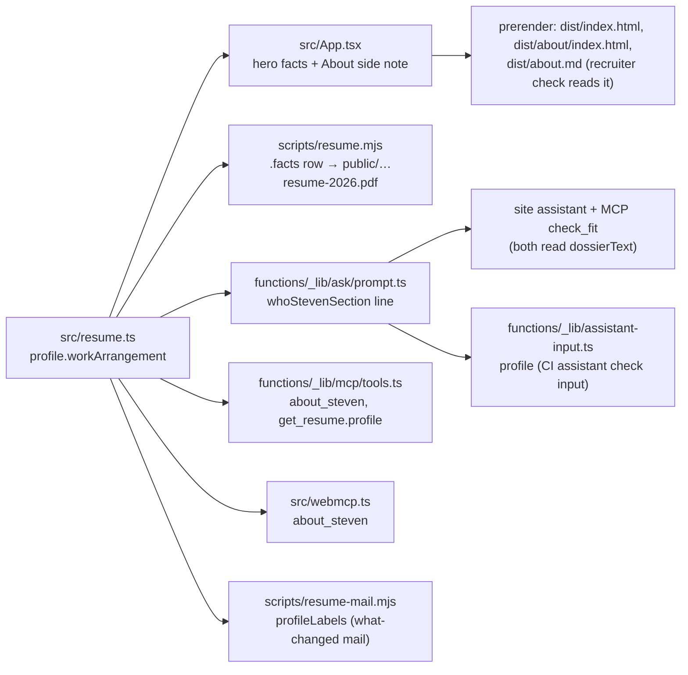

# Where and how Steven works, the Cosmos hire, and sharper Windows outcomes

Slug: `work-arrangement-cosmos-story-and-outcom-44` · Branch: `work-arrangement-cosmos-story-and-outcom-44` · Status: built
Asked by Steven on 2026-10-23 (approved exact wording, replaces PR #73): "Profile / work arrangement: add 'Seattle-based, open to remote or hybrid, and to coordinated travel; not relocating.' as a work-arrangement field next to location in `profile`, shown on the site, the PDF, the assistant, the MCP and WebMCP. Role 'cosmos': append to summary: 'Joined as a consultant from Info Support, then hired full-time.' Selected work 'windows-quality': outcome becomes 'Adopted by every Windows team, and behind the roughly 30% drop in issue days across Perfect Day scenarios.' and remove the Amit Gupte source from this card. Role 'windows-devices-data': replace the experimentation bullet with 'Scaled experimentation across Windows to hundreds of concurrent experiments, significantly reducing the number of features pulled back after release.' Selected work 'okr-tool': append to `work`: 'Built in six months to replace Viva Goals, Microsoft's acquired OKR product, after it was retired.' Change nothing else; ATS score stays 100/100."

## Problem

- **Recruiters and hiring managers screening on location.** The first screening question for a
  Seattle-based candidate is "remote, hybrid, or relocation?". Today the site, the PDF, the
  assistant and the MCP say only "Seattle, Washington" (`profile.location`) and the work
  authorization; a recruiter with a remote role, or one in another city, cannot tell whether to
  call, and the assistant has no fact to answer with (`functions/_lib/ask/prompt.ts` carries
  location, authorization, availability and team size, nothing on arrangement). Source: Steven's
  word in the instruction.
- **Hiring managers reading the selected work.** The Windows quality case (`windows-quality`)
  ends on a soft, second-hand outcome ("Colleagues describe these as…") with no number, and
  the recruiter review asks for one on every recent case without a digit
  (`functions/_lib/review/recruiter.ts:69`). The OKR case does not say what was replaced or how
  fast. The experimentation bullet on the latest Microsoft role says "adoption" without scale.
- **Peers checking the early career.** Cosmos (2004-2005) overlaps Info Support (2001-2004)
  with no explanation; a close reader sees two employers at once.

## Outcome

A recruiter learns in one line, on any page, in the PDF, and from the assistant or an AI agent,
that Steven is in Seattle, open to remote or hybrid and to travel, and not relocating; a hiring
manager reads a measured, first-person Windows quality outcome, the scale of the experimentation
work and the Viva Goals story, all in Steven's approved words, with the résumé ATS score still
100/100.

## Acceptance criteria

Data (`src/resume.ts`, the only source; no component hard-codes any of this text):

- AC-1: `profile` has a new string field next to `location` (recommended name
  `workArrangement`) whose value is exactly
  `Seattle-based, open to remote or hybrid, and to coordinated travel; not relocating.`
  `profile.location` stays `Seattle, Washington`.
- AC-2: The `cosmos` role's `summary` is exactly
  `Built and supported software components across C# client and Java server systems using CORBA middleware. Joined as a consultant from Info Support, then hired full-time.`
  Its `dates` stay `Jan 2004 - Dec 2005`, and its role, company, location and points are unchanged.
- AC-3: The `windows-quality` selected-work item's `outcome` is exactly
  `Adopted by every Windows team, and behind the roughly 30% drop in issue days across Perfect Day scenarios.`
  and the item has no `source` field. Its key, title, period, role, context and work are unchanged.
- AC-4: The `windows-devices-data` role contains the bullet
  `Scaled experimentation across Windows to hundreds of concurrent experiments, significantly reducing the number of features pulled back after release.`
  in the position of the old bullet, and the old bullet
  (`Scaled experimentation adoption across Windows, …`) appears nowhere in `src/`, `functions/`,
  `scripts/` or the built pages.
- AC-5: The `okr-tool` selected-work item's `work` is exactly the current text followed by one
  space and `Built in six months to replace Viva Goals, Microsoft’s acquired OKR product, after it was retired.`
  (apostrophe style matching the rest of the file; recommended the typographic `’`, as in the
  surrounding text). Its `outcome` and `source: 'Amit Gupte'` are byte-for-byte unchanged.

Where it shows:

- AC-6: Wherever the work arrangement appears it is `profile.workArrangement` verbatim (no
  shortened form, Open question 3), never a second hand-typed copy: `src/App.tsx` does not
  contain `open to remote or hybrid`. In the prerendered HTML:
  - `/about`: the side note has a `span` "Work arrangement" with a `strong` holding the
    sentence, directly after the "Based in" pair and before "Work authorization".
  - Home: `.hero-facts` has a fourth `span` with the sentence, directly after the
    `{location} · {workAuthorization}` span, with no label.
  - The contact band and the hero kicker are unchanged (no work arrangement in either).
  - `dist/index.html`, `dist/about/index.html` and `dist/about.md` each contain
    `coordinated travel`.
- AC-7: On `/work`, asserted per card (within each card's `article`, not anywhere on the page):
  the Windows quality card shows the new outcome, has no "As described by" text, no Amit Gupte
  link and no `.work-meta` element (the meta row renders only when a card has a `source` or a
  `link`); the AI feature forecast and OKR cards each still show "As described by" with the
  Amit Gupte link; the spatial-audio card's outcome and meta are as on main.
- AC-8: The regenerated `public/steven-wilssens-resume-2026.pdf` (by `npm run resume:build`, not
  by hand):
  - shows the work arrangement as its own full-width row in the facts block under the header,
    after Looking for / Scope / Background, with the inline label "Work arrangement" (extracted
    text contains
    `Work arrangement Seattle-based, open to remote or hybrid, and to coordinated travel; not relocating.`
    with a single trailing period);
  - leaves the header contact block unchanged: `Seattle, Washington` alone and first, followed by
    the work authorization, so `resume-check`'s `contact-location` and `contact-authorization`
    still pass;
  - contains the new Cosmos summary in the early-career section and the new experimentation
    bullet, and no longer contains `Scaled experimentation adoption`;
  - is exactly 2 pages (a test asserts `pages === 2`). If the row does not fit, the build uses the
    presentation fallbacks in the Technical approach inside `scripts/resume.mjs`, never a data
    change, `--force`, or a move to the contact column.
  - The value is wrapped in `esc()` in `scripts/resume.mjs`, as `profile.location` is.
- AC-9: The assistant's prompt (`functions/_lib/ask/prompt.ts`, the "who" block) states the work
  arrangement from `profile` as `… Based in Seattle, Washington. Work arrangement: <sentence> Looking for: …`
  (no doubled period), and a unit test asserts the literal sentence is in the prompt. In the
  Review workflow's assistant check, the branch's answer to "Where is Steven based and is he
  authorized to work there?" still names Seattle and the green card (the recruiter reads
  `.review/assistant/assistant-check.md`; a check that did not run is not a pass).
- AC-10: The MCP server returns the work arrangement wherever it returns location and
  authorization (`functions/_lib/mcp/tools.ts`: `about_steven`, in private and public mode, as a
  new `workArrangement` key, with the existing `location` string unchanged; and
  `get_resume.profile`, which `review_for_recruiters` reads), and
  `functions/_lib/assistant-input.ts` passes it; tests assert the literal. The public MCP tool
  list (`publicToolNames`) is unchanged.
- AC-11: The WebMCP profile tool (`src/webmcp.ts`, `about_steven`) returns the field, and its
  `get_selected_work` tool returns `source: null` for `windows-quality`; `src/webmcp.test.ts`
  asserts both per key (`windows-quality` null; `ai-feature-forecast` and `okr-tool` a source
  naming Amit Gupte), not with a check any case passes. The MCP `get_resume.selectedWork` test
  asserts the same two keys.
- AC-17: On tablet widths (521-800px) the four hero facts form a 2 × 2 grid: the
  `@media (max-width: 800px)` `.hero-facts` rule is `grid-template-columns: repeat(2, 1fr)`,
  nothing else in that rule changes. At 390px the résumé link and the email are in the same place
  in the first screen as on main (the new fact is below the actions, in the one-column facts
  list), and at 320px there is no horizontal scroll. Checked in the designer's screenshots
  against main.
- AC-18: The deploy email Steven reads (`scripts/resume-mail.mjs`, `profileLabels`) labels the new
  field `work arrangement`, so a change to it is listed like any other profile field; its existing
  test gets a case. (Decision below.)

Bars and checks:

- AC-12: `node scripts/resume-check.mjs` reports ATS score 100/100 on the new PDF, with no new
  error or warning compared with main, and `npm run resume:build` replaced the PDF without
  `--force`. `src/resume.test.ts` passes (PDF matches `src/resume.ts`).
- AC-13: Unexplained numbers. `scripts/resume-check.mjs` checks only `impact` for a backing role
  bullet (lines 78 and 162); it does not read `selectedWork`, and the PDF does not render
  selected work. So the "roughly 30%" in `windows-quality` and "six months" in `okr-tool` raise
  no résumé finding, and no checker is changed to make that so. The spec records that both
  numbers are Steven's own word (instruction of 2026-10-23, "roughly 30%" decided 2026-10-22),
  like the spatial-audio outcome. `npm run check:recruiter` is not lower than main; the review's
  "is there a number for the outcome" question for "Windows quality…" disappears.
- AC-14: Untouched, verified by `git diff main -- src/resume.ts` showing only the five changes
  above plus the new field: the team-size bullets on `csx-data` and `windows-devices-data`, every
  recommendation quote (Ryan Parsell and Amit Gupte included), the `wilssens-com` item ("five
  sites and the family's mailboxes"), `impact`, `headline`, `summary` and `availability`.
- AC-15: No temporary or helper script is committed; `git diff --stat main` lists only
  `src/resume.ts`, the PDF, the files needed to show the new field (AC-6 to AC-11, AC-17, AC-18:
  `src/App.tsx`, `src/App.css`, `scripts/resume.mjs`, `functions/_lib/ask/prompt.ts`,
  `functions/_lib/assistant-input.ts`, `functions/_lib/mcp/tools.ts`, `src/webmcp.ts`,
  `scripts/resume-mail.mjs`), their tests, generated artifacts the build already commits (e.g. the
  résumé report), and this spec. Nothing under `.github/`, no `package.json` change, no checker
  change (`git diff main -- scripts/resume-check.mjs functions/_lib/review/` is empty).
- AC-16: `npm run lint`, `npm run test:coverage` (90% or more overall and per changed file) and
  `npm run build` pass.
- AC-19: Tests that pin the old wording (the `windows-devices-data` points `toEqual`, the "who"
  line in `functions/_lib/ask/agent.test.ts`, the `assistant-input` `toEqual`) are updated to the
  new exact text, never deleted or loosened to `toContain` of a fragment. Every new assertion on
  the approved wording uses the literal string, not only a comparison with `profile`.

Decision (PM, reconciliation): `scripts/resume-mail.mjs` is in scope. Steven listed the site, the
PDF, the assistant, the MCP and WebMCP; the deploy email is the one place he himself reads what
changed in `profile`, and without the label it would drop the new field silently. It is one line
plus a test case, adds no surface for visitors, and is consistent with "shown everywhere the
location is". The LinkedIn suggestion and the review input stay out (Out of scope).

## Out of scope

- Any change to the five fixed questions of the assistant check (`scripts/assistant-check.mjs`),
  or a sixth question about work arrangement. Follow-up if Steven wants the CI check to hold the
  assistant to the new field.
- The Work page intro, which says "outcomes stay within what colleagues have said publicly"
  (`src/App.tsx`, `renderWork`); with Windows quality now in Steven's own words it is less exact.
  Steven said change nothing else; see Open question 2. The recruiter's condition: this is the
  next change after this one, not a someday.
- A `csx-data` bullet backing the `~30%` in `impact` (the open `TODO(steven)` stays); Open
  question 5.
- Widening the About-proposal guard (`functions/_lib/mcp/about.ts`) or the "never infer
  relocation" prompt rules to the work arrangement; a prompt follow-up only if the CI assistant
  answers show it refusing the published fact (Open question 4).
- The contact band and the hero kicker (designer: unchanged on purpose).
- Making `resume-check` or the recruiter review check numbers in `selectedWork` for backing.
- The share image (`public/og-image.png`): headline and photo are unchanged, no regeneration.
- LinkedIn copy (`functions/_lib/review/linkedin.ts` "about" suggestion) beyond what follows
  automatically if the developer chooses to include the field; not required.
- Recommendations, team-size bullets, `wilssens-com`, and anything PR #73 changed beyond this list.

## Recruiter impact (senior-recruiter)

Baselines, taken 2026-10-23 on this branch before any change (identical to `origin/main`
40d84f9), after `npm run build`:

- `npm run check:recruiter` = **80/100** (0 high, 4 medium, 0 low; 11 questions). The four
  mediums: no team size on `csx-data`, `azure-devops` and `spatial-audio-lead`, and LinkedIn
  not imported. Same as main's data on the live pages (80/100).
- `node scripts/resume-check.mjs` ATS = **100/100**, 2 pages, 357 KB, 0 errors, 0 warnings;
  with `--baseline https://steven.wilssens.com/resume-report.json`: 100 → 100, same as live.
  One question: the Cosmos / Info Support overlap.

**First ten seconds.** The phone hero already answers who, what role, Seattle, the green card,
the résumé and the email. What it never answered is the recruiter's second filter: "remote,
hybrid, or would he move?". The recruiter review asks this today (recruiter.ts:64). After this
change the answer sits next to the location: open to remote or hybrid and to travel, not
relocating. That is a real gain. A recruiter with a remote role calls, and one with an
on-site role elsewhere stops early, which saves both sides a call. "Not relocating" is a
negative to end on, but it is honest and it is what recruiters want to know. I accept
Steven's wording as it is.

**Close read.** Windows quality now ends on a number (roughly 30% fewer issue days) and on
adoption, not on a second-hand "colleagues describe". The experimentation bullet gains scale
("hundreds of concurrent experiments"). The OKR card names Viva Goals, a term people search
for, and gives a timeframe. Cosmos explains the 2004 overlap that looked like a dating error.
All four are things a hiring manager would ask about in a screen, so this change helps the
reader's decision more than Steven's ego. I have no pushback on the criteria.

Expected effect on the checks: the score stays **80/100**, because no finding changes.
Questions go from 11 to 9: the work-arrangement question clears *if* the arrangement appears
in `dist/about.md` (main's checker reads only `lookingFor`, `availability` and the About page
text, not a new profile field, so AC-6 is what clears it), and the "number for the outcome"
question on Windows quality clears. Both Cosmos overlap questions stay, because the checkers
compare dates and do not read the summary. That is expected, not a regression. ATS stays
100/100 only if the PDF stays at 2 pages.

Risks to the bar, and what I will check at merge:

1. **PDF placement (I push back on AC-8 "in the contact block").** The PDF contact block is a
   narrow right-hand column with four short lines. A 75-character sentence there wraps to 2-3
   lines, makes the header busier, and is where parsers mix header columns into the name or
   location fields. Recommendation: put it in the `facts` block under the header, as its own
   row ("Work arrangement", or "Where") or after "Looking for". Keep `Seattle, Washington`
   alone and first in the contact line, because the ATS location check and parsers key on
   it. A blocker at merge: a third page (an ATS error, `pages`), or a lost
   `contact-location` / `contact-authorization`.
2. **Phone first screen.** Do not add a new line to the hero. On main the "Open to:" line
   already says `Seattle, Washington` a second time (the kicker says it first). Put the
   arrangement in that slot, or right after it, so the 390px first screen keeps the résumé
   link and the email where they are. A blocker at merge: the résumé link or the email moves
   below the first phone slice. On `/about`, show it under its own label after "Based in"
   (AC-6), so the "Seattle-based … / Seattle, Washington" repeat reads as two different facts.
3. **The 30% number.** It is not a checker risk. `selectedWork` is not in the PDF, and the
   number checks read only `impact`. `impact` already shows "~30% fewer issue days" with
   `backing: 'csx-data'`, but a `TODO(steven)` in `src/resume.ts` admits that no `csx-data`
   bullet states it. The card makes the number consistent across the site, and its source is
   Steven's own word (decided 2026-10-22), which CLAUDE.md accepts. The TODO stays open
   because "change nothing else" applies; see the question below. Credibility note:
   `windows-devices-data` also has a "cutting costs 30%" bullet. Two different 30% figures
   in adjacent roles are fine because their labels differ. Keep the card's wording ("issue
   days", "Perfect Day") exactly as approved so the two cannot be confused.
4. **Losing the third-party voice on Windows quality.** The card trades a colleague's
   attribution for Steven's own number and the claim "every Windows team". A sceptical
   hiring manager will push on "every". That is acceptable because Amit Gupte still
   attributes two other cards and the recommendations page carries his words. But the
   `/work` intro says outcomes "stay within what colleagues have said publicly", which is now
   untrue for two cards (spatial audio already). A reader who sees the claim and then a card
   with no attribution trusts both less. I accept it as out of scope for this pull request,
   as the PM proposes (Open question 2), on one condition: it is the next change, not a
   someday.
5. **OKR card.** "Built in six months … after it was retired" next to the context's "was
   being retired" leaves the order of events slightly unclear: was there a gap, or was it
   built ahead of the retirement? The card is still credited "As described by Amit Gupte"
   while "six months" and "Viva Goals" are Steven's facts. Neither is a blocker, because the
   wording is approved. Next to "wilssens.com … in 16 days", "six months" can read slow; the
   Viva Goals context (a company-wide product replaced for an organization) carries it.
6. **Assistant and agents.** The assistant can only say what its prompt carries. AC-9 is
   required, not optional. The fixed CI question "Where is Steven based and is he authorized
   to work there?" must still name Seattle and the green card (its check reads
   `profile.location` and `profile.workAuthorization`, both unchanged). I will read the
   branch-versus-main answers in `.review/assistant/assistant-check.md` to make sure the new
   sentence did not push the authorization out of the answer.
7. **Tense and level.** Every new line is past tense ("Joined", "Scaled", "Built"). None
   starts with a present-tense verb, so the tense checks stay quiet. "Experimentation" (an
   ATS keyword) stays in the bullet, and the dropped word "adoption" is not one of the
   tracked keywords.

At merge I will run `npm run check:recruiter` (must be at least 80, no new high, at most 9
questions expected) and `resume-check --baseline` against live (100, 2 pages). I will look at
the `home` and `about` phone slices at 390px, check that `/work` shows the Windows quality
card with no attribution while the other Amit cards keep theirs, and that the résumé link
still resolves to a `%PDF` built from `src/resume.ts`.

- Questions for Steven (the `~30%` backing bullet, the `/work` intro, the Viva Goals timing):
  merged into "Open questions for Steven" below as questions 5, 2 and 6.

**Verdict on the spec: APPROVE**, on two conditions the designer and developer carry into the
build. In the PDF, the work arrangement goes in the facts block, not the narrow contact
column, and the PDF stays at 2 pages. On the phone first screen, it replaces or follows the
duplicate "Seattle, Washington" in the "Open to" line, without adding a line above the résumé
link or the email.

## Design (ux-designer)

The change is text: one new fact and four rewordings. Nothing new to click, no new component,
no new token. The design work is where the new sentence sits so a recruiter sees it on the first
screen, without the hero or the PDF header getting busier than they need to. I take both of the
recruiter's conditions: the PDF line goes in the facts block, not the contact column (this
changes AC-8, see below), and on the phone nothing is added above the résumé link or the email.

### Readers and flows

1. **Recruiter on a phone, from a LinkedIn message (home).** They scan the hero facts for level,
   location and work authorization. The new sentence is the next fact, right after
   `Seattle, Washington · US permanent resident (green card)`, so "Seattle-based, open to remote
   or hybrid…" reads as more detail on the location line, not as a repeat. (The recruiter's
   note says the "Open to:" line repeats Seattle. In the code, `Open to:` shows `lookingFor`,
   and the line that repeats Seattle is the third fact, `{location} · {workAuthorization}`.
   The new fact goes right after that one.) On the phone, `.hero-body` is one column: the lede
   and the actions (résumé link, email, LinkedIn) come first and the facts come after them. So
   the new line sits below the résumé link and the email and moves neither of them.
2. **Recruiter or hiring manager on /about.** The side note is the fact sheet. The new label
   "Work arrangement" sits right after "Based in", so a reader looking for location finds the
   arrangement in the same place, as a separate fact (AC-6).
3. **Hiring manager on /work.** The Windows quality card ends on the new measured outcome and
   has no attribution line. The AI feature forecast and OKR cards keep "As described by Amit
   Gupte".
4. **Peer on /experience.** The Cosmos entry's summary gets one more sentence; the
   windows-devices-data bullet is reworded in place. Same components, no layout change.
5. **Recruiter forwarding the PDF.** The facts block under the header gets the sentence as its
   own full-width row.
6. **Assistant, MCP and WebMCP.** No UI. The Ask panel renders whatever the assistant answers,
   as it does today.

### Where it renders (exact copy)

The value is always `profile.workArrangement`, verbatim (Open question 3: no shortened form):
`Seattle-based, open to remote or hybrid, and to coordinated travel; not relocating.` (83 characters).

| Surface | Placement | Label | Component and tokens reused |
|---|---|---|---|
| Home hero (`renderHome`, `.hero-facts`) | a fourth `<span>`, right after the `{location} · {workAuthorization}` span | none: the sentence names itself, like its neighbours | `.hero-facts span` (13px, `--muted`, line-height 1.4) |
| About side note (`renderAbout`, `.side-note`) | new `<span>Work arrangement</span><strong>{workArrangement}</strong>` right after "Based in", before "Work authorization" | **Work arrangement** (shown uppercase by `.side-note span`) | `.side-note span` / `.side-note strong`, the existing label/value pattern |
| PDF facts block (`scripts/resume.mjs`, `.facts`) | a fourth `div` after Looking for / Scope / Background, spanning the whole row, with the label inline | **Work arrangement** in the existing `.mono` label style | `.facts`, `.mono`; one new rule (below) |
| PDF contact block (`header .contact`) | **unchanged**: `Seattle, Washington` stays alone and first, followed by the authorization | n/a | Keeps the ATS location parse and `contact-location` / `contact-authorization` intact |
| Contact band (`renderContactBand`) | **unchanged** | n/a | It already says "based in Seattle, Washington". Adding the sentence would put Seattle there twice and make the paragraph longer than its heading needs. The hero and About already cover the first screen and the fact sheet. |
| Hero kicker (`Steven Wilssens · Seattle, Washington`) | **unchanged** | n/a | The kicker is one line; an 83-character sentence would break it. |
| Share image | unchanged (out of scope) | n/a | n/a |

**AC-8 change (for the PM).** "In the contact block next to the location" should read "in the
facts block under the header, as its own row labelled Work arrangement; the contact block is
unchanged".

**Windows quality card on /work.** With `source` gone and no `link`, `.work-meta` still renders as
an empty flex div with `margin-top: 18px`, so this card would get 18px more space at the bottom
than its neighbours. Render the meta row only when it has something in it:
`{(item.source || item.link) && <div className="work-meta">…</div>}` in `renderWork`. The card
then ends on its Outcome `dd`. The five cards with a source or a link are unchanged, and no CSS
changes.

### Layout

**Desktop 1440 (light and dark), home hero.** `.hero-facts` is the 210px right column. At 13px the
sentence wraps to about four lines. The column is `align-self: center` next to the lede and the
actions, which are taller, so the hero should not grow (check this in the shot):

```
  [photo]  STEVEN WILSSENS · SEATTLE, WASHINGTON
           Product leader for data, experimentation and AI …
           ┌──────────────────────────────────────────┐ │ Open to: product leadership
           │ Most recently I led Windows & Devices …  │ │ roles building new products…
           │                                          │ │
           │ [View experience] (Ask AI) Resume …      │ │ Principal · Group PM · led …
           └──────────────────────────────────────────┘ │
                                                        │ Seattle, Washington · US
                                                        │ permanent resident (green card)
                                                        │
                                                        │ Seattle-based, open to remote   <- new
                                                        │ or hybrid, and to coordinated
                                                        │ travel; not relocating.
```

**Tablet 521-800.** The `@media (max-width: 800px)` rule sets `.hero-facts` to
`grid-template-columns: repeat(3, 1fr)`, so a fourth fact would sit alone on a second row. Change
that one declaration to `repeat(2, 1fr)` so the four facts form a 2 × 2 grid. Nothing else in
that rule changes.

**Phone 390 (light and dark).** `@media (max-width: 520px)` already makes `.hero-facts` one column
with a 12px gap. The new fact is the last row, at the same size and colour as the location row,
below the actions:

```
  (photo)
  STEVEN WILSSENS · SEATTLE, WASHINGTON
  Product leader for …
  Most recently I led …
  [View experience]  (Ask AI about my work)
  Resume · steven@wilssens.com · LinkedIn        <- unchanged position
  ─────────────────────────────
  Open to: product leadership roles …
  Principal · Group PM · led …
  Seattle, Washington · US permanent resident (green card)
  Seattle-based, open to remote or hybrid, and to          <- new
  coordinated travel; not relocating.
```

**About, desktop.** The side note is the right column of `.reading-layout`. On the phone it
stacks under the paragraphs. Same order in both:

```
  │ MOST RECENTLY
  │ Principal Group Product Manager, Microsoft
  │ LOOKING FOR
  │ Product leadership roles building new products, …
  │ BASED IN
  │ Seattle, Washington
  │ WORK ARRANGEMENT                                   <- new
  │ Seattle-based, open to remote or hybrid, and to
  │ coordinated travel; not relocating.
  │ WORK AUTHORIZATION
  │ US permanent resident (green card)
  │ …
```

**PDF, page 1.** The facts block becomes three columns plus one full-width row:

```
  Steven Wilssens                              Seattle, Washington · US permanent resident (green card)
  <resumeHeadline>                             steven@wilssens.com · +1 …
                                               linkedin.com/in/… · steven.wilssens.com
                                               For AI assistants: steven.wilssens.com/mcp (read-only MCP)
  ═══════════════════════════════════════════════════════════════════════════════════════
  LOOKING FOR                    SCOPE                       BACKGROUND
  Product leadership roles …     Led teams of …              Product leader since 2008, …
  · available now
  WORK ARRANGEMENT  Seattle-based, open to remote or hybrid, and to coordinated travel; not relocating.   <- new
```

Markup: `<div class="arrangement"><span class="mono">Work arrangement</span>${esc(profile.workArrangement)}</div>`
as the fourth child of `.facts`. New rule:
`.facts .arrangement { grid-column: 1 / -1; } .facts .arrangement .mono { display: inline; margin: 0 8px 0 0; }`.
At 9.2pt the row fits on one line across the page width, so it adds one line (about 12pt plus the
16px row gap). If that makes a third page, the `compact` class `resume.mjs` already has is the
fallback, as for any long résumé. The PDF must stay at 2 pages (recruiter's blocker). Render
page 1 from main and from the branch, side by side, before signing off.

**Light and dark.** No new colours. The hero fact uses `--muted`; the side note uses `--green` for
the label and `--ink` for the value on `--paper`, the same pairs as its neighbours, which pass axe
on main in both themes. The PDF is print-only light.

### States

- **Empty.** The field is required (`string`, not optional) in the `profile` type, so the site has
  no empty state and no conditional rendering for it. Never ship an empty span, label or row.
- **Loading or error.** None. Everything is prerendered from `src/resume.ts`.
- **No JavaScript.** The hero fact, the About side note and the Work cards are all in the
  prerendered HTML. Check `dist/index.html`, `dist/about/index.html` and `dist/work/index.html`
  for the sentence, and check that no "As described by" sits inside the Windows quality article.
  `dist/about.md` should carry it too (the recruiter check reads it).
- **Very long content.** Every placement wraps and none truncates. Keep the value to one sentence
  of about 100 characters or less: the hero facts column then stays shorter than the lede, and
  the PDF row stays on one line.

### Accessibility

- **Keyboard and focus.** No new interactive element; the Tab order is the same as on main on
  every page, except on /work. With the Windows quality meta row gone, its two links (Amit
  Gupte's LinkedIn, "his recommendation") leave the Tab order there. Both can still be reached
  from the AI feature forecast and OKR cards.
- **Labels and semantics.** Plain text in the existing structures. The About side note keeps its
  `span` + `strong` label/value pattern; do not turn this one fact into a `dl` unlike its
  neighbours. In the PDF the label is real text, so it is in the extracted text a screen reader
  or parser reads.
- **Contrast.** Existing token pairs only (see above).
- **Reduced motion.** No new motion. The row reveal on /work and /experience is unchanged and
  already respects `prefers-reduced-motion`.
- **Reflow at 320px.** The hero facts and the side note are single-column text that wraps, so
  there is no horizontal scroll. Verify with a 320 shot.

### Flow diagram

Not applicable: the change does not touch the agent workflow or a reader's path through the site.

### Pages to screenshot (UI check, branch against main)

- `npm run screenshots -- --out screenshots/branch --slices home about work experience`, and the
  same pages from main's build (`--base http://127.0.0.1:8790 --out screenshots/main`), at 1440
  and 390, light and dark.
- 320px reflow: `--widths 320 home about`. Tablet 2 × 2 hero facts: `--widths 768 home`.
- PDF page 1, branch against main, as images (for example `pdftoppm -png -r 110 -f 1 -l 1` on
  each PDF), plus the page count.
- No admin shots: nothing under `src/admin/` changes.

Before/after pairs for Steven:

1. Home hero, first phone slice at 390 (the new fact; the résumé link and email in place).
2. About side note at 1440 (the new label).
3. The Windows quality card on /work at 1440 (new outcome, no attribution, no extra gap).
4. PDF page 1 header and facts.

### Designer's verdict on the spec

**APPROVE**, on four conditions:

1. AC-8 moves the PDF line to the facts block, as above.
2. `.work-meta` renders only when the card has a source or a link.
3. The `max-width: 800px` hero facts rule becomes `repeat(2, 1fr)`.
4. The PDF stays at 2 pages, with the contact block unchanged.

The contact band and the hero kicker stay unchanged on purpose.

## Threat model (security-engineer)

**New attack surface: none.** There is no new endpoint, route, tool, input, token, secret, D1
table or dependency. The new value is a static string Steven approved, committed in
`src/resume.ts`. It travels the same trusted path `profile.location` already takes: the
prerendered pages, the PDF (`scripts/resume.mjs`), the assistant's system prompt
(`functions/_lib/ask/prompt.ts`, through `functions/_lib/assistant-input.ts`), the MCP tools and
WebMCP. No visitor, job-description or MCP input reaches it.

What can still go wrong, and the controls:

- **Output encoding (XSS or PDF markup injection).** Today the value is harmless, but a later
  edit could put markup into it. Control: render it as React text only (no
  `dangerouslySetInnerHTML`; `src/resume.test.ts` already asserts that) and wrap it in `esc()` in
  `scripts/resume.mjs`, as `profile.location` is. Test: none beyond the existing ones; checked
  at review.
- **Privacy and public exposure.** The field goes to the public `/mcp`, WebMCP and the assistant.
  It is Steven's own approved wording, says no more than his city, and names no family or
  colleague. The `windows-quality` change *removes* an attribution to a colleague and adds none.
  No dossier entry, private or public, is copied into it.
- **Assistant prompt.** The sentence goes into the trusted "who" block. It is not
  attacker-controlled, so it cannot widen injection, and its 83 characters do not change cost.
  Control: interpolated from `profile`, not hand-typed (AC-9 test).
- **Supply chain or workflow.** No workflow, permission or `package.json` change. A diff that
  touches `.github/`, adds a dependency or commits a helper script (AC-15) is a finding at merge.

Required at merge: `esc()` on the PDF value; no raw-HTML rendering of it; `git diff --stat main`
limited to the files in AC-15.

**Verdict on the spec: APPROVE.** A data-only change on an existing trusted path, with no
reachable abuse case.

## Technical approach (senior-developer)

No migration, no endpoint, no dependency. One new string in `profile`, four text edits, one
conditional in `renderWork`, one CSS declaration, one PDF row. Everything else picks the text up
from `src/resume.ts` as it does today.

### Data flow of `profile.workArrangement`



### Files to change

| File | Change |
|---|---|
| `src/resume.ts` | `profile`: add `workArrangement: 'Seattle-based, open to remote or hybrid, and to coordinated travel; not relocating.'` on the line after `location` (line 118). `profile` is an inferred `const` object, so the type follows and every consumer that names the field is type-checked. `cosmos.summary` (line 17): append `' Joined as a consultant from Info Support, then hired full-time.'`. `windows-devices-data.points[4]` (line 9): replace in place. `windows-quality` (line 162): new `outcome`, delete `, source: 'Amit Gupte'` (the `Work` type already has `source?`). `okr-tool.work` (line 165): append one space and the Viva Goals sentence with `’` (U+2019, as in `organization’s` on the same line). Nothing else in the file, the `TODO(steven)` on line 140 included. |
| `src/App.tsx` | `renderHome` (line 112): a fourth `<span>{profile.workArrangement}</span>` in `.hero-facts`, after the `{profile.location} · {profile.workAuthorization}` span. `renderAbout` (line 114): `<span>Work arrangement</span><strong>{profile.workArrangement}</strong>` between the "Based in" pair and "Work authorization". `renderWork` (line 116): wrap the meta row as `{(item.source \|\| item.link) && <div className="work-meta">…</div>}` (designer's condition 2); the two inner conditionals stay. `renderContactBand` (line 111) and the hero kicker unchanged. |
| `src/App.css` | Line 90, inside the `@media (max-width: 800px)` rule that starts on line 89: `.hero-facts { grid-template-columns: repeat(3, 1fr); … }` → `repeat(2, 1fr)`. Nothing else; the 520px rule (line 126) already makes it one column. |
| `scripts/resume.mjs` | `.facts` (line 127): fourth child `<div class="arrangement"><span class="mono">Work arrangement</span>${esc(profile.workArrangement)}</div>`; CSS after line 71: `.facts .arrangement { grid-column: 1 / -1; } .facts .arrangement .mono { display: inline; margin: 0 8px 0 0; }`. The header `.contact` (line 121) is untouched, so `contact-location` and `contact-authorization` in `resume-check.mjs:134` still match. The Cosmos summary and the new bullet reach the PDF through the existing `early` and `detailed` templates with no change. |
| `public/steven-wilssens-resume-2026.pdf` | Regenerated by `npm run resume:build`, never by hand. |
| `functions/_lib/ask/prompt.ts` | `WhoData.profile` (line 44) gains `workArrangement: string`; line 46 becomes `… Based in ${location}. Work arrangement: ${workArrangement} Looking for: …`. The value already ends in a period, so the template must not add `. ` after it (no "relocating.."). `check_fit` in the MCP (`tools.ts:623`, `dossierText`) gets it from the same section with no change of its own. |
| `functions/_lib/assistant-input.ts` | `AssistantInput.profile` (line 22) and the object on line 61 gain `workArrangement`. Additive: `scripts/assistant-check.mjs:75` (main's copy in CI) validates only its four keys and ignores a fifth, and `SCHEMA` stays `assistant-input/1`. The five fixed questions do not change (out of scope). |
| `functions/_lib/mcp/tools.ts` | `about_steven` (line 546): a new key `workArrangement: profile.workArrangement` after `location`; the `location` string itself stays `${location} · ${workAuthorization}` so no client parsing it breaks. `get_resume` (line 830): `profile` gains `workArrangement`; `review_for_recruiters` and the owner's proposal work read that. `selectedWork` there (line 834) already maps `source: item.source ?? null`, so `windows-quality` returns `null` with no code change. |
| `src/webmcp.ts` | `about_steven` (line 75): `workArrangement: profile.workArrangement` after `workAuthorization`; update the description on line 66 ("where he is, how he works, his work authorization…"). `get_selected_work` (line 105) already maps `source ?? null`; no code change. |
| `scripts/resume-mail.mjs` | `profileLabels` (line 134): add `workArrangement: 'work arrangement'`. `diffFields` walks the labels, not the object, so without it the deploy mail Steven reads would omit the new field silently. One line, plus a case in its existing test. I count this as "a file needed to show the new field" under AC-15; if the PM disagrees it is a follow-up, not a blocker. |
| Tests | As the test plan lists: `src/resume.test.ts`, `src/App.test.tsx`, `src/webmcp.test.ts`, `functions/_lib/ask/agent.test.ts`, `functions/_lib/assistant-input.test.ts`, `functions/_lib/mcp/server.test.ts`, `scripts/resume-mail.test.mjs`. |

Generated by the build and committed only if the build already commits them (check
`git status` after `npm run build`; e.g. `public/resume-report.json` if tracked): nothing else.

### What stays the same

- `profile.location`, the PDF contact block, the contact band, the hero kicker, the share image.
- Every checker: `scripts/resume-check.mjs`, `functions/_lib/review/` (the "remote, hybrid"
  question at `recruiter.ts:64` clears through the About text in `dist/about.md`, which the
  side note now carries; I do not add `profile.workArrangement` to that regex, because `gates`
  runs main's checker and the result must come from the page, not from a checker change),
  `scripts/assistant-check.mjs`.
- `functions/_lib/mcp/about.ts:87`: the guard that refuses an About paragraph proposal with
  "based in / relocat…" unless it carries `profile.location`. Not widened to the arrangement in
  this change (change nothing else); the side-note facts still change only through `src/resume.ts`.
- The "never infer … willingness to relocate" rules in `prompt.ts:161`, `tools.ts:623` and
  `tools.ts:1335` stay. Stating a published fact is not inferring one, and the fact now sits in
  the dossier the model is told to quote. If the CI assistant answers show it refusing the
  arrangement, that is a prompt follow-up (Open question 4), not a reason to loosen the rule here.
- The `/work` intro (Open question 2), `impact` and its `TODO(steven)`, the public MCP tool list.

### Feasibility risks

1. **The PDF is already at its last safe layout.** A render of the current data on this branch
   (`node scripts/resume.mjs --out /tmp/…`, nothing replaced) prints "Layout: 1 bullet on the
   older Microsoft roles, compact type": layout 3 of 4 in `layouts` (`scripts/resume.mjs:25`).
   The only fallback left is `olderBullets: 0`, which drops Perfect Day, spatial audio and
   Azure DevOps from the older roles and fails `src/resume.test.ts` › "keeps the first bullet
   of every older Microsoft role". The change adds height three ways: the facts row (one line
   at 9.2pt plus the 16px grid gap, about 30px), the experimentation bullet (about 108 → 152
   characters, likely one more line in a detailed role) and the Cosmos summary (about 104 →
   167 characters, one more line in the early section). Roughly 55-65px in all. I could not
   measure the slack on page 2 here (no permission to run a throwaway render script), so the
   build must check it first. If it does not fit, in this order, without touching the data:
   (a) a smaller gap above the new row only (`.facts .arrangement { margin-top: -10px }`
   against the 16px `gap`), (b) the label on the same line is already in the design; keep it,
   (c) a new layout step between 3 and 4 in `layouts`, e.g. compact with `olderBullets: 1` and
   a tighter `section` margin, so older bullets are never the first thing lost. Each is a
   presentation change inside `resume.mjs`; none needs `--force`. If none fits, stop and bring
   it back to the PM and the designer (the alternative is the contact column, which the
   recruiter rejected).
2. **ATS 100.** The contact block is unchanged, so location, authorization, email, phone,
   LinkedIn and site are found as today. The new bullet is past tense and keeps
   "experimentation"; the Cosmos sentence starts with "Joined". `resume-check.mjs` checks
   numbers only in `impact` (lines 78 and 162), so "hundreds", "30%" and "six months" raise
   nothing. Risk is a third page (an ATS `pages` error), covered by risk 1.
3. **getByText collisions.** "Seattle-based…" in its own `strong`/`span` does not equal
   "Seattle, Washington", so exact-text queries stay unique; regex queries on `/Seattle/` in
   `src/App.test.tsx` need a look.
4. **Hydration.** All new text is static and identical in prerender and client; no
   conditional on the client only. The `.work-meta` condition is data-only, so the server and
   client trees match.
5. **Coverage.** The only new branch is the `.work-meta` condition, covered both ways by the
   `/work` test (a card with a source or link, Windows quality with neither).

**Feasibility verdict: FEASIBLE as written** (with AC-8 as the designer amended it: facts row,
contact block unchanged). The one real risk is the two-page fit of the PDF, which is at its
last safe layout; the build checks it first and uses the presentation fallbacks above before
anything else.

## Test plan (senior-tester)

Every test below asserts the exact approved string from the spec, typed into the test as a
literal, never `expect(x).toBe(profile.workArrangement)` alone. Comparing a surface to `profile`
proves the wiring; only the literal proves the wording. Where a test compares a surface to
`profile`, it pairs that with one literal assertion in `src/resume.test.ts`. No snapshots, no
network: the PDF tests read the committed file through `extractPdf`, and the WebMCP and MCP
tests use the existing fakes (`run`/`tool` in `src/webmcp.test.ts`, the fake store and `call`
in `functions/_lib/mcp/server.test.ts`).

| AC | Test (file, name) or check | Kind |
|---|---|---|
| AC-1 | `src/resume.test.ts`, new `describe('the work arrangement')` › `it('profile.workArrangement is Steven’s approved sentence, and location stays Seattle, Washington')`. Asserts the exact literal and `profile.location === 'Seattle, Washington'`. The `profile` type makes the field a required `string`, so `tsc` in `npm run lint`/`build` fails when it is missing. | unit + type check |
| AC-2 | `src/resume.test.ts`, new `describe('the early career')` › `it('cosmos explains the Info Support overlap and keeps its dates, title, company, location and points')`. `toEqual` on the whole `cosmos` entry (summary literal, `dates: 'Jan 2004 - Dec 2005'`, role, company, location, points as on main). | unit |
| AC-3 | `src/resume.test.ts`, new `describe('the selected work')` › `it('windows-quality ends on the measured outcome and has no source')`. `toEqual` on the whole item, so a leftover `source` key or a changed title, period, role, context or work fails it (`'source' in item` is `false`). | unit |
| AC-4 | `src/resume.test.ts` › existing `it('windows-devices-data says about 20, then about 12, with a curly apostrophe')`. Update its fifth element to the new bullet (same index, so the position is held). Today it pins the old bullet, so it goes red until it is updated. For "appears nowhere": a new `it('the old experimentation bullet is gone from the data, the prompt and the PDF')` checks `JSON.stringify(experiences)`, `systemPrompt([])` and `pdfText()` for `scaled experimentation adoption`. For `scripts/` and the built pages, the named check `grep -rn "Scaled experimentation adoption" src functions scripts dist` must return nothing (the reviewer runs it at merge). | unit + named check |
| AC-5 | `src/resume.test.ts` › `describe('the selected work')` › `it('okr-tool adds the Viva Goals sentence after one space, with a curly apostrophe, and keeps its outcome and Amit Gupte as source')`. Asserts `work === <main's work text> + ' Built in six months to replace Viva Goals, Microsoft’s acquired OKR product, after it was retired.'` (main's text as a literal), `toContain('Microsoft’s')` (U+2019), the `outcome` literal unchanged, and `source === 'Amit Gupte'`. | unit |
| AC-6 | `src/App.test.tsx` › existing `it('moves the honors into the About sidebar with the hiring logistics')`. Extend it: inside `.side-note`, the `span` "Work arrangement" is followed by a `strong` with the literal, and it comes directly after "Based in"/"Seattle, Washington" and before "Work authorization". Check the order of the side note's `span` texts: `[…, 'Based in', 'Work arrangement', 'Work authorization', …]`. Home: existing `it('answers the recruiter screen on the home page: scope, location, work authorization, availability')` gains the literal inside `.hero-facts`, placed after the `location · workAuthorization` span. The contact band still renders without it (designer: unchanged). No hard-coded copy: `src/resume.test.ts` › existing `it('keeps the About copy out of the component')` pattern, extended with `expect(appSource).not.toContain('open to remote or hybrid')`. Prerendered: `npm run check:site` plus the named check `grep -c "coordinated travel" dist/index.html dist/about/index.html dist/about.md` (each ≥ 1). | component + unit + site-check |
| AC-7 | `src/App.test.tsx` › existing `it('shows the selected work from the data and AI years, each case with its source')`. Rename it to `'…, and a source only where the case has one'` and tighten it: within the `article` of the "Windows quality, measured from preview channels to retail" heading, the new outcome literal is shown, there is no "As described by" text, no Amit Gupte link and no `.work-meta` element (designer's condition 2). Within the AI feature forecast and OKR articles, "As described by" plus the `Amit Gupte` link are present. The spatial-audio article's outcome and meta are as on main. Today the test passes as long as any `Amit Gupte` link exists anywhere on the page, so it cannot catch a regression on a single card; scoping it to each card's article fixes that. | component |
| AC-8 | `src/resume.test.ts` › new `it('prints the work arrangement as its own facts row, the Cosmos story and the new experimentation bullet')`, over `pdfText()`: contains `work arrangement seattle-based, open to remote or hybrid, and to coordinated travel; not relocating.`; the text after the header's `seattle, washington · us permanent resident (green card)` starts with that contact line unchanged (the contact block keeps location then authorization, designer's change to AC-8); contains `normalize(cosmos.summary)` and `normalize(newBullet)`; does not contain `scaled experimentation adoption`. The existing `it('matches src/resume.ts and passes the resume checks')` holds `pages <= 2`; add `expect(report.pages).toBe(2)` to the new test so a third page fails here, not only in the ATS score. | unit (PDF) |
| AC-9 | `functions/_lib/ask/agent.test.ts` › existing test at line 48 that asserts the "who" line exactly. Update it to include `Work arrangement: ${profile.workArrangement}`, at the position the developer picks (after "Based in" is recommended). Add the literal sentence to the `for (const value of [...])` list on line 44, so the test fails if the prompt drops it, even if someone rewrites the line. `WhoData` gains the field, so `tsc` catches a caller that does not pass it. | unit |
| AC-10 | MCP: `functions/_lib/mcp/server.test.ts` › the existing `about_steven` test (line 99) and the `get_resume` test (line 202) assert the arrangement literal next to `location`/`workAuthorization` (`about.workArrangement`, `resume.profile.workArrangement`). The public-mode `about_steven` test (line 385) asserts the same, because the field is public. `get_resume`'s `selectedWork` gives `windows-quality` `source: null` and `okr-tool` `source: 'Amit Gupte'`. Assistant input: `functions/_lib/assistant-input.test.ts` › the test at line 30 `toEqual` gains `workArrangement: profile.workArrangement`. It already fails while the field is missing, so a dropped field cannot pass. If the developer adds the field to the review input (`functions/_lib/review/`), `functions/_lib/review/recruiter-branches.test.ts` gets a case. Otherwise the field is not there, and the spec's "review input" in AC-10 means `get_resume`'s profile, which `review_for_recruiters` reads. | function (fake store) |
| AC-11 | `src/webmcp.test.ts` › existing `it('about_steven answers from src/resume.ts: who, what he wants, how to reach him, and the keys the other tools take')` asserts `about.workArrangement` (the literal). Existing `it('gives every selected work case its role, and a link or source only where it has one')` gets a per-key assertion: `windows-quality` has `source === null`, `ai-feature-forecast` and `okr-tool` have a source naming Amit Gupte. As written, it accepts null, an object or a string for every case, so it cannot fail and does not prove AC-11. | unit |
| AC-12 | `npm run resume:build` log (no `--force`; the commit message carries no force reason). `node scripts/resume-check.mjs --baseline https://steven.wilssens.com/resume-report.json` → `100 → 100`, 0 errors, 0 warnings, 2 pages. `src/resume.test.ts` › `it('matches src/resume.ts and passes the resume checks')` (PDF matches the data). On GitHub the `gates` job compares with main's checker. | named check + unit |
| AC-13 | `src/resume.test.ts` › existing `it('raises the questions the dates and numbers leave open')` still finds no `about === 'impact'` question, and a new assertion finds no question that names `30%` or `six months`. Recruiter: `npm run check:recruiter` ≥ 80, no new high, and no "Remote, hybrid or on-site" question (that clears through `dist/about.md`, AC-6). The "number for the outcome" question on Windows quality is gone. `git diff main -- scripts/resume-check.mjs functions/_lib/review/` is empty (no checker changed). | unit + recruiter-check |
| AC-14 | Named check: `git diff main -- src/resume.ts` shows only the five edits and the new field. The tests pin the untouched parts: the existing `describe('the Windows Data roles')` (team-size bullets of `csx-data` and `windows-devices-data`, `toEqual` on all points), `src/App.test.tsx` › `it('highlights colleague quotes on the home page')` (quotes), and the new AC-3/AC-5 tests (`ai-feature-forecast` and `spatial-audio` items `toEqual` their main values). `impact`, `headline`, `summary`, `availability` and the `wilssens-com` item are reviewed in the diff; no new test, because a test that restates the whole file would be a snapshot. | named check + unit |
| AC-15 | Named check: `git diff --stat origin/main...HEAD` lists only the allowed files. No `*.mjs`/`*.ts` outside the files of AC-6 to AC-11 and their tests. | named check |
| AC-16 | `npm run lint`, `npm run test:coverage -- --coverage.reportsDirectory=.review/<slug>/cov-tester` (≥ 90% overall and per file; `perFile` in `vitest.config.ts`; read `coverage-summary.json` for `src/App.tsx`, `src/webmcp.ts`, `functions/_lib/ask/prompt.ts`, `functions/_lib/mcp/tools.ts`, `functions/_lib/assistant-input.ts`), `npm run build`. | named check |
| UI | `npm run screenshots -- --slices home about work experience` at 1440/390 light and dark, plus `--widths 320 home about` and `--widths 768 home` (2 × 2 hero facts), against main; PDF page 1 as an image, branch vs main. The designer reviews them; there is no assertion on pixels. | ui-check |

Threat-model controls: nothing new is reachable. The field is static build-time data, with no
new endpoint or input. Two refusal paths still need a test:
- The public MCP does not grow. `server.test.ts` › the `publicToolNames` `toEqual` (line 301)
  stays unchanged.
- The side-note fact cannot be changed through an About proposal. `functions/_lib/mcp/about.test.ts`
  › `it('refuses another location, work authorization, availability or title')` covers it. If
  the developer adds the work arrangement to the side-note guard, add cases such as
  `'I am willing to relocate.'` and `'I only work on-site.'`, which must be refused. If not,
  the threat model says why.

Edge cases:
- Curly versus straight apostrophe in `Microsoft’s` (AC-5). The test asserts U+2019.
- The trailing period of the arrangement sentence must not double up in the prompt line or
  the PDF row, for example "relocating.." when a template appends ". ". The AC-8 and AC-9
  tests assert the exact neighbouring text.
- The Windows quality card without `source` and without `link`: no empty `.work-meta`, and
  the card renders without error.
- getByText collisions: on /about, "Seattle, Washington" and "Seattle-based…" are separate
  `strong`s. The exact-string `getByText('Seattle, Washington')` must stay unique, or the test
  switches to scoped `within`.
- A third PDF page. The new AC-8 test asserts `pages === 2`.
- Existing tests that pin the old wording (the `windows-devices-data` `toEqual`, the
  `assistant-input` `toEqual`, the "who" line in `agent.test.ts`) are updated to the new
  wording, never deleted or loosened to `toContain` of a fragment.

Coverage stays at or above 90% (statements, branches, functions, lines) and every new
or changed file is at 90% or more on its own. The only new branch is the `.work-meta`
condition in `renderWork`. The AC-7 test covers both sides: a card with a source or link, and
one with neither.

**Verdict on the spec: APPROVE.** Every criterion has a test or a named check that fails
when it breaks. Before merge I need three things:
1. The AC-7 and AC-11 tests are scoped to each card. The current `/work` and
   `get_selected_work` tests cannot fail on a single card, and an unchanged copy of them is a
   blocker at merge.
2. AC-8 is read as the designer amended it (facts row, contact block unchanged), and the test
   asserts that.
3. The tests that pin the old experimentation bullet and the old "who" line are updated to the
   new text, not removed.

## Open questions for Steven

None blocks the build; each has a recommendation the team follows unless Steven says otherwise.

1. Field name and label: `profile.workArrangement`, shown as "Work arrangement"? Recommendation: yes.
2. The Work page intro says outcomes "stay within what colleagues have said publicly", which no
   longer holds for Windows quality (nor, already, for spatial audio). May the next change reword
   it, for example "outcomes come from colleagues' words or my own"? Recommendation: yes, as the
   very next one-line change (the recruiter's condition), since this one is "change nothing else".
3. The new sentence repeats "Seattle" next to "Seattle, Washington"; may the site shorten it
   where the location is already shown (e.g. "Open to remote or hybrid and travel; not
   relocating")? Recommendation: no, show the approved sentence verbatim everywhere, and let the
   designer place it so the repetition reads naturally.
4. Should the CI assistant check hold the assistant to the work arrangement, as it does the
   location and authorization? Recommendation: yes, as a follow-up spec (and a prompt follow-up
   if the answers show the assistant refusing the arrangement under the "never infer relocation"
   rule).
5. The `~30%` on the home page and in the résumé's key numbers still has no `csx-data` bullet that
   states it (`TODO(steven)` in `src/resume.ts`). May a follow-up add one, for example "about 30%
   fewer issue days across Perfect Day scenarios", so the number is backed in the PDF too and not
   only on `/work`? Recommendation: yes, in a follow-up, in Steven's wording.
6. On the OKR card, did the replacement go live before or after Viva Goals stopped (was there a
   gap)? The context says "being retired" and the new sentence "after it was retired".
   Recommendation: keep the approved wording in this change; if there was no gap, a follow-up
   adjusts the context sentence.

## Sign-offs

| Role | Spec | Merge | Notes |
|---|---|---|---|
| Product manager | APPROVE | | Reconciled once: AC-8 to the designer's facts row, conditions folded in as AC-6, AC-7, AC-11, AC-17 to AC-19; `resume-mail.mjs` in scope (AC-18). |
| Senior recruiter | APPROVE (with conditions) | | PDF line in the facts block, PDF at 2 pages; nothing added above the résumé link or email at 390px; `/work` intro reworded next. |
| Senior designer | APPROVE (with conditions) | | AC-8 facts row; `.work-meta` only with a source or link; tablet hero facts 2 × 2; contact block unchanged. |
| Senior developer | FEASIBLE | | Risk: PDF at its last safe layout; presentation fallbacks in `resume.mjs` first. |
| Security engineer | APPROVE | | `esc()` on the PDF value; no raw HTML; diff limited to AC-15. |
| Senior tester | APPROVE | | Per-card tests for `/work` and selected-work sources; old-wording pins updated, never loosened. |
